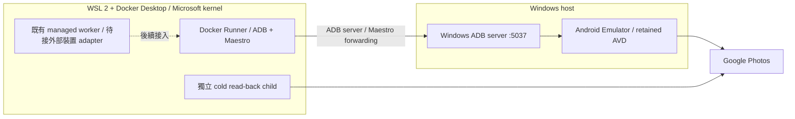

# pixAV

pixAV 將外部媒體來源可靠地轉換成「已驗證、可長期從 Google Photos 恢復播放」的私人媒體資產。Google Photos 是目標架構的持久媒體儲存，本地磁碟承擔 staging 與可重建的播放 cache；PostgreSQL 始終保存 domain 事實。Jellyfin 負責展示、搜尋、收藏、觀看紀錄與各裝置播放。

本文件整合產品的十項核心目標與完整 BDD 規格，集中描述目標、程式現況、行為契約、開發順序及操作方式。[AGENTS.md](AGENTS.md) 定義開發與資料安全規則；[CLAUDE.md](CLAUDE.md) 僅為入口。本文中的「必須」是驗收要求，不表示程式已實作或部署已通過。

Windows 開發方案已改為 [Windows Android Emulator + Docker Runner](#開發環境windows-android-emulator--docker-runner)。操作者回報 redroid 自訂 WSL kernel 造成 Docker／WSL 相容性問題；本專案不再要求為 Android 修改 `.wslconfig` kernel。新開發入口與既有 redroid managed 上傳的遷移分開驗收。

## 設計 checkpoint 與重跑起點

舊隔離媒體已重置，保留資料的 D 槽加密備份與獨立還原已有先前核對證據；不備份影片本體。Docker 資料磁碟已搬到 D 槽，完整備份／還原與當時身分／掛載驗證通過後，已精確刪除 C 槽舊資料磁碟。2026-10-23 的程式 checkpoint `f607f13` 通過完整專用 PostgreSQL／Redis 檢查：2,544 passed／8 skipped，coverage 85%，Ruff／Black／isort／mypy 通過；integration／Android runner Compose 設定重新檢查通過；managed Compose 的 DB index 預設及覆寫已經實際設定輸出重核。同一 Docker daemon 與原四個服務停止狀態已重核，原五十九個 volumes 的保全證據保留。先前來源相符映像已有 child 取消／保全及 canary／generator 真 FFmpeg 鎖契約；`e642b25` 的正式 storage-tools recipe 映像核對一百五十個 source 檔案，通過 cold session 與原子收據的實際工具／中斷契約，未部署到原服務。`887ecb5` 另以同 recipe 建立不可變 storage-tools 候選，核對一百五十個 source 檔案，實測舊 Docker canary 的五個 CLI 指令與三個 helper 在接觸 runtime／來源／checkpoint 前拒絕；合成私有輸入 metadata 不變，沒有新建 evidence 或全域 lock。此映像仍是未部署候選，不能把先前映像的整輪 cold session 證據改記成新來源的完整 Photos 驗收。

當次 Windows native 候選已用版本化 4 核心／4096 MiB／host GPU 契約核對 SDK、AVD、root／framework／模組、四個新版 Photos APK 與實際 process／boot，並通過十五個環境檔案的 Windows sharing 保護。操作者完成 Android 登入後，人工控制已結束且帳號保留；先前 quiesce 曾通過，最新只讀重驗仍符合原 process／boot、十五個環境檔案與套件，但 quiescence 回報 UI writer。當次 Photos process 為一、Maestro／tagged shell 為零，前景未能確認，admission 維持暫停；帳號 digest 也對應到原 DB 的唯一帳號與保留 owner。原 guest 容器引用缺失，reconciliation、registry enrollment 與 managed ownership 仍待處理；native control 維持 `HALTED`，沒有啟動上傳。一般瀏覽器的人工登入與 cookie-only 新 context 曾通過帳號核對；後續新 context 已要求人工登入，目前 admission 暫停並交回無遠端控制的手動視窗，舊收據不抵新 session。既有 exact item 未唯一確認，搜尋結果不授權重傳；完整原件 cold 回載仍待驗收。Photos live、人工實播、二十四小時 quota、完整 Windows managed adapter 與 production 保持 OPEN。

本輪唯讀重核保留的原 PostgreSQL named volume：offline identifier、三十張表的完整內容摘要、二十一個 roles 屬性與 migration ledger 均符合 checkpoint；2026-10-22 帳號核對前再次驗證同一來源 volume 的 device／inode／owner、乾淨關閉狀態及完整內容，查詢前後來源指紋不變，當次 DB clock 下無帳號 lease。原 Redis 的三個持久鍵 DUMP 相符，另兩個原 TTL 已過的鍵在 RAM 查詢副本中到期；來源檔案指紋前後一致。保留 guest bind 的 host／container device、inode 及五千三百八十個檔案的完整 size／SHA-256 相符，未啟動 guest。DB／queue 的保留來源維持只讀；先前查詢與 migration 演練在斷網 tmpfs 副本進行，未新增備份或啟動原服務。既有 managed bind DB 是另一個 cluster／database；當次只讀 RAM 核對有兩筆 tasks、兩筆 videos、二十四筆 ledger，帳號／execution／remote asset 為零，並非空目標。它與保留 DB 使用相同 PostgreSQL 16 映像，但檔案 UID 分別為 1000／999；其 schema 或少量資料不代表原 domain 已遷移；原四個 managed 服務的十七個檔案／目錄 bind 已核對 device／inode／內容，Docker socket 的實際 inode 與唯讀 API 亦指向相同 daemon；服務保持停止，恢復後仍須核對 DB／Redis live instance 與 pause ownership。原設定／資料清單的五千一百八十四個檔案內容相符；另保留一個不在舊備份基線的 0600 secret，未新增備份。原 Jellyfin SQLite 的 RAM 工作副本通過完整性檢查，觀看狀態可讀，來源指紋未變；本輪沒有舊觀看紀錄的逐列 digest 比對。這些保全盤點不抵當次未知上傳結果 reconciliation、guest 開機恢復或完整 Stage 0 驗收。

2026-10-12 操作者授權保存目前設計、退休舊部署入口，並把既有影片、分段、回載、播放 cache 與影音錄影視為可丟棄的隔離驗收資料，不備份影片本體。這是人工重置，不能記成安全 staging cleanup 或 Golden Path PASS，也不改變正式 durability／cleanup 契約。新一輪必須使用新 cohort，重新取得全部 cold read-back、完整性、播放／seek、故障恢復與連續二十四小時 quota 證據。

保留 PostgreSQL、roles／ledger／queue checkpoint、guest／ownership、認證及未知上傳 operation。舊 DB、publication、驗證收據與 JSON manifest 僅供 reconciliation；已刪除的本地媒體與錄影不得被當作仍存在或有效的驗收。舊 execution 不自動 resume／replay，未知遠端結果先 reconciliation，不能換新 operation 盲目重傳同一筆媒體。

repository 保留 [Windows Android 工具入口](docker-compose.android-runner.yml) 與 [CI PostgreSQL／Redis 入口](docker-compose.integration.yml)，並以新的 [managed Compose](docker-compose.managed.yml) 分段接入受管部署。舊 base／prod／direct／playback／first-4k／indexer Compose 和啟動 shell 已退休，舊單片 CLI 僅保留唯讀 status。業務模組、歷史 Git checkpoint、操作守衛與 BDD 保留；這不表示 Windows managed upload adapter 或新的應用部署已完成。下一個 agent 先完成指定上傳環境的 adapter／execution ownership 與可回復部署，再從新的隔離 cohort 跑通 Golden Path。

備份及還原工作目錄必須實際位於 D 槽，且在部署 data、staging、cache 與 cleanup 掃描範圍之外；Ubuntu 的 C 槽 LocalState 是指向 D 槽的 junction，不能遞迴刪除。加密保留資料須完整還原驗證；Docker 資料磁碟另做一致離線備份、還原與原 daemon／volume 身分核對。離機備份、整機恢復與 production promotion 保持 OPEN。私有 exact-target manifest、刪除 audit 與備份收據留在 `.verify/` 及專案外私有 vault，不放進 Git。

2026-10-15 操作者指示本輪略過離機備份要求並停止新增實際備份；保留已完成的本機備份與獨立還原，不再要求離機目的地。此指示不把離機保存或 production promotion 記為通過。

## 完成標準

同一個 `video_id` 必須走完：來源選擇 → qBittorrent 下載 → ffprobe 檢查與必要 FFmpeg 準備 → 指定 Pixel-compatible environment 上傳 → 全新 cold path 回載與完整性驗證 → `RemoteAsset.DURABLE` → `PlayableAsset.READY` → `.strm + .nfo + artwork` 發布 → Jellyfin 實播及 seek → 安全刪除 staging → 清空可重建播放 cache 後，再由 Photos 恢復播放及 seek。

全程不能重複上傳或重複計入成功用量。上傳 UI 成功、分享頁 HTTP 成功、local finalize、單段可播、CLI exit 0、coverage 達標，均不足以宣告這條流程完成。未在真實環境穩定通過前，Phase 0 與 production playback 保持未驗收。

## 五個核心邊界

### 新一輪隔離驗收契約

合成媒體與真實媒體各自驗證，不把過去人工確認、舊 cohort 或已刪錄影升級成新證據。cold 回載只接受全新 session、空白工作目錄及必要認證；不掛 staging／guest／播放 cache。challenge 交人工處理，原件尚未可用時等待 provider 或 reconciliation，不重傳。

至少三個媒體、至少一個分段，全部片段須通過版本化完整性政策。之後完成 Jellyfin 影音／seek／resume／交界與人工確認，再取得沒有採樣缺口的二十四小時 quota 證據。正式 cleanup 仍依 exact-target、完整備份還原、retention、reader 與 operation 守衛；本次人工丟棄測試影片的例外不可套用到未來 production（BDD-078、119、122、125、143）。

原帳號下載的工作區實作使用 `PIXAV_PHOTOS_COLD_AUTH_SECRET` 指向 worker 可讀的私有 cookie-only JSON（檔案 0600、所在目錄 0700）；空值維持匿名模式。[認證 adapter](src/pixav/pixel_injector/photos_auth.py) 核對 DB 帳號、retained guest owner 與瀏覽器帳號 digest；只將驗證後的 cookies 經記憶體 stdin 傳入新 browser context，不把 secret、profile 或媒體 cache 掛進 child。storage verification 與 playback rebuild 共用 [download_original](src/pixav/pixel_injector/parts_download.py)，登入模式拒絕預填媒體，要求唯一 exact item、完整檔名、full hash／size、影音探測及全片解碼。[`photos-cold-account-v1`](src/pixav/shared/cold_receipts.py) 收據綁定帳號、owner、session、item／filename digest 與原件 digest；upload review、durability、playback 及使用同一 policy 的 observer 都重驗此收據。匿名歷史收據保持原義，缺少或錯誤的新版本欄位不降級接受。challenge／session 過期使 storage 或 playback execution 進 `USER_ACTION_REQUIRED`，不以匿名、staging 或重傳 fallback。

沒有現成 secret 時，人工登入使用 D 槽全新的私有 Chrome profile，Windows ACL 僅允許目前使用者、SYSTEM 與 Administrators，停用密碼儲存與 sync；不讀既有瀏覽器 profile。登入期間不開遠端控制介面，帳密及 challenge 由操作者處理；[Google 官方支援說明](https://support.google.com/accounts/answer/7675428?hl=zh-Hant)將軟體自動控制列為可能拒絕登入的情況，拒絕時停止自動嘗試。操作者確認完成後，才安全關閉該專用 browser，保留同一私有 profile，依 [Chrome 自訂 profile 要求](https://developer.chrome.com/blog/remote-debugging-port)建立 exact process 的 loopback 控制入口，透過 [Playwright CDP](https://playwright.dev/python/docs/api/class-browsertype#browser-type-connect-over-cdp)核對帳號並僅匯出必要 cookies；不擷取登入畫面、送出帳密或讀取個人既有 profile。啟動時以四十五秒 deadline 等待可見視窗，匯出後核對 exact browser／SDK child 與控制 listener 均已結束。此入口不是服務，沒有 health／metrics；本輪不新增備份，沿用操作者例外。停止或回退保持 account automation pause，保留未知狀態，不用舊 profile 或匿名 session 補齊新契約。

本輪以簽章有效的 Chrome 155.0.8059.81 完成人工登入；Playwright 1.55.0（Apache-2.0）的獨立 Windows SDK 只作登入交回後的 cookie 匯出，既有 venv 不改動。瀏覽器帳號 digest 與原 DB／先前驗證的 Android 帳號相符，cookie-only JSON 為 0600、父目錄 0700。其後在固定 storage-tools 映像，以 Playwright 1.55.0／Chromium 140.0.7339.16、全新 context、僅有空白 `/work:rw` 與 stdin cookies 通過同帳號核對；沒有掛 producer profile、secret file、staging 或媒體 cache。該 exact child 已移除，producer 及控制入口也已逐一收斂。後續新 cookie-only context 要求人工登入即停止自動嘗試，當次 admission 保持暫停；已交回無遠端控制的手動視窗，先前成功收據不抵新 session。這是先前登入 session 的隔離證據，未檢視 exact item、下載原件、驗證 size／hash／全片解碼或推進 DURABLE；原 guest／operation reconciliation 及完整 Golden Path 仍 OPEN。

cold child 只掛該次 `/work:rw`、2 CPU／4 GiB，登入與匿名模式均適用；沿用 [storage-tools](docker/storage-tools.Dockerfile)／[Photos tools](docker/photos-canary.Dockerfile) 的 Playwright 1.55.0（Apache-2.0）、Chromium 與 FFmpeg，依固定映像保留其版本與授權資訊，不增服務或 migration。頁面導覽六十秒、元素三十秒、download event 六百秒，storage activity 上限六小時，playback 依段數乘六小時；FFmpeg 全片解碼也受 activity deadline 限制。隔離 cold 基底實測為 FFmpeg 6.1.1-3ubuntu5（GPL build）；解碼保留輸入原生 time base，避免有效 VFR 影格在名目幀率網格碰撞，仍拒絕非零退出或任何 error 診斷。UI 鎖失聯先停止並移除該 exact child 才結束擁有權；服務 health／metrics 沿用 storage／playback worker，人工處理原因為 `PHOTOS_ACCOUNT_SESSION_REQUIRED`。secret 與必要收據納入私有加密備份，不能以瀏覽器 profile 取代 secret。部署前須固定 source／build context／image digest，成對更新相容的 authority／worker；回退也必須能理解登入收據與人工處理結果，不能交給會忽略新契約的舊 process。上述是工作區實作，尚非新版部署或完整 live／production 驗收。

目前保留的是登入 adapter 與契約實作；舊軟體檢查和 live 收據不代表本次 checkpoint 或新 cohort 已驗收。完整解碼、原 operation reconciliation、Windows 指定上傳環境及人工實播需重新取得當次證據。

### Docker 資料位置與搬移守衛

當前 Windows Docker Desktop 資料磁碟為 `D:\DockerDesktopData\disk\docker_data.vhdx`，其開機 distro 亦位於同一 D 槽根目錄；Ubuntu-24.04 的 Docker WSL 整合已核對。Android SDK 位於 `D:\Android\Sdk`，原 C 槽 SDK 路徑只是相容 junction。專案、保留 guest、備份及還原均實際位於 D 槽。不能沿用已不存在的 `docker-desktop-data` registration 或舊 `wsl/data/ext4.vhdx` 搬移腳本；每次操作仍核對當前 daemon 與實體位置。

2026-10-13 盤點發現十四個 pixAV 舊容器已被移除，2026-10-14 操作者確認因認為不再需要而人工刪除；當次核對原 daemon、五十九個保留 volumes、離線 DB system identifier、當前 DB 三十張表的內容與完整 roles／認證、保留資料內容及十四個可定位的實際 bind；隔離查詢使用原 DB volume 的唯讀 tmpfs 複本，原檔案 fingerprint 不變。舊播放 cache／tools staging 的三個 binding 已失去原暫時路徑，維持未核實；新部署須重新核對其 host／container device、inode 與內容。保留 guest 資料、journal、operation／generation，缺失容器引用先 reconciliation；刪除容器不能授權重傳。2026-10-14 重查時另有其他專案的既有服務運行，保留當前狀態，不沿用舊停機集合操作。WSL 內刪檔與 trim 不代表 Windows D 槽已回收同量實體空間，未取得實體容量證據不得宣稱。

Docker volume 的 `Mountpoint` 字串經直接 bind 後，本輪實測與 named-volume 掛載的 device／inode 不同；該 bind alias 不能證明原 volume 內容。原 DB／queue 由既有 exact named volume 唯讀掛載並停用 copy-up，再核對 checkpoint 身分與內容；不對另一目錄初始化或覆寫。既有 managed DB 的 bind root 與實際 `PGDATA` 子目錄須分開核對；其離線 control 為未乾淨關閉，不能用 control 識別或 RAM 副本查詢代替原服務恢復驗收。

搬移前核對當前 daemon、原容器／volume 集合、DB identifier／ledger、queue checkpoint 與實際 bind 身分；一致離線加密備份和獨立完整還原通過後，才改變資料位置並精確清除原 C 副本。目的地、備份、還原及 staging 均核對底層實體磁碟，保留 100 GiB／10% reserve。全 WSL 釋鎖若新增其他專案中斷範圍，須取得當次授權。搬移成功、刪檔與 Windows 實體容量釋放各自以收據判定。

### 架構邊界

```text
多個外部來源 adapter
        ↓
SourcePolicy → MediaWorkflow → GooglePhotosStorage
                                      ↓
                              PlaybackResolver
                                      ↓
                              LibraryProjection → Jellyfin

PostgreSQL：以上各邊界的 domain facts
唯一 execution authority：活動派送、attempt、timer、retry 與恢復
Redis／播放 cache／library projection：衍生狀態
```

| 核心 | pixAV 維護的決策 | 委派的能力 |
| --- | --- | --- |
| SourcePolicy | normalization、去重、eligibility、品質與政策評分、cooldown、候選切換、provenance | 外部 adapter／indexer 發現候選 |
| MediaWorkflow | execution 生命週期、checkpoint、下載與準備政策、失敗分類、恢復、storage handoff | qBittorrent 執行 torrent；ffprobe／FFmpeg 檢查、remux 及必要轉換 |
| GooglePhotosStorage | 帳號 LRU、quota、cooldown、lease、上傳 reconciliation、remote reference、cold read-back、durability、刪除資格 | 指定 Pixel-compatible environment 執行上傳；Google Photos 儲存媒體 |
| PlaybackResolver | 穩定 URL、播放資格、遠端重新解析、cold materialization、Range／seek、分段完整性、cache 與 reader 保護 | 經驗收的 OSS 傳輸能力；播放器負責解碼 |
| LibraryProjection | effective metadata、`.strm`／`.nfo`／artwork、原子發布、reconciliation、撤架與重建 | Jellyfin 掃描、展示、搜尋、收藏與觀看狀態 |

這是業務邊界，並不要求立刻改成五個獨立服務或更名現有目錄。不自行實作 torrent、codec、播放器、transcoder、通用 crawler、queue/DLQ/retry framework、UI automation framework、media proxy 或 catalog/search framework。PlaybackResolver 保留 Photos 專屬政策與穩定入口，傳輸實作以成熟元件的已驗證契約承接。

不預選 orchestrator；選定後只有一套 execution SSOT。upload concurrency 固定為 1。不並行維護 Stash／MetaTube 兩套 metadata 系統，不安排 Rust rewrite。現有 fallback 必須等完整 Phase 0 通過，再按各自替代契約逐段退休。

## Domain 與狀態契約

下列為目標模型；目前 schema 對應與缺口見後文。不要把來源、執行、遠端儲存、播放、發布狀態全部塞進 `Video.status`。

| Entity | 身分與事實 | 狀態／約束 |
| --- | --- | --- |
| Video | 穩定 `video_id`、媒體身分、metadata 與 provenance | 候選故障不得污染媒體身分；不同 info hash 不代表已證明相同媒體 |
| SourceCandidate | 所屬 Video、provider identifier、正規化欄位、排名、失效證據 | hard eligibility 優先於分數；來源 cooldown 可恢復 |
| Execution | domain task 與各次 attempt、owner、外部 operation reference、checkpoint、due time | `READY / RUNNING / WAITING_RETRY / WAITING_QUOTA / USER_ACTION_REQUIRED / SUCCEEDED / FAILED / CANCELLED` |
| RemoteAsset | provider=`google_photos`、account、可重新取得媒體的 reference、預期內容、驗證證據 | `REQUESTED → CREATED → VERIFIED → DURABLE`；全段冷回載成功即提交 `VERIFIED`，manifest 整體通過才 `DURABLE`。完整性失敗不得 durable；已 DURABLE 的資產重新驗證失敗才轉 `INVALID`，share URL 過期不是失效 |
| PlayableAsset | RemoteAsset／manifest 版本、可播放物件、完整性與播放驗證 | `PREPARING → READY`；過期準備為 `STALE`，不可恢復為 `INVALID` |
| Account | LRU、quota 使用與重設、cooldown、lease ownership | DB clock 決定資格；lease 覆蓋實際執行且不可並行擁有 |
| LibraryPublication | video、projection 版本、有效 metadata、必要檔案與發布結果 | `PENDING / PUBLISHED / STALE / FAILED`；只有 READY 可發布 |

Models immutable；外部 payload 在 adapter 邊界驗證。metadata 以 provider namespace 合併並保留 provenance；manual override 優先於 scraper，refresh 不得覆蓋人工值。未知的演員、studio、backdrop 等 optional 欄位不阻擋發布，也不捏造內容。

短命 CDN URL 只能在 TTL cache，不能作永久 identity。`share_url`／provider reference 只是重新解析的線索，其存在不證明內容 durable。URL 到期不應使已驗證 RemoteAsset 失去 durability；確認遠端內容毀損或遺失，才走相應 invalidation 與恢復。

每個有外部副作用的 business operation 必須有可辨識的穩定鍵、intent 與 reconciliation 依據。crash 後先確認 qBittorrent、輸出檔或遠端上傳是否已成功，再決定重做。無法證明是否上傳成功時，保留本地檔並進入 reconciliation／人工處理，不能以盲目重送換取表面成功。確認遠端建立與成功用量應以可重入的同一交易提交；重試 commit 不重扣，未確認的副作用不得直接當成零用量重傳。

持久 retry／quota 用 PostgreSQL clock；heartbeat 間隔用 monotonic clock。worker 回報活動結果，唯一 execution authority 決定有限 retry 與 timer。terminal failure 不自動 replay；人工 replay 建立可追蹤的新 attempt／execution，保留原始歷史。

## 五塊核心的驗收要求

### SourcePolicy

adapter 回傳合法候選才進入正規化；錯誤 payload 記錄 adapter error，其他候選仍可使用。保留 provider identity，不發明跨來源媒體關聯。同樣輸入與政策版本產生確定的排序；最高分違反硬性條件時選下一個合格候選。

`num_seeds=0` 不能單獨判定永久失效。確認 `SourceUnavailable` 才讓該候選 cooldown 並切換；Redis、網路或 worker 故障走 infrastructure retry，不污染候選。全部來源暫不可用時明確等待來源恢復，不產生假下載；新發現可重新使媒體具備執行資格。

### MediaWorkflow

選定來源後關聯 execution 與 qBittorrent 工作；下載完成記錄 artifact，再由 ffprobe 取得 container、影音 codec、解析度及 duration。媒體無法解析就拒絕 upload-ready。相容格式跳過不必要轉碼；remux 後重新 probe，duration 必須在明確容許誤差內，失敗保留可恢復原始檔。

下載成功但 checkpoint 未提交、remux 輸出完成但 transition 未提交，都須重新驗證既有結果並接續。domain task 與 attempt 分開觀測。候選失效交 SourcePolicy；暫時依賴故障有限重試，耗盡後 terminal。保留 FIFO、in-flight recovery、後段處理與 single-flight 的既有安全語意。

### GooglePhotosStorage

以 LRU 在 quota 足夠、未 cooldown 的帳號中取得 lease，執行中維持 ownership，終止或失聯後安全釋放／過期。沒有合格帳號時 `WAITING_QUOTA` 並保留 staging。指定環境不可用就失敗或等待，不得默默改走一般直接 upload。rclone fallback 若使用，必須明確計入 quota，不能宣稱具有同樣的儲存或配額效果。

登入 challenge 進 `USER_ACTION_REQUIRED`，停止自動提交帳密。上傳建立 RemoteAsset 後，必須使用新的 retrieval session、空的回載 cache，且不掛載可冒充遠端回載的原始下載或上傳片段。驗證政策要記錄版本、預期 byte count、duration 誤差、codec 及必要 hash；完整原件驗證要求全量 byte count／SHA-256 一致。若未來允許 provider 轉換，必須另定且實測完整性政策，不可在 hash 失敗時臨時放寬。

只有 remote creation、cold read-back 與政策檢查都成功，才能提交 `DURABLE`。單次成功不保證未來永遠可取回；後续失效、定期重新驗證的觸發條件與恢復策略也須有可觀測狀態。分段 manifest 完整且不可變，每段有身分、順序、時間範圍、size、hash、codec 與 account/reference；所有段及交界通過才能代表整片。

### PlaybackResolver

Jellyfin 永遠使用 `video_id` 的 pixAV 穩定入口，例如 `/stream/{video_id}`。目標契約不得把短命 provider URL 寫入 projection、回 JSON 或以對外 redirect 暴露給 Jellyfin；需要的傳輸能力由經驗收的 OSS 整合提供，pixAV 不擴寫通用 proxy。

只有 durable 遠端內容且準備成功才可 `READY`。完整 GET 的 byte count／SHA-256 要符合可播放物件；HEAD 不傳 body，已知時回正確 Content-Length，不為取得長度無謂全量下載。single Range 驗收首段、中段、suffix 的 206／Content-Range／精確 bytes，以及越界 416。seek 不應為略過內容強制重傳前面全部 bytes，附近重複 seek 可利用 cache。

cold path 可 materialize 暫存內容；首次準備成本須與 READY 後的 Range 效能分開驗收，不能用「整片先下載完才 seek」證明 cold seek 已達標。cache 可丟棄並由遠端重建，TTL 到期仍須等 active reader 釋放。缺段、只完成第一段或 manifest 版本不符都拒絕整片播放；分段交界必須驗證畫面、聲音與 seek。

### LibraryProjection

只有 `PlayableAsset.READY` 可發布；RemoteAsset durable 本身不夠。輸出穩定 URL 的 `.strm`、Jellyfin-compatible `.nfo` 與有效 artwork；metadata 含可用的 title、description、release、演員、studio、tags。已保留的封面不得因外部 provider 暫時故障而消失，backdrop 可缺省。

準備全部必要檔案後才原子啟用完整版本，更新失敗保留先前有效發布，不能露出半寫檔案。重跑不產生重複 library item。metadata 變更可刷新，缺檔與整個生成目錄遺失可從 PostgreSQL 的發布資料及保留的 artwork 原件重建；DB 保存 artwork 的 provenance/reference，保留的原件也納入備份。Jellyfin DB 遺失不影響 domain facts。

PlayableAsset 變 INVALID 後撤下／停用 active projection；撤架不刪遠端資產。Jellyfin 驗收包含掃描、封面、tags 導覽／搜尋或篩選、實際 client 播放、seek 與續播。收藏、觀看紀錄與裝置體驗由 Jellyfin 管理，其個人狀態備份由 Jellyfin 部署負責，不能宣稱只靠 pixAV DB 可還原觀看紀錄。

## Cleanup 與存取安全

staging 的刪除資格必須同時成立：`RemoteAsset.DURABLE`、完整性證據有效、`PlayableAsset.READY`、播放驗證通過、完整 library publication、retention 到期、沒有 active execution／reader，以及 path、symlink、ownership 與操作備份守衛通過。disk 壓力或 retry 耗盡不取代這些條件；`pixav-local://` 媒體不是遠端備份。

資格檢查與真正 unlink 之間必須防止 reader／execution 新增或版本變更造成競態。dry-run 不改 DB、queue 或檔案；apply 僅刪當次核准的 exact target/count，不能以擴大 glob 取代目標。刪除成功記 audit、更新 local reference；crash 後重查檔案系統並 reconciliation，不能把 missing file 當成遠端完整的證據。

cache eviction 與 staging cleanup 有不同用途，但都保護 active readers。private playback 由部署的認證與授權邊界保護；未授權 client 與已撤銷裝置的新請求必須被拒絕。projection、log、model repr、metrics、fixture、Maestro YAML 不得洩漏 credential、cookie 或 Photos token。不要把目前 HTTP route 的存在當成已實作 private access control。

## Repository 現況與差距

以下依實際程式、callers、migration、Compose 與當次隔離驗收核對。實作契約、隔離 live evidence 與 production promotion 分開記錄；版本、instance、manifest 與 evidence 保存在私有驗收資料。測試檔存在不代表已執行，隔離成功也不宣告正式部署通過。

| 邊界 | 可確認的實作依據 | 尚需補齊與證明 |
| --- | --- | --- |
| Windows Android 開發環境 | [獨立 runner Compose](docker-compose.android-runner.yml) 與 [smoke flow](config/maestro/android-runner-smoke.yaml)：Docker 只執行工具，經 Windows ADB server 操作 exact Emulator serial；不建立 Android guest 或 execution。2026-10-14 Settings launch／Home connectivity smoke exit 0，當次實際掛載及 exact AVD 名稱一致 | 新入口不接 DB／queue，也不替換 managed runtime。Photos hook、重啟後恢復、指定上傳環境與新一輪 Golden Path 仍待驗收；既有 redroid evidence 不自動沿用 |
| SourcePolicy | [policy](src/pixav/sht_probe/policy.py)、[discovery caller](src/pixav/sht_probe/service.py)、[authority](src/pixav/maxwell_core/media_workflow.py)：provider observation、hard eligibility、確定排序、DB-clock cooldown 與候選切換 | managed 模式 opt-in；provider live access／parity 與 production promotion 仍需當次 evidence |
| MediaWorkflow | [authority](src/pixav/maxwell_core/media_workflow.py)、[activity worker](src/pixav/media_loader/activity.py)、[preparation](src/pixav/media_loader/preparation.py)、[managed segmentation](src/pixav/media_loader/segmented_preparation.py)、[014 migration](migrations/014_media_workflow_recovery.sql)：execution／attempt 分離、DB clock retry、有限失聯恢復、operation intent、原始檔 hash 綁定的 lossless-mp4-v1 準備；超過 transport target 時以既有 FFmpeg segmenter 產生完整分段 manifest | 隔離 contract 與 production 驗收分開；legacy orchestrator 僅服務未 admit 的 video，不自動接手受管 execution |
| GooglePhotosStorage | [storage authority](src/pixav/maxwell_core/storage_workflow.py)、[activity worker](src/pixav/pixel_injector/storage_activity.py)、[Photos adapter](src/pixav/pixel_injector/photos_storage.py)、[repository](src/pixav/shared/remote_assets.py)、[013](migrations/013_remote_storage.sql)／[017 migration](migrations/017_remote_asset_reverification.sql)：execution-owned account lease、WAITING_QUOTA、USER_ACTION_REQUIRED、實際提交的 `REQUESTED→CREATED→VERIFIED→DURABLE`，以及 [versioned policy registry](src/pixav/shared/storage_models.py)：`photos-original-v1` 凍結保留、`photos-original-v2` 為現行版本，除全量 hash 外要求回載收據帶 ffprobe 觀測事實，並在促成前以 `segment_plan` 的同一判準重驗持久化 manifest 的時間軸；`reverify_due` 依 `PIXAV_REMOTE_REVERIFY_INTERVAL_DAYS`（預設 30，0 停用）開只走 verify stage 的 execution，重新驗證失敗才 `invalidate`；[segment staging](src/pixav/pixel_injector/segment_staging.py) 以硬連結呈現 canonical 檔名，[retained guest](src/pixav/pixel_injector/managed_runtime.py) 與 [015 migration](migrations/015_managed_runtime.sql) 將 guest 建立記為可 reconciliation 的 intent，帳號切換退休 runtime 而非共用裝置 | 指定 Pixel-compatible 環境的一筆既有資產，以及本輪一筆自有合成 MP4，已由真帳號 cold read-back 通過 v2 並由 authority 促成 DURABLE；後者經 operator-supplied 入口，不計為來源下載驗收。三筆新下載到上傳與 24 小時 quota 觀察仍未驗收。contract 測試使用 fake，不能作 promotion 證據。回載收據形狀屬容器契約：`photos-original-v2` 的資產必須由重建過的 [storage-tools](docker/storage-tools.Dockerfile) 映像回載，舊映像產出的收據會被拒（刻意 fail-closed） |
| 分段隔離流程 | [010](migrations/010_video_parts.sql)、[011](migrations/011_first_4k_heartbeat.sql)、[video_parts](src/pixav/shared/video_parts.py)、[單片 CLI](scripts/first_4k_movie.py)：manifest、checkpoint、usage marker、heartbeat 與 cold preparation | 隔離設計與一般 worker 尚有差異；需實測完整 Photos／24 小時 quota／Jellyfin／刪 staging 後再播，不能直接 promotion |
| PlaybackResolver | [routes](src/pixav/strm_resolver/routes.py)、[managed playback](src/pixav/strm_resolver/playback.py)、[cache janitor](src/pixav/strm_resolver/cache_janitor.py)、[playback authority](src/pixav/maxwell_core/playback_workflow.py)、[playback worker](src/pixav/pixel_injector/playback_activity.py)、[019 migration](migrations/019_playable_assets.sql)：有 RemoteAsset 的 managed video，`/stream` GET／HEAD 只從 SHA-256 已驗證的 playback cache 提供 bytes；非 READY 或 remote 非 DURABLE 回 409，HEAD／416 只讀 READY 記錄，cache MISS 寫 demand 並在同一請求等待重建，逾時回 503 + `Retry-After`；`/resolve` 不回 provider URL。PlayableAsset 的準備與重建是 `playback` stage execution，eviction 以 `flock` 等待 reader。legacy video（無 RemoteAsset）維持舊 `/stream` 302 與 `/local` | 隔離環境的單段及兩段 Photos durability、READY、完整 GET／hash／HEAD／Range／416，以及人工影音／跳播／續播已有當次證據；多段另驗分段交界。獨立還原環境清 cache 後的 Photos rebuild 已通過；刪 staging 後的完整 client 契約仍 OPEN。cold 狀態下的中途 seek 要等整片重建完成才回 bytes；跨容器 `flock`、裝置撤銷與未授權存取須各保留當次 evidence，不能推定 production 已通過 |
| LibraryProjection | [metadata](src/pixav/library_projection/metadata.py)、[artwork](src/pixav/library_projection/artwork.py)、[render](src/pixav/library_projection/render.py)、[writer](src/pixav/library_projection/writer.py)、[reconciler](src/pixav/library_projection/reconciler.py)、[020 migration](migrations/020_library_projection.sql)：只發布 READY、remote DURABLE 且已保留 poster 的 video；缺少 poster 回報 `POSTER_REQUIRED`；`.strm` 只含穩定 URL，`.nfo` 依 `metadata-merge-v1`（manual > Stash > video 列，tags 取聯集）並逐欄保留 provenance，artwork 只用以 SHA-256 保存並驗證的原件。完整版本目錄驗證後才以 symlink `rename` 切換。Maxwell tick 定期 level-triggered 收斂：缺檔或整個 root 遺失就重建，失效就撤架，撤架不碰 RemoteAsset | 隔離 Jellyfin 掃描（含相對 symlink）、單一 video 項目、封面與 tags 已有證據；本輪前兩片完整影音／seek／續播已人工確認並登錄 v2，第三片仍 OPEN。Jellyfin 與認證 gateway 由 playback overlay 提供；目前只有人工 artwork 匯入，沒有 provider 封面擷取 |
| Cleanup | [janitor](src/pixav/maxwell_core/gc.py) 檢查 `verified_playback_evidence`、`exact_target_backup_authorization`、RemoteAsset、publication、open execution、reader lease、DB-clock retention 與 path／symlink containment；後者要求 [018](migrations/018_cleanup_authorization.sql) 的未過期授權列，其 path 與 janitor 當場重算的 sha256／size 相符且指向本 video 的 DURABLE asset；dry-run 不寫 DB／audit／檔案，apply 拒絕時寫 audit | `verified_playback_evidence` 要求同一 video 有 READY PlayableAsset、其 `playback_verified_at` 已由 [manage_playback](scripts/manage_playback.py) `verify` 寫入，另有版本化 `jellyfin-client-v1`／`jellyfin-client-v2` 實播登錄綁定相同 video／remote／playable ID、preparation version、size／hash，觀察時間介於 READY 與 DB 現在之間，且所屬 remote 仍 DURABLE；`complete_publication` 要求 `library_publications` 為 PUBLISHED 且指向目前 READY 的物件，並以設定的 `library_root` 重讀 `.strm + .nfo + poster`，核對完整 projection digest；缺檔、內容異動或路徑外逃均拒絕。cleanup 與 publication reconciliation 共用 advisory lock，持有至 unlink 結束；exact-target 授權須綁定該 READY 物件的 remote asset。[真 PostgreSQL 測試](tests/integration/test_cleanup_gate.py)涵蓋完整條件下的單一目標刪除與 audit；client 證據與 publication 檔案守衛由同一隔離測試覆蓋。live 播放驗證、備份授權與實際刪除後由 Photos 恢復仍未實測，BDD-058／063／134 的 production 驗收保持 OPEN |
| Domain | [models](src/pixav/shared/models.py)、[storage models](src/pixav/shared/storage_models.py) 有 Video、Task、Account、SourceCandidate、VideoPart、RemoteAsset、RemoteAssetSegment；[playback models](src/pixav/shared/playback_models.py) 與 [repository](src/pixav/shared/playable_assets.py) 有 PlayableAsset；[library repository](src/pixav/library_projection/repository.py) 有 LibraryPublication、metadata override 與 retained artwork；[migrations](migrations/) 為 001–021 | 既有 frozen models 不等於所有 secret repr 已合格 |

[managed Maestro uploader](src/pixav/pixel_injector/maestro_parts.py) 的新 push 先核對 host 來源 inode／size／mtime／ctime 與完整 SHA-256，再由 tools 內精簡的 [ADB media helper](src/pixav/pixel_injector/adb_media.py) 重核同一來源 binding，持 shared inode lock 並將 descriptor 傳給實際讀檔的 ADB child；傳輸後重驗名稱、parent、版本及完整內容才允許 push 完成收據。換檔、異內容、忙碌、timeout 或 helper 缺失均保留原 intent 待 reconciliation，不以未受保護的 `adb push` fallback。來源參數與錯誤不回顯，helper 不持有帳號／DB／queue secret，不登入或發布；上限六小時，沿用 tools health 與 UI fence，沒有額外 health／metrics endpoint。[tools recipe](docker/windows-tools.Dockerfile) schema 2 僅增加兩個無業務依賴的 Python 檔案，既有 ADB client 為 Apache-2.0。來源 `990cee2` 的不可變候選已核對兩檔一致，斷網唯讀 `/parts`、256 MiB／單核心環境通過合成 reader、wrong binding、deadline 回收與 parent SIGKILL 鎖延續；映像內真正的 ADB 34.0.4-debian client 也對固定 loopback SYNC 接收端完成全量 size／hash，parent SIGKILL 後 child 持鎖至結束並回收。這些是 Linux client／程序證據，未連 Windows ADB server／真裝置或 Photos；候選尚未登錄／部署。舊 `AdbConnection.push`、native Windows 媒體及其他 actor 覆蓋仍 OPEN，cleanup 保持關閉。切換或 rollback 須先停 writers、成對核對相容 caller／image／runtime generation，不以此映像的局部契約放行正式 cleanup。

[單元測試](tests/)、[真實 repository／migration 測試](tests/integration/)、[segmented HTTP 測試](tests/strm_resolver/test_segmented_routes.py) 與 [E2E 入口](tests/e2e/) 可作後續基礎。`pyproject.toml` 尚無 pytest-bdd dependency 或 `tests/bdd/`；BDD 情境索引目前是規格，不是已可執行的 suite。

## 開發順序與交付門檻

| 順序 | 可審查的交付 | 通過條件 |
| --- | --- | --- |
| 0. 固定相容的 Windows 開發環境 | Microsoft WSL kernel、Windows Android Emulator、獨立 Docker Runner；再將既有 retained runtime 遷移為外部裝置 adapter | Docker／WSL／WHPX 共存、exact AVD／帳號／owner 綁定、ADB／Maestro forwarding 與唯一 UI writer；先完成原 guest／未知上傳 reconciliation，不能用換 kernel 解決 |
| 1. 保護現有 artifact、建立事實模型 | 先補一般 cleanup 的完整拒絕條件；新增 domain 模型／migration／repository，定義驗證政策與 operation identity | 真 PostgreSQL 測 transition、constraint、舊 schema 對應、競態與 restore；既有 AVAILABLE／share URL 不自動升級為 DURABLE |
| 2. 打通隔離 Golden Path | 以合成媒體、單帳號、upload concurrency 1，串接五塊核心；完成 Photos cold read-back、READY、原子 projection 與 Jellyfin | 全 GET／hash、HEAD／Range、影音／seek、刪 staging 且清 cache 後再播；無重複 upload／quota |
| 3. 證明故障恢復與安全 | 注入 upload 後 commit 前、verification 後 cleanup 前、unlink 中、URL expiry、Redis／projection 遺失等失敗 | 副作用 reconciliation、有限 retry、人工 replay audit、reader guard、private access 與精確備份還原通過 |
| 4. 選定 execution 與替代 adapter | 以相同 BDD 比較成熟 OSS，確認 ownership、timer、FIFO、single-flight、後段優先與恢復 | 完整 Phase 0 先過；新舊 executor 不得同時寫同一 execution，保留 domain facts 並完成 rollback |
| 5. 分段 canary 與退休 fallback | 各 adapter／execution 邊界有版本、health／metrics、secret、volume、資源限制、備份及 rollback 契約 | contract、隔離 integration、live、recovery、rollback 全過；任何 critical 情境失敗或無 evidence 均阻擋 promotion |

不以「更換 orchestrator」代替 cold durability 與 remote-only playback 的驗收。候選 execution 工具可比較 Taskiq／Windmill／Temporal，尚未選定；來源 adapter 替代須通過 access-gate、bare-hash-only、同範圍非空 parity，才能退休既有 fallback。Maestro、MediaFlow、MetaTube 等僅為待驗證的替代整合選項，不是目前已接管的服務。任何替代都不能遺失來源政策、帳號政策、Photos resolver、projection 或 cleanup guard。

每次交付在既有測試目錄加入能驗證行為的測試；需要 pytest-bdd 時才新增工具與 `tests/bdd/features/`、`steps/`、`fixtures/`，按五個核心及 system／Jellyfin 分組。保留本文件情境 ID 作 traceability，不建立另一份 roadmap 或測試報告作長期規格。

## 驗證層級與證據

| 層級 | 要驗證的邊界 | 限制 |
| --- | --- | --- |
| contract | 純 domain／adapter contract，以已實測契約建立 fixture | fake Photos 不證明 live upload 或 cold recovery |
| isolated | 專用 Compose、真 PostgreSQL／Redis／qBittorrent 及所需 Jellyfin；外部副作用可用經驗證 fixture | 先核對 instance；不能使用正式 queue |
| live | 指定 upload environment、專用 Google account、Photos、cold reload 與真實播放器 | 需當次版本、identity、完整性與播放 evidence |
| production canary | production-like 單片完整 Golden Path，加 recovery／rollback | 完成前不得標 Phase 0／production playback PASS |

原 BDD 的 `@contract / @isolated / @live / @production_canary` 是設計層級，`@critical / @destructive / @chaos / @security / @jellyfin / @promotion` 表示驗收屬性；不是目前 pytest 已註冊的全部 markers。現有 `integration`／`e2e_live` 是 opt-in，設定與 instance guard 見 [conftest](tests/integration/conftest.py) 及 [integration_guard](scripts/integration_guard.py)，不要只設啟用旗標就對未知服務執行。

程式變更執行 [AGENTS.md 的完整檢查](AGENTS.md#驗證)。live evidence 要能關聯 revision／image、DB identifier/database、Redis run ID、execution／video、manifest／verification version、驗證時間及結果；敏感 reference 與媒體保存在私有 evidence，不放本文件。PASS 要有實測，缺資料、等待 24 小時 quota 或未實播保持 OPEN／未驗收。模擬規則測試、container healthy 或過去主機的數字均不能代替當次 runtime evidence。

故障恢復至少包含：upload 成功但 DB 未提交時不重傳且只扣一次；verification 後 crash 保留 durable facts；unlink 中 crash 安全收斂；Redis 遺失不遺忘遠端資產；Jellyfin／projection 遺失可重建；播放途中 URL 到期可重新取得。監控要區分 source-unavailable、WAITING_QUOTA、upload failure、remote verification failure、publication lag，並保留 queue／retry／DLQ、disk／pause 與實際播放信號。

## 開發環境：Windows Android Emulator + Docker Runner

### 已知 WSL kernel 相容性限制

2026-10-12 操作者回報：在 Windows 使用者的 `.wslconfig` 啟用下列 redroid 自訂 kernel 後，Docker 與 WSL 發生相容性問題。這是本機已回報的限制，尚未重新測定根因或所有版本組合，不能推論每個自訂 kernel 都不相容。

```ini
# 已知有相容性問題的舊設定；不要用於 pixAV 開發環境。
[wsl2]
kernel=C:\\Users\\charl\\.pixav\\wsl-kernel\\bzImage-6.6.87.2-pixav-redroid
```

`.wslconfig` 是所有 WSL 2 distributions 的全域設定；`kernel` 未設定時使用 Microsoft 提供的 kernel。詳見 [Microsoft WSL 設定](https://learn.microsoft.com/en-us/windows/wsl/wsl-config)。因此本專案採用預設 Microsoft WSL kernel，不編譯／載入 binder kernel、不為 redroid 改全域 kernel，也不以 privileged Android container 作開發前置。Docker 的 netfilter／TUN 問題仍須獨立驗證，不能把更換 redroid kernel 當作修復方案。

若目前仍有這項 override，復原方式是移除或註解該 `kernel=`，並核對是否有與它綁定的 `kernelModules=`；保留原有 memory、processors、swap、networking 等其他設定。使設定生效所需的 Desktop／WSL 停機屬另一項主機操作：先確認中斷範圍、停寫與備份守衛，取得當次授權後執行，再核對原 daemon、DB／Redis identity 及實際 bind mounts。**本次文件與 runner 入口修改不會變更 `.wslconfig` 或重啟主機。**

### Windows 與 Docker 的分工

Android Emulator 原生執行於 Windows，使用 [Windows Hypervisor Platform（WHPX）](https://developer.android.com/studio/run/emulator-acceleration#accel-vm)。Android 官方要求 VM acceleration 的 Emulator 直接在 host 執行；本方案不在 WSL／Docker 內啟動 Emulator，不需要 `/dev/kvm`、binder、host PID namespace 或 privileged runner。



| 元件 | 責任與持久資料 | 開發限制 |
| --- | --- | --- |
| Windows Android Emulator | Android system image、Photos／Google Play、AVD userdata、登入狀態 | 專用 AVD 綁定一個帳號；Windows 管理啟停與磁碟，不掛進 Docker。Pixel hardware profile 或 `getprop` 名稱不能證明原始品質／不計容量 |
| Windows ADB server | 保留 host ADB keys，提供 5037 控制入口與 Maestro 所需 forwarding | 只有受控 Docker 路徑可達；不對 LAN／公網開放，不讓 runner 接管其他裝置或停止共用 server |
| Docker `android_runner` | 現有 ADB／Maestro／JRE 工具，唯讀 `/parts` 與單一 smoke flow | 獨立 `android-dev` profile、無自動重啟、1 CPU／2 GiB、swap 上限同 memory、256 PIDs；不掛 Docker socket、AVD、帳號 secret、DB／queue 或 cold work |
| 既有 domain／activity workers | PostgreSQL domain SSOT、唯一 Maxwell authority、帳號 LRU／lease／quota 與 operation journal | 新 runner 不是 executor；已接 registered adapter／持久 UI fence；原資料切換與當次 ownership 待驗收，不另起 execution authority 或搶既有 execution |
| cold read-back／playback rebuild | 新 browser context、空 work、完整原件驗證 | 繼續使用獨立 cold child，不掛 AVD、runner staging 或原始上傳媒體；`DURABLE`／`READY`／cleanup 門檻照舊 |

新入口重用 [Photos tools Dockerfile](docker/photos-canary.Dockerfile)，Maestro 2.10.0（Apache-2.0）與 Playwright 1.55.0（Apache-2.0）沿用既有版本；ADB、OpenJDK 21、FFmpeg 與基底的實際版本／license 清單依固定映像記錄，不把 apt 套件當作已固定的 SDK 版本。Windows Emulator、Platform-Tools、system image package／revision、Photos／Play 版本與 AVD 設定 digest 也必須記錄，SDK／system image 遵循 [Android SDK 授權](https://developer.android.com/studio/terms)。runner 要指定已存在的 immutable image ID 或 digest，`pull_policy: never` 防止開發時拉取另一版本；Compose 的必填檢查不會替代 image identity 驗證。

AVD 舊版起始預算為 2 cores／4096 MiB／軟體 GPU；當次候選另以明確的 v3 契約固定 4 cores／4096 MiB／host GPU，使用 Windows 的固定 SDK 與同一專用 AVD。這是 guest 配置，host RAM／GPU 開銷須另量測，開機與 UI timeout 也須實測。runner 的 `/tmp`、`/root`、`/work` 都是有限 tmpfs，CLI 狀態與報告不持久化；要保存 evidence 時另由操作者寫入私有 0700／0600 目錄。Windows SDK／新 AVD 與備份設在 D 槽；SDK 已搬到 `D:\Android\Sdk`，原 C 路徑僅為相容 junction。Windows AVD、WSL／Docker VHD 與 staging 所在實體分區各自檢查容量，不以 WSL `df` 代替 Windows 實體餘額。

2026-10-14 當次隔離 AVD 已完成原生 emulator／QEMU 的 exact stop 與 cold start，保留 userdata、核對新的 Android boot epoch，原 SDK ramdisk 不變。重啟後 root UID 0、Magisk 30.7、Vector 2.2 build 3080／API 102、固定 Infinity 1.4.1 APK 與僅限 Photos／user 0 的 scope 均核對；新 Photos process 有 Pixel XL `VERIFY OK` 且 native ready 的兩筆日誌，無 VERIFY failure。診斷頁 ContentProvider IPC 回報仍有缺口，此處以新 process 的實際 hook 日誌驗證。重啟後 exact ADB／Maestro Settings launch／Home smoke exit 0，runner 實際唯讀 bind 的 device／inode／內容與 host 相符；同次 smoke 執行至結束的 23 次 Windows ADB listener 取樣均為 loopback，5037 owner 與原 server 相符。這些證明本機工具與注入契約，Photos 原始品質／容量、managed fencing 與 production 尚待驗收。

### Managed 部署入口與當前 profile

新的 [docker-compose.managed.yml](docker-compose.managed.yml) 是受管部署的單一入口，目前宣告 `windows-tools`、`core`、`schema`、`authority`、`storage`、`playback`、`vpn`、`torrent`、`media`、`resolver` 與 `library` profiles；`core` 只包含 PostgreSQL／Redis，`schema` 供 migration／角色登錄，`authority` 啟動唯一 Maxwell。各 profile 依下列隔離證據分段接入，完整 Stage 3 仍 OPEN。工具映像以 [windows-tools.Dockerfile](docker/windows-tools.Dockerfile) 延伸已核對的本機 immutable tools 基底，只加入 repository 的 Maestro flows；build 前後核對基底 image ID／RootFS layers，執行時使用產出的 immutable image ID。二十四個 baked flow 的完整 SHA-256 已核對，帳號、AVD、DB／queue secret 不進 image 或 runner。

[managed preflight](scripts/manage_managed_deployment.py) 是唯讀入口：依 `--profile` 選擇當階段服務，核對 explicit context／daemon／project、私有 0600 env（父目錄 0700）、固定 image、runtime owner／generation、transport、resource limits、各角色 mounts 與 tmpfs；依角色拒絕額外 service、越界 credential／socket／privileged／host network 及仍在其他 project 運行的 Android tools。設定檢查不等於 native readiness、DB 登錄或 provider 能力。當前 tools 限制一 CPU／2 GiB、swap 與 RAM 同限、256 PIDs，無 restart policy；health 每三十秒、timeout 二十五秒、grace 二百四十秒，只核對 exact serial 與 Android boot，沒有 metrics endpoint。啟動前仍核對 Windows 實體容量與新 bind 的 host／container device、inode 及內容；只啟動當前需要的 profile，不恢復停止的其他專案。

```bash
# BASE_IMAGE 是已核實的本機 tools image ID；BASE_REF 是綁定該 ID 的私有建置用 tag。
docker --context default image tag BASE_IMAGE BASE_REF
docker --context default build --pull=false --network=none --build-arg PIXAV_WINDOWS_TOOLS_BASE_IMAGE=BASE_REF -f docker/windows-tools.Dockerfile --iidfile PRIVATE_IMAGE_ID_FILE .
# 將產出的 immutable ID 與固定 owner／runtime／generation 寫入私有 env，先檢查：
uv run python -m scripts.manage_managed_deployment --context default --project MANAGED_PROJECT --daemon-id DAEMON_ID --env-file PRIVATE_ENV
# 只啟動 tools；實際 runtime 登錄與 UI 活動另受 enrollment／lease 守衛。
docker --context default compose --project-name MANAGED_PROJECT --env-file PRIVATE_ENV -f docker-compose.managed.yml --profile windows-tools up -d --no-deps --no-build windows_tools
```

native host／AVD 或 daemon 恢復後先重新核對 process creation、loopback ADB owner、SDK／AVD 設定、userdata 與 physical disk，重新產生 boot identity；舊收據不能直接沿用為新 generation 的資格。開發 runner 退休使用 exact ID，保留 image／staging／AVD／journal；tools rollback 只停止該受管 object，任何未覆核 UI owner 仍保留 fence。這個 profile 本身不啟動 executor、不處理舊 queue，也不 promotion Golden Path。

native control 的拒絕回應只保留有長度限制的 `NATIVE_*` 錯誤碼；client 不輸出原生 stderr、私有 payload 或 ticket，並保留 resource fence。這讓裝置觀測 timeout 可以被定位，拒絕結果仍不能授權接手或重傳。

Vector 的唯讀模組清單會掃描已安裝 APK；本次兩核心 AVD 冷啟動實測一次需 17.453 秒，原十秒限制因此拒絕有效查詢。該查詢上限改為三十秒，其餘單項仍十秒，整次 native control 仍受四十五秒 deadline 約束；逾時仍拒絕新 writer 並保留原 fence。

`core` 使用固定 PostgreSQL 16／pgvector 與 Redis 8.2 映像，兩者都以指定非 root UID／GID 執行、drop ALL、唯讀 root、無 published port，只加入 internal network。PostgreSQL 限二 CPU／3 GiB／256 PIDs，Redis 限半 CPU／256 MiB／64 PIDs，swap 與 RAM 同限；兩者均不自動重啟。PostgreSQL health 每五秒、timeout 三秒、grace 六十秒，Redis grace 三十秒；目前只有 health，metrics exporter 尚未接入。

當次隔離 core 實測版本為 PostgreSQL 16.13／pgvector 0.8.2 與 Redis 8.2.10。[PostgreSQL](https://www.postgresql.org/about/licence/) 與 [pgvector](https://github.com/pgvector/pgvector/blob/v0.8.2/LICENSE) 採 PostgreSQL License；[Redis 8.2.10](https://github.com/redis/redis/blob/8.2.10/LICENSE.txt) 的三選一授權在此選用 AGPLv3，CI 亦使用同一 immutable image。

core 預設使用 explicit `PIXAV_MANAGED_DATA_ROOT` 的 `postgres`／`redis` 目錄，禁止自動建立 bind source；目錄 owner 須與服務 UID 相符。PostgreSQL 使用掛載內的 `pgdata` 子目錄，掛載根可保留核對用內容。`PIXAV_MANAGED_SECRETS_ROOT` 下的 `postgres_password`、`redis_password`、`redis_config` 都為 0600、父目錄 0700；Redis config 設定認證，秘密只掛入各自服務，不放 env、image 或 command。core preflight 驗設定及檔案權限，仍須另核對 actual daemon、實體容量、host／container bind 與啟動後 DB identifier／Redis run ID；設定 eligible 不表示 runtime 已驗收。

需要保留既有 managed PG 目錄而選用已準備的新副本時，設定 `PIXAV_MANAGED_POSTGRES_HOST_ROOT`，並在 `core` preflight 同時傳入 `--postgres-host-root PRIVATE_POSTGRES`，其中 `PRIVATE_POSTGRES` 為既有的絕對路徑。未設或空值沿用共同 data root；不同路徑若未由 CLI 明確指定即拒絕。獨立 root／`pgdata`／`global` 必須是對應 UID 的 0700 真實目錄，具有 regular `PG_VERSION`／`global/pg_control`，版本須為 16；symlink、缺 marker、過長版本字串、Redis／secret root 重疊及中途換檔拒絕。版本檔以 noatime descriptor 讀取。只有 PostgreSQL bind 改變，Redis 與其他資料路徑保持原設定；preflight 不建立／初始化目錄，不搬移資料，也不啟動服務。真正的 cluster identity、角色認證、資料完整性及唯一 execution ownership 仍須另驗，不能用 marker 或 config eligible 代替資料切換（BDD-141、142）。

[preflight 測試](tests/scripts/test_manage_managed_deployment.py) 已涵蓋實際 Compose 的預設／空值／獨立 root。另以固定 PostgreSQL 映像的 stock initdb helper、UID 1000 建立受限合成 cluster，再執行真正 CLI：預設接受、僅 env 改路徑拒絕、明確指定已準備 root 才接受；每個案例的 cluster／Redis 標記／secret 檔全內容及 nanosecond metadata 不變，沒有 PostgreSQL server 或應用服務啟動。原 named-volume DB、既有 managed bind DB 與資料都保留；這些證據不抵原資料副本的 UID 轉換、credential mapping、queue 隔離或正式 cutover。

另已用真正停用部署副本執行 core preflight：明確指定的新 PostgreSQL root 接受，舊 managed PG 目錄、Redis／其他 data root 及 secret references 保留。cluster 的完整內容與 nanosecond metadata 在 CLI 前後不變；Compose 讀取新 env 可更新該輸入的 atime，其內容、identity、權限、mtime／ctime 仍相符，原 env 不變。這只確認 config eligible，沒有啟動 core 或應用服務，亦不代表 live instance／Redis pause／authority 交接完成。

```bash
uv run python -m scripts.manage_managed_deployment --context default --project MANAGED_PROJECT --daemon-id DAEMON_ID --env-file PRIVATE_ENV --profile core --data-root PRIVATE_DATA --secrets-root PRIVATE_SECRETS
# 在 actual mount／instance 守衛核對後逐一啟動，不啟動 application：
docker --context default compose --project-name MANAGED_PROJECT --env-file PRIVATE_ENV -f docker-compose.managed.yml --profile core up -d --no-deps --no-build --wait postgres
docker --context default compose --project-name MANAGED_PROJECT --env-file PRIVATE_ENV -f docker-compose.managed.yml --profile core up -d --no-deps --no-build --wait redis
```

當次隔離 core 已實測拒絕未授權 PostgreSQL TCP／Redis client，逐一停止及重啟 exact containers 後，PostgreSQL identifier 不變、Redis run ID 改變，兩者的合成 probe 資料仍保留，host／container bind 的 device／inode 與內容再次相符。原 DB／queue 未載入，未啟動 executor，也未建立新備份。這不抵整機故障、獨立 restore、application ownership、VPN 或 private playback 驗收。

Redis 8.2 切換的隔離實測僅移轉一筆合成 probe，保留原 expiration；原 7.4.8 資料目錄及映像保留，已實際以保留資料啟動舊版核對，再停止 exact 回退容器並恢復新版。新版重啟後 probe 仍在、run ID 改變，未授權 client 被拒絕；未載入原 production queue，不宣告舊正式 Redis 資料升級完成。

core rollback 停止 exact service containers，保留其 bind、secret 與 instance 收據；不使用 `down -v` 或 prune，不載入舊 queue。core 本身不含 migration／角色 provision 或 executor，後續僅按已驗收的 schema／authority profile 啟動；不能據此宣告完整應用部署。備份依本輪操作者停止新增備份的授權辦理，既有保全資料保留。

[managed-app.Dockerfile](docker/managed-app.Dockerfile) 以固定 Python 3.12 Bookworm digest、uv 0.9.11 及 `uv.lock` 建置同一應用映像，排除 dev／embeddings 與本地資料／secret，只複製程式、設定與 migration。映像預設不選 executor；部署必須給 immutable image ID 與 explicit role。程式來源、映像來源及 runtime 證據分別核對，dependency build 不表示應用已驗收。

`schema` 只有 `migrate`／`provision`，不掛資料目錄或 Docker socket，只連 internal core network。migration 同時核對 cluster identifier 與 database name，再建立 ledger／套用 SQL；角色登錄預設 dry-run，apply 另行明確指定。三個 login 分別只繼承 execution authority、activity worker、playback reader 的權限。role 密碼可經 `PIXAV_*_ROLE_PASSWORD_FILE` 指向 exact 0600 file，與直接值同時出現即拒絕；密碼不進 image、command 或 logs。

當次應用映像實測為 Python 3.12.15（PSF License）、uv 0.9.11（MIT／Apache-2.0）、redis-py 5.3.1（MIT）、Pydantic 2.12.5（MIT）與 FFmpeg 5.1.9 Debian build（啟用 GPL）。版本屬固定映像的實際輸出，不以 mutable base tag 代表部署。

應用以 `PIXAV_SETTINGS_SECRETS_DIR` 載入 Pydantic 的 file secrets，容器的 DB password／Redis URL 分別掛至 `/run/secrets/PIXAV_DB_PASSWORD`、`PIXAV_REDIS_URL`；DB credentials／Redis URL／torrent password／provider API key 不進 Settings repr，DSN 依 URI 規則編碼。schema 與應用連線固定 `PIXAV_EXPECTED_DB_IDENTITY`／`PIXAV_EXPECTED_DB_NAME`，每個新 PostgreSQL pool connection 先核對後才初始化 codec；共用 Redis 連線入口核對 `PIXAV_EXPECTED_REDIS_RUN_ID` 與選定 logical DB。`PIXAV_EXPECTED_REDIS_DATABASE` 在 managed Compose 預設為 0，應用 preflight 的 `--redis-database` 須與其相符；更換 DB index 時也須同步私有 Redis URL。程式依 Redis client 實際解析結果核對 index，包含 query 覆寫 path 的情況，錯接即關閉 client，回報 `REDIS_DATABASE_BINDING_CHANGED`，不繼續 instance 查詢或工作；resolver 即使只設定 DB binding 也拒絕退回未初始化狀態。一般非 managed 設定未指定 index 時保留原行為。Redis 計畫重啟後須重核新 run ID，再明確更新部署設定；同一 run ID 不代表同一 logical DB。

需保留原 Redis URL 時，`PIXAV_MANAGED_REDIS_CLIENT_URL_FILE` 可另指向私有檔案，並在 authority／storage／playback／media／resolver preflight 同時提供相同的 `--redis-client-url-secret`；預設或空值仍使用既有 secrets root 的 `redis_client_url`。未明確選取時，換成同 root 的其他檔案亦拒絕。指定檔案須是絕對 regular path、無 symlink、0600，父目錄為 0700，檔案與父目錄 owner 對應服務 UID；其他角色的 secret references 及容器內 `/run/secrets/PIXAV_REDIS_URL` 位置不變。preflight 不解析 secret 內容，runtime 仍核對 URL 選取的 DB index 與 fresh run ID。此選項在其他 profiles 於環境／daemon I/O 前拒絕。

當次已建立獨立 DB 1 URL 與候選應用輸入，認證與其他連線選項延續既有來源，原 DB 0 URL／密碼檔／設定未覆寫。實際 CLI 驗證 env-only 與錯選拒絕、明確相符接受；正向 fixture 明確使用合成 run ID／native identity marker，不抵 live controller 或 namespace 交接。真候選的 run ID 與 native identity 尚未完成，preflight 維持拒絕。新 URL 認證另在真 Redis 8.2.10 的斷網 RAM 副本驗證：錯誤密碼拒絕、三種 queue 與 owned pause／foreign owner 邊界通過，DB 0 的兩個既有 key／其他 DB 的內容及 expiry 不變，來源 bind 與 URL／密碼檔的完整 metadata 不變，最後以認證連線關閉副本。新 pause token 僅存私有 0600 檔案及記憶體，未設定原服務 pause 或 replay queue。這次只改 host operator／Compose；既有應用映像的一百五十一個 runtime source、config／migration callers 未變，未重建或宣稱完整應用部署。

現有 managed Redis bind 的斷網 RAM 副本以真 Redis 8.2.10 驗證獨立 DB 1：實際連線工廠拒絕同一 instance 的錯誤 DB 與錯誤 run ID，owned pause／foreign owner 拒絕及三種合成 queue 的 FIFO／claim／ack／in-flight recovery 通過。DB 0 的兩個既有 key 及其他 DB 的完整內容／absolute expiry 均不變，原 bind 的內容與 nanosecond metadata 不變；沒有重播保留 queue，副本 run ID 也不是原服務的 live identity。專用真 Redis 的修正前四個錯接案例失敗，修正後連同正確選取、worker／resolver 與未設 run ID 的情境納入完整檢查。來源相符的新 managed application 映像核對一百五十一個 source 檔案，八個真 URL parser／啟動守衛案例通過；該映像未部署，未連接 Redis server 或帳號。原四個服務、當前 live keyspace 與新 pause 的切換仍待驗收。

`authority` 使用獨立非 superuser login、指定 Windows runtime／mTLS／daemon，所有 application role 限一 CPU／768 MiB／256 PIDs，非 root、drop ALL、唯讀 root、無 published port，不自動重啟。authority 與 activity workers 依職責掛資料目錄、TLS client references 與 Docker socket；socket 的 readonly mount 仍允許 Docker API 操作，屬信任的控制端，停止行為另受 exact identity／UI fence 保護。health／metrics 只在容器網路提供，health 每五秒、timeout 四秒、grace 三十秒。Core 的 PG／Redis 健康不代表 application ownership 或 provider 就緒。

`storage`／`playback` profiles 各只選一個 [storage worker](src/pixav/pixel_injector/storage_worker.py)／[playback worker](src/pixav/pixel_injector/playback_worker.py)，使用 `pixav_worker` activity role，不能取得 authority／admin password。兩者固定 DB／Redis、原 Windows runtime／generation／owner、native identity、daemon 與 cold image；不自行 provision guest，也不啟動 legacy executor。storage 只讀 remuxed、寫 read-back 與原登錄 staging；staging 在 worker 內使用相同 host 絕對路徑，以保留 enrollment 的 device／inode 核對。playback 只讀 read-back、寫 cache，不掛 staging。`PIXAV_MANAGED_PROJECT_ROOT` 必須與 `PIXAV_MANAGED_DATA_ROOT=PROJECT_ROOT/data` 對應，讓冷 child 的工作目錄正確轉換成 daemon-host 路徑；未綁定時 preflight 拒絕。

`PIXAV_MANAGED_PHOTOS_AUTH_SECRET` 指向 exact 0600 cookie-only file，其父目錄須 0700；只將該檔掛入 worker 的 `/run/photos-auth/cookies.json`，父目錄使用屬於 worker 的 0700 tmpfs。cookie 經 stdin 交給全新 cold child，不掛 DB／TLS／cookie 目錄到 child。實際合成容器已核對 nested file mount 的 0600／0700、非 root ownership 與可讀性；這不證明登入或帳號綁定完成。worker health／metrics 分別為 8005／8007，無 host port；父程序沿用一 CPU／768 MiB，cold child 的資源、timeout 與版本沿用上述獨立 storage-tools 契約。

worker 每輪在 queue recovery／claim 前檢查 system pause 與同一個持久磁碟 latch，容量查詢後再檢查一次 system pause。暫停期間不搬動 in-flight queue、不 claim 活動；首次放行才恢復 FIFO，低磁碟或容量未知不自動解除 latch。global pause 的輪詢為五秒，正常活動輪詢一秒，容量 RPC 上限五秒。已啟動的活動仍受既有 lease／deadline 與 reconciliation 約束，停止新增 claim 不表示取消或重傳未知上傳。同一 immutable image 已在專用合成 PostgreSQL／Redis 上逐一啟動兩個 worker，health／metrics 通過，pause 與 FIFO／in-flight queue bytes 維持原值；沒有登錄 runtime、連接原帳號或執行 provider 請求。工作區契約及 Compose／preflight 已有隔離證據，當次 GPU generation／登入未重新驗收前不在原部署啟動 worker，live、故障恢復及 rollback 保持 OPEN。

工作區的 managed media-loader 也將 queue recovery 延至 system pause／disk latch 放行後，容量查詢期間新設的 pause 仍會攔住 recovery／claim；恢復期間新設的 pause 會在後續 claim 前再次攔住兩個 consumer。兩個 consumer 共用一次恢復程序，避免重搬另一個 consumer 正在處理的 receipt；低磁碟時下載與 preparation 都停止新增工作。四個回歸情境在修正前失敗、修正後通過；專用 Redis 另核對暫停期間 pending／in-flight 的完整 bytes 不變、放行後 FIFO 恢復一次、兩個 consumer 各取得不同工作，取消後保留 in-flight 待 reconciliation。這組測試使用合成活動，沒有 torrent／provider 請求，不抵 media-loader 的實際部署與完整故障恢復（BDD-024、034、141）。

實際部署驗證包含獨立 DB migration、角色 dry-run／apply、authority health／metrics、第二個 authority 拒絕。managed tick 已停用 legacy dispatcher／orphan maintenance，既有 legacy task／queue 保留待 reconciliation；合成 pending task 的回歸測試在修正前變成 dispatched，修正後保持 pending，原 queue bytes 亦未改動。該次 authority 保留本輪操作者自己持有的 pause，未啟動 worker 或媒體副作用。操作者確認曾刻意停止或重啟；Docker Desktop 隨後恢復至同一 daemon，十七個 managed bind 與 socket 已有恢復後重核證據，2026-10-22 原四個服務仍停止。DB／Redis 的當前 live identity 與 pause ownership 尚未重驗；不自動恢復原服務。後續恢復仍須重新核對實際 bind 與 instance，不能沿用先前 health 或 runtime 收據。完整 worker／VPN／private playback 及 Golden Path 保持 OPEN。

Windows 磁碟守衛以本地 download filesystem 與 enrolled AVD 所在的實體 Windows volume 同時檢查 100 GiB／10% 門檻。`PIXAV_WINDOWS_CONTROL_IDENTITY_SHA256` 固定 native environment，`PIXAV_WINDOWS_CAPACITY_VOLUME_DEVICE` 固定 volume identity；本輪已核對 AVD、SDK 與 Docker／WSL VHD 都位於同一 D 槽。新 `/v1/capacity` 使用既有 mTLS、runtime generation 與 fresh nonce，五秒 timeout，不經 ADB、不取得 UI ticket、不改 journal。容量未知或分區身分改變就 latch，不能用容器虛擬餘額放行；移動 VHD 或 AVD 前必須重核此對應。

2026-10-18 操作者授權本輪隔離驗收繼續至 D 槽剩餘 25 GiB 才停止，因此此輪私有部署設定為 `PIXAV_DOWNLOAD_MIN_FREE_BYTES=26843545601`、`PIXAV_DOWNLOAD_MIN_FREE_PERCENT=0`，在餘額小於等於 25 GiB 時 latch。程式與 Compose 預設仍為 100 GiB／10%；此例外不豁免容量身分、未知結果 reconciliation 或其他資料守衛。

`PIXAV_DOWNLOAD_PAUSE_TOKEN_FILE` 指向持久、絕對路徑的 0600 file，managed authority 掛至 `/run/secrets/download_pause_token`。Redis 僅保存 owner digest，latch 使用 SET NX，恢復必須重新核對兩個 filesystem、持有原 token，並原子比對完整 pause record 後解除；不自動恢復。`scripts/manage_download_pause.py status` 只讀，`resume` 不接受未知 owner 或 legacy 無 owner 的 latch。當次 native 容量與唯讀 journal 實測、真 Redis 的 SET／resume 競態測試已通過；這些守衛不抵 Photos、VPN 或播放驗收。

2026-10-18 恢復後已重新核對同一 Docker daemon、PostgreSQL identifier 與七個資料 bind 的 device／inode，Redis 換新 run ID 後明確更新設定。新 authority 的實際程式 digest 與來源相符，health／metrics 均 200；部署內以真實 Windows 容量及隔離合成 key 實測低容量 latch、容量恢復後仍保持 pause、其他 owner 被拒絕、原 owner 原子解除。原 system pause 與 legacy queue 保留，未啟動媒體 worker；Android 新 boot enrollment、VPN、私有播放與 provider gates 仍待驗收。

同日保留 AVD 已重新啟動，新的 boot epoch、root UID 0、Vector 3080／API 102、Photos-only scope 與當次 Photos process 的兩筆 Pixel XL 驗證成功紀錄均核對，無驗證失敗或 IPC 錯誤。12 個 SDK 檔案與四個 Photos APK 已重驗，完整 observe 在暖機後以原 45 秒限制實測 21.23 秒；第一次冷啟動的 observe 超時與後續放寬至 90 秒的診斷分開保留，不能把診斷設定當部署 timeout。新 generation 的 Docker tools 已連到 exact serial，registry enrollment 與 managed ownership 尚未促成。

帳號數量以 `dumpsys account` 的 `Accounts:` 區段與實際 Account rows 核對，不能將 `AuthenticatorDescription {type=com.google}` 當已登入帳號；先前核對實際為 `Accounts: 0`，寬鬆計數的一筆是 authenticator，不能作登入證據。Windows caller 只有明確的空帳號區段才允許初次登入；已有其他帳號或輸出不明時要求人工核對，不以提交帳密修補。已重用本機 [scrcpy 4.1（Apache-2.0）](https://github.com/Genymobile/scrcpy/blob/v4.1/LICENSE) 提供 exact serial 的人工登入視窗，固定 SDK ADB、停用音訊及 clipboard autosync，未記錄帳密。人工控制期間保持 system pause，native managed control 停止；關閉及核對 exact controller／全部 owned Android child，再重驗 quiescence 與 enrollment 才能交回 managed UI writer。

操作者回報卡頓與 System UI 無回應後，已停止 exact scrcpy、同步 guest filesystem，再以原 process identity 停止 emulator／QEMU，保留同一 AVD 與 userdata。僅調整此 AVD 的 CPU／GPU 設定為 4 個 vCPU、4096 MiB 與 `-gpu host`；當次日誌確認 NVIDIA RTX 4060 硬體 renderer、WHPX 正常，root UID 0 已恢復，沒有重啟全 WSL。原有 720×1280／280 dpi override 保留。2026-10-20 操作者確認 UI 恢復後，以同一 AVD、原設定及保留 userdata 冷開機，不載入或寫入 snapshot。2026-10-22 操作者回覆已登入；已核對同一 boot、實際一個 Google account row、Windows scrcpy 與 Android scrcpy 子程序皆不存在，人工 owner 記錄已收斂。帳號 digest 與原 DB 唯一帳號及 owner 相符，但保留 record 的 guest 容器已缺失，仍須 reconciliation；native control 維持 `HALTED`，registry enrollment 與 managed ownership 保持 OPEN。

[Windows environment](src/pixav/pixel_injector/windows_environment.py) 的 `windows-pixel-environment-v3` 明確要求 strict integer `emulator_cpu_cores=4`、`emulator_memory_mib=4096` 與 `emulator_gpu=host`，同步驗證 hardware config 與實際 emulator／QEMU argv；v1／v2 的 2 核心／軟體 GPU 與 canonical identity 保持原義，不填入新預設。新 profile 必須重新產生 identity／generation，未知版本、缺欄位、型別轉換、不同 launch、wipe 或載入／儲存 snapshot 均拒絕。實際 Windows parser 的十七個情境通過；當次候選對十五個環境檔案持有唯讀 sharing handles，獨立 child 實測 write／delete 在持鎖期間被拒絕，釋放後恢復。完整 native observe 以原四十五秒上限實測 18.633 秒，核對當次 boot、root／framework／scope、SDK 及四個 Photos 7.97 APK；原 7.96 manifest 不被覆寫。當次 Photos process 有兩筆 Pixel XL `VERIFY OK`、零驗證失敗；兩筆 ContentProvider fallback 診斷對應到兩筆授權 broadcast 接收成功，符合固定 1.4.1 模組的備援路徑，並非宣稱 primary IPC 無錯誤。完成登入交回後已 force-stop Photos／Maestro，重驗 UI quiescence、帳號與原 HALTED journal 均保留。此為未登錄的 native 候選證據，不抵 tools enrollment、原 operation reconciliation、provider 原始品質／quota 或完整 managed promotion。

```bash
# schema／authority 的 preflight 另外提供 --db-identity、--database；authority 再提供 --redis-run-id。
docker --context default compose --project-name MANAGED_PROJECT --env-file PRIVATE_ENV -f docker-compose.managed.yml --profile schema run --rm --no-deps migrate
docker --context default compose --project-name MANAGED_PROJECT --env-file PRIVATE_ENV -f docker-compose.managed.yml --profile schema run --rm --no-deps provision
# 僅對同一已核對的隔離實例明確 apply：
docker --context default compose --project-name MANAGED_PROJECT --env-file PRIVATE_ENV -f docker-compose.managed.yml --profile schema run --rm --no-deps provision --db-identity IDENTIFIER --apply
docker --context default compose --project-name MANAGED_PROJECT --env-file PRIVATE_ENV -f docker-compose.managed.yml --profile authority up -d --no-deps --no-build --wait maxwell_core
```

回退先停止 exact authority、核對其 ownership 已釋放，再使用相容 schema／fence 的舊 immutable image；保留資料、原 operation、秘密與 journal，不切回不能讀取 enrollment 或完整 APK 契約的 process。本輪依操作者指示不新增實際備份，既有還原資料保留。

worker preflight 使用同一 project／env／daemon／DB／Redis 綁定，另外明確指定 project root、原 staging 與 cookie reference；通過只是靜態部署資格，不表示已取得 UI ownership：

```bash
uv run python -m scripts.manage_managed_deployment --context default --project MANAGED_PROJECT --daemon-id DAEMON_ID --env-file PRIVATE_ENV --profile storage --db-identity IDENTIFIER --database MANAGED_DATABASE --redis-run-id RUN_ID --data-root PRIVATE_DATA --secrets-root PRIVATE_SECRETS --project-root PRIVATE_PROJECT --staging-root REGISTERED_STAGING --photos-auth-secret PRIVATE_COOKIE_FILE
# playback 用同一組實例與路徑參數，僅將 --profile storage 改為 --profile playback。
```

worker rollback 先保持 system pause，停止並核對 exact worker 及其 cold child；由 authority reconciliation 原 activity／UI fence 後，才部署理解同一契約的相容 immutable image。保留 read-back／cache／staging／secret 與 operation，不透過清 queue 觸發重新上傳；資料保全沿用本輪停止新增備份的操作者授權。

`vpn` profile 只啟動 [Gluetun v3.41.3](https://github.com/passteque/gluetun/releases/tag/v3.41.3)，固定 digest，採 [MIT](https://github.com/passteque/gluetun/blob/v3.41.3/LICENSE)；不加入 DB／Redis core network，不掛 Docker socket、AVD 或應用認證，不發布 host port。它限半 CPU／512 MiB／128 PIDs、不自動重啟，唯讀 root 並僅提供有容量限制的 `/tmp`／`/gluetun` tmpfs。以 root 設定其自身 network namespace，drop ALL 後只保留 `NET_ADMIN` 與讀取 host-owned 0600 secret 所需的 `DAC_OVERRIDE`；使用標準 `/dev/net/tun`，不修改 WSL kernel。

沿用 [Gluetun firewall](https://github.com/qdm12/gluetun-wiki/blob/main/faq/firewall.md) 執行阻流，固定啟用且 `FIREWALL_OUTBOUND_SUBNETS` 為空，不額外豁免 LAN／outbound subnet。Gluetun 連接 runtime 與 internal `download_control`，只額外開放 INPUT 8080 給同 namespace 的 qBittorrent API，沒有 host published port。`PIXAV_MANAGED_WIREGUARD_CONFIG` 是 exact 0600 WireGuard file，父目錄 0700，掛至 `/run/secrets/wg0.conf`；secret 不放 env 或 command。control 認證檔 `PIXAV_MANAGED_SECRETS_ROOT/vpn_control_auth` 同樣 0600，只允許 `pixav-runtime` API-key role 的 `GET /v1/vpn/status`、`PUT /v1/vpn/status`，key 須為 32–128 個 base58 字元。控制端只綁 namespace 內的 `127.0.0.1:8000`，拒絕未授權控制與 settings route；[官方 control API](https://github.com/qdm12/gluetun-wiki/blob/main/setup/advanced/control-server.md) 不代表 HTTP 200 就已完成停止，仍須核對 outcome、實際狀態與 child。

`PIXAV_MANAGED_VPN_RESOLV_CONF` 指向本輪可重建的 0600 resolver file，父目錄 0700，唯一 nameserver 為 `127.0.0.1`，以唯讀 file bind 掛至 `/etc/resolv.conf`。`DNS_KEEP_NAMESERVER=on` 防止未連線時改寫成公共 DNS；full health 使用固定 IP 的 TLS 目標避免依賴 bootstrap DNS，small health 使用 DNS，沿用自動恢復。torrent／namespace consumer 必須共用此 resolver bind，不能依賴 Docker 自動產生的 DNS 檔。health 在本機 9999，Docker 每五秒、timeout 五秒、grace 十秒；控制請求依測試 client 上限三秒。managed VPN metrics／sentinel 尚未接入，出口 IP 比對仍只作告警。

當次獨立合成設定已實測：外部 IPv4 TCP 對照成功；無法連線的 tunnel、API 確認停止後的恢復期間，以及 exact VPN container 停止後仍存活的 namespace child 都無法直接連外。OUTPUT policy 保持 DROP，child 的 DNS 仍是 loopback，resolver 的 host／container device／inode 相符，未授權控制與 credential settings route 被拒絕；測試容器已逐一移除。測試未使用真實 VPN provider 或帳號，不能抵真實連線、斷線重連、IPv6、torrent topology 或完整 kill switch promotion。

```bash
uv run python -m scripts.manage_managed_deployment --context default --project MANAGED_PROJECT --daemon-id DAEMON_ID --env-file PRIVATE_ENV --profile vpn --secrets-root PRIVATE_SECRETS --wireguard-config PRIVATE_WIREGUARD_FILE --vpn-resolv-conf PRIVATE_RESOLVER_FILE
```

目前沒有可用的私有 VPN 連線設定，原部署未啟動 VPN。取得設定後仍須核對 daemon、實體容量、secret／resolver actual binds、provider contract 與連線／阻流／重連，不能拿合成負向測試當 live PASS。VPN rollback 先停止 exact namespace consumers 與 Gluetun，核對沒有 child 後再以相容 immutable image 恢復；保留私有設定與證據，resolver 可重建，本輪不新增實際備份。

`torrent` profile 選 Gluetun／qBittorrent，`media` 只選 media-loader。qBittorrent 固定本機已核對的 LinuxServer digest，binary／API 實測為 5.2.3；[上游授權](https://github.com/qbittorrent/qBittorrent/blob/release-5.2.3/COPYING) 將 source 列為 GPLv2+、binary distribution 列為 GPLv3+，[LinuxServer wrapper](https://github.com/linuxserver/docker-qbittorrent/blob/master/LICENSE) 為 GPLv3。依 [image 文件](https://docs.linuxserver.io/images/docker-qbittorrent/) 的應用路徑，以非 root UID／GID、唯讀 root、drop ALL、單 CPU／512 MiB／128 PIDs 啟動，不執行 root init。固定 shell 只先設 `umask 077` 再 exec binary；實測缺少此設定時 Qt 關閉時會將 config 重寫成 0644，加上後仍為 0600。

[初始化工具](scripts/prepare_managed_qbittorrent.py) 由 WSL 執行，預設 dry-run，不建立目錄、config 或 credential。它先核對 explicit Docker context／daemon，拒絕任何可寫到該 config 的 running mount；data／secrets root 須為操作者的既有 0700 目錄。apply 僅在新空位置以 O_EXCL 建立兩個 0600 檔案：`DATA/qbittorrent/qBittorrent/qBittorrent.conf` 與 `SECRETS/qbit_password`。完整既有 config 只驗證、不重寫；半完成或不相容的資料保持原樣並要求 reconciliation。密碼隨機生成，只以私有 file reference 提供 worker，server 保存 PBKDF2-HMAC-SHA512 verifier；舊的 container-name bootstrap 已退休。

qBittorrent 使用 `network_mode: service:gluetun`，不另接 bridge、發布 port 或掛 Docker socket／應用 credential。它只寫專用 config／downloads，唯讀掛同一個 loopback resolver；必須等 Gluetun healthy 才能正常啟動。BitTorrent interface 固定 `wg0`、同時最多一個 download，停用 UPnP／local discovery。WebUI 僅接受固定 `gluetun` Host，CSRF／Host header／localhost 認證保持開啟，不啟用 subnet auth bypass 或 reverse proxy auth；worker 使用 `http://gluetun:8080`。health 每五秒、單次四秒，只測 API TCP listener，登入與 torrent 狀態另驗；目前沒有 managed qBittorrent metrics exporter。

media-loader 使用同一 immutable app image 的 `pixav_worker` role，只掛 downloads／remuxed 及 worker DB／Redis／qBittorrent password、Windows capacity mTLS 與自有 disk-pause references；沒有 Docker socket、staging、guest 或 Photos cookie。它限單 CPU／768 MiB／256 PIDs、唯讀 root，health／metrics 只在 internal 8002，每五秒檢查、單次四秒、grace 四十五秒。qBittorrent HTTP timeout 三十秒，下載輪詢沿用後述單次三十秒的 managed check；qBittorrent 暫時不可用仍可提供 preparation，但 system pause／disk latch 會攔住新增工作。完整 GPU generation／登入與 capacity／ownership 未核對前，不在原部署啟動此 worker。

當次新空資料以同一 managed Compose 逐段實際驗證 torrent、core、schema 與 media：VPN unhealthy 會阻止正常 torrent 啟動；只有合成故障測試以 `--no-deps` 啟動 consumer，確認 namespace 相符、失效 tunnel 及 exact VPN container 停止後仍阻擋外部 IPv4 TCP。qBittorrent 重啟後同一 client 重新登入，原 torrent 保留；停止 consumer 後成對重啟 VPN／consumer，namespace 再次相符。media 的 health／metrics 通過，pause 與 pending／in-flight 全部 bytes 不變，二十組 bind 的 device／inode 相符，沒有 runtime enrollment 或 provider 請求。全部臨時容器／network 已依 exact identity 移除；未使用真實 VPN provider，不抵健康連線、重連、IPv6 或 Golden Path（BDD-024、034、141）。

```bash
# 所有命令均需先核對當次實例；初始化不會停止既有容器或修改現存 config。
uv run python -m scripts.prepare_managed_qbittorrent --context default --daemon-id DAEMON_ID --data-root PRIVATE_DATA --secrets-root PRIVATE_SECRETS
uv run python -m scripts.prepare_managed_qbittorrent --context default --daemon-id DAEMON_ID --data-root PRIVATE_DATA --secrets-root PRIVATE_SECRETS --apply
uv run python -m scripts.manage_managed_deployment --context default --project MANAGED_PROJECT --daemon-id DAEMON_ID --env-file PRIVATE_ENV --profile torrent --data-root PRIVATE_DATA --secrets-root PRIVATE_SECRETS --wireguard-config PRIVATE_WIREGUARD_FILE --vpn-resolv-conf PRIVATE_RESOLVER_FILE
# 真實 VPN healthy、contract 與當次 promotion gate 通過後，保留 health dependency：
docker --context default compose --project-name MANAGED_PROJECT --env-file PRIVATE_ENV -f docker-compose.managed.yml --profile torrent up -d --no-build qbittorrent
uv run python -m scripts.manage_managed_deployment --context default --project MANAGED_PROJECT --daemon-id DAEMON_ID --env-file PRIVATE_ENV --profile media --db-identity IDENTIFIER --database MANAGED_DATABASE --redis-run-id RUN_ID --data-root PRIVATE_DATA --secrets-root PRIVATE_SECRETS
```

回退與維護保持自有 system pause，先停止 exact media／torrent consumers，再停止 Gluetun。VPN 重啟後須重新啟動 consumer 並核對實際 namespace，不能只看 Config 的舊 parent ID；保留 config、torrent state、下載檔與原 operation，不刪 queue、不重加未知 torrent。本輪不新增實際備份；原 volumes、資料與既有保全收據保留，完整 production rollback 仍待驗收。

### Docker Runner 開發入口

[docker-compose.android-runner.yml](docker-compose.android-runner.yml) **獨立使用**，不與 base／prod／direct／acceptance 合併；它只宣告一個工具容器，不啟動應用 worker，也不自動登入、push 或 upload。[`.env.example`](.env.example) 的 `PIXAV_ANDROID_*` 鍵只供這份工具 Compose 使用；managed worker 另以 `PIXAV_PIXEL_INJECTOR_MODE=windows_android` 選擇下述 registered runtime。

[Android transport selector](src/pixav/pixel_injector/android_target.py) 讓 [Maestro flow／hierarchy](src/pixav/pixel_injector/canary_maestro.py) 明確接收 Windows server 與 exact emulator serial；提供 credentials 或操作 UI 前，拒絕與 runner `ADB_SERVER_SOCKET`／`ANDROID_SERIAL` 不一致或重複的設定。未指定 external target 的 caller 也不能默默接到 Windows runner。serial 仍不代表 runtime identity／ownership／fencing；managed callers 與失聯後 fencing 尚待完整驗收。

[022 expand migration](migrations/022_external_android_runtime.sql) 新增 `upload_runtimes` 與 `photos_ui_sessions`；[023](migrations/023_photos_ui_halt_requests.sql) 追加 worker 的 halt request audit。原 `guest_runtimes` 不改動，登錄其原 identity 並維持待 reconciliation；runtime identity／tools binding 改變須建立新 generation。持久 session 綁定原 activity／operation／generation，帳號、device、runtime owner 與全域 upload slot 各自排他；連線結束或 DB-clock lease 到期都不授權新 writer 接手。過期 session 或 execution stage 已改變時 heartbeat 拒絕續租並維持 halt 要求。worker 可取得／heartbeat session 及登錄停止請求，只有 authority 可登錄綁定原 identity 的 verified halt 收據，且登錄前仍須獨立核實原 runner／native writers 已停止。SQL 不會停止 Windows 裝置，也不會驗證外部 boolean 的真實性。當次 [24 項真 PostgreSQL 情境](tests/integration/test_external_android_runtime.py) 通過，含 full dump／restore 後原 runtime／operation／generation、active／halt fence 與 halt request audit 不變；cold scope 亦接受原 playback activity，帳號由原 playable／segment 關聯驗證。原資料的實際部署 migration／restore、完整環境 identity registration 與 live 故障恢復仍待驗收，不能據此宣告 Stage 2 完成。

[Windows session](src/pixav/pixel_injector/session.py) 與 [device binding](src/pixav/pixel_injector/windows_device.py) 讓 [Maestro uploader](src/pixav/pixel_injector/maestro_parts.py) 明確選擇外部 target，不把 serial 填入 container identity。首次效果前先 journal runtime／generation／boot／tools binding；未 reconciliation 的舊 recovery 或改變的 binding 進 `RUNTIME_BINDING_CHANGED` 人工處理，不能移到另一裝置重做。ADB、flow、hierarchy 與 Photos UID clipboard 走同一 selector；Windows shell child 帶不含 secret 的 UI session marker，讓 host quiesce 可偵測未完成的 native writer。Windows 分支不執行 redroid `adb connect` 或 guest `exec_run`。每次效果核對 UI lease、tools identity 與 native observer；guard 失效停止 exact tools 並要求停止原 native writers，任何 halt 不明仍保留 DB fence。 guarded I/O 中斷後由獨立 task 依序完成原 tools stop、native halt 與原 I/O drain；重複取消不傳入這段收尾，halt 不明也先等待原 I/O 結束，再向外傳遞取消，不清除持久 fence。[28 項 driver 邊界測試](tests/pixel_injector/test_windows_device.py) 及 storage 人工處理契約通過。

來源 `743266b` 的實際 managed application 候選核對一百五十一個 source 檔案，Python 3.12.15／Pydantic 2.12.5／HTTPX 0.28.1 下重跑同一組取消測試函式：tools stop、native halt、I/O drain 三個阻塞階段均不因多次取消提前返回，reader 鎖待 I/O 結束才釋放；native halt 失敗亦保留取消語義並 drain。容器斷網、唯讀 root、單核／256 MiB、只掛空白 work，沒有 DB／queue／帳號／Docker socket；native 與 runner 是可控合成 adapter，不抵原資料或真 Windows 失聯／cold halt 驗收。候選未部署，原四個服務與 HALTED journal 保留；Photos process 存在時仍拒絕新的 admission。

[完整環境 identity](src/pixav/pixel_injector/windows_environment.py) 綁定 Windows host 摘要、AVD 實體目錄的 device／inode、`config.ini`／`hardware-qemu.ini`、私有 ramdisk、完整 system／vendor／kernel 檔案、固定 SDK／框架／模組版本、Photos APK 與同一 boot 的 hook 證據。host 初始化時以 Windows 唯讀 handle 封存設定與基礎映像，拒絕 write／delete sharing，驗證完整 size／SHA-256；後續核對實體路徑與檔案身分。原生 observer 要求明確的 `-datadir`／`-sysdir`／ramdisk 和固定啟動參數，並重查 root、Vector、啟用模組集合、Photos-only user 0 scope 及 APK／版本。只有 process／boot 的舊記錄保留原 digest，可覆核既有停止與 operation／generation，但 factory 與 host 都拒絕用它開立新 managed UI ticket。環境失效仍保留原 process identity 供 exact emergency halt，停止結果繼續由 authority 驗證。

完整套件契約分為原單一 APK 的 `windows-pixel-environment-v1` 與 [完整 APK 集合 v2](src/pixav/pixel_injector/windows_environment.py)。v2 固定 Photos base 與每個 split 的 exact path、size、SHA-256，要求唯一 base、同一安裝目錄、無重複路徑且 base digest 一致。observer 核對完整集合，並在套件觀測前後重查 `pm path`；缺 split、額外 split、size／hash 或版本改變都拒絕。v1 的既有 canonical payload／digest 保持不變，只接受單一 APK，不自動升級舊 identity 或收據。套件更新後須重新蒐集同一 boot 的 Photos hook、完整環境證據與新 runtime generation，再明確登錄；不是忽略 mismatch 或重播原 operation。

實機 v2 candidate 已核對四個 APK、十二個 SDK 基礎檔與 Photos-only scope，當前 Photos process 的 Pixel XL hook 通過；修改 split digest、缺 split、增 split 三項真實 observer 負例均拒絕。原 operation／generation 的交接與 Photos 能力仍分別驗收，套件身分通過不抵 original-quality／quota。

當次 Windows SDK 實測通過十二個基礎映像檔的封存、設定檔 write-open 拒絕、實際套件／scope 核對、warm quiesce 後再次觀測與錯誤 Photos APK pin 拒絕；原生呼叫約十五至十六秒。AVD 以明確的 [data／system directory 參數](https://developer.android.com/studio/run/emulator-commandline) 冷啟動後，root、Photos-only scope 與同一 Photos process 的 Pixel XL Build hook 通過；diagnostics IPC 仍有失敗，未作 provider 容量驗收。當次環境已登錄至獨立驗證資料庫，原資料庫尚未登錄；完整故障恢復／restore 與 production 仍 OPEN。

[activity context](src/pixav/shared/activity_context.py) 讓 storage 與 playback worker 的 await chain 保留原 request／worker token，平行活動彼此隔離且 token 不進 repr。[持久 UI scope](src/pixav/shared/photos_ui_session.py) 取得原 activity 綁定的 session，DB clock 決定剩餘期限、monotonic clock 量測等待，每十秒 heartbeat；scope 到期或 execution 改變即停止續租並要求 halt。結束與取消都等待原 writer 的 halt callback，登錄 request 後仍保持 fence，回覆不明不釋放；DB 斷線時保留原 ACTIVE row。[legacy UI guard](src/pixav/shared/photos_ui_ownership.py) 也會拒絕同帳號或 owner 的持久 fence，不能因 advisory connection 消失而接手。Windows cold child 登錄 deterministic name、session／owner label 與 create／remove phase；取消會等候 exact child 收尾，create 結果不明維持 fence。authority 在交接前精確停止並移除已知 reader container，保留 bind-mounted work／evidence，使延遲的 start RPC 不能恢復舊 reader。當次完整檢查為 2,059 passed／8 skipped，含專用 PostgreSQL／Redis；Ruff／Black／isort／mypy 通過。

[registered factory](src/pixav/pixel_injector/windows_managed_runtime.py) 與 [Windows storage adapter](src/pixav/pixel_injector/windows_storage.py) 已接入 storage／cold／playback callers，只附著 READY 的原 runtime generation，核對 account／owner／profile／staging、native digest、原 Docker daemon 與 exact tools ID，不 provision 或替換缺失的裝置。正常活動 quiesce；失聯要求 cold halt。只有 [Maxwell halt reconciler](src/pixav/maxwell_core/windows_ui_reconciliation.py) 可在新一輪 native 唯讀觀測及 exact daemon／tools／reader 核對後解除 fence；停止請求與 worker boolean 不抵驗證，原 operation／generation 不變。[真 PostgreSQL factory／authority 情境](tests/integration/test_windows_managed_runtime.py) 已通過。這些隔離測試的 native／Docker adapter 是契約替身，實機 warm 交接另經下述驗收；AVD restore 開機、原 DB 登錄與 fault drill 保持 OPEN。

原 checkpoint named-volume DB 的斷網 RAM 副本已逐筆套用實際 022–026 SQL 與 ledger：每步二十九張原業務表、二十一個 roles 的完整 credentials／屬性與 memberships 均不變，原二十一筆 ledger 及時間戳保留。展開後為三十四張表／二十六筆 migration；保留 guest 只登錄成 REVIEW_REQUIRED，沒有新 READY、UI session 或 Windows enrollment，舊 cleanup 同意不回填。再從同一唯讀來源建立第二份 RAM 副本，原 DB identity、三十張表、roles／memberships 與二十一筆 ledger 相符，來源完整內容指紋不變。同一原資料 RAM 副本另經私有 filesystem Unix socket 執行實際 [Python migration runner](src/pixav/shared/migrations.py)：逐檔 `until` 套用 022–026，錯誤 identifier／database 在寫入前拒絕，第二次全量執行為空操作。來源 volume 唯讀、network none、無 DB TCP listener；client 核對 socket 權限、當次 container owner、原 DB identity 與 RAM data directory。CLI wrapper 及原 DB apply 未執行，亦不代表正式 deployment restore／離機備份或資料切換完成。

保留 DB 的既有登入角色雖齊全，目前四份 managed secret references 經 RAM 副本的嚴格 SCRAM 登入實測均不相容；原 `.env` 指向另一個 database，角色也不在保留 DB，未試送其密碼。另一份展開至二十六筆 ledger 的 RAM candidate 只對齊四個角色的 password verifier，完整角色屬性／memberships 不變；實際 role provisioner、三種業務角色的 connection factory／workflow contract、跨角色與錯誤 DB identity 拒絕均通過。再從原唯讀來源建立第二份 RAM 副本，原完整憑證／roles／ledger 及三十張表內容恢復相符，來源指紋不變。以上是 RAM 演練；原 named-volume DB 未改密碼或 apply migration，來源內容保留。

實際停用部署副本已由乾淨關閉的 exact named volume 串流建立，一千四百四十三個原檔逐一核對相同；不留中間 archive，UID／GID 由接收端對齊 1000，目錄／檔案維持私有，原來源的完整內容與 nanosecond metadata 不變。僅在新副本套用 022–026 與四個角色的 password verifier，二十九張原業務表、舊二十一筆 ledger／時間戳及角色屬性／memberships 均保留，第二次 migration 為空操作。新副本先經嚴格 SCRAM／實際連線工廠核對，再乾淨停止並使用持久化 HBA 重啟；三筆 HBA 規則有效、錯誤密碼拒絕，四份憑證、三種業務角色、原 DB identity／業務內容及二十六筆 ledger 再次相符，最後乾淨停止。legacy runtime 仍只有 REVIEW_REQUIRED，沒有 Windows enrollment／UI session 或新上傳。這是獨立部署輸入，原 named volume 與既有 managed DB 都未覆寫；沒有開啟應用、queue replay、資料切換或備份驗收，新 domain commit 之後的 rollback 仍待證明。

[024 enrollment migration](migrations/024_windows_runtime_enrollment.sql) 新增不可改寫的 `windows_runtime_enrollments`；Windows READY 須有同一 runtime／generation／identity／tools 的登錄稽核，factory 亦核對此關聯。migration 將缺乏登錄證據的舊 Windows READY 留為 REVIEW_REQUIRED，保留原 identity、operation、execution 與 UI fence；不改既有 redroid journal，也不直接升級環境。隔離 PostgreSQL 已驗證交易 rollback、重複 apply、audit 權限／不可改寫、完整 dump／restore 與舊 fence 保留。切換須先停止不相容的舊 callers；rollback 使用仍理解 enrollment 與持久 fence 的 authority／worker 配對。

[登錄入口](scripts/manage_windows_runtime.py) 預設 dry-run，讀取絕對路徑的私有 0600 manifest（父目錄 0700），依 [WindowsRegistration](src/pixav/pixel_injector/windows_registration.py) 固定帳號／owner、完整 host manifest、immutable tools image、原 daemon 與 staging 的 host／container device／inode。tools 必須已存在且為 idle running，唯讀 root、drop ALL、無 privileged／host network／device／socket／secret mounts；只允許唯讀 `/parts` 與 tmpfs，flows 由固定 image 提供。檢查前後重驗實際 bind，並經 mTLS 取得 fresh nonce 的 native readiness。apply 在原帳號／owner guard 和 DB 交易內重查 instance／database、既有 generation 與未覆核 UI owner，原子寫入 registry／audit／READY；同一實體 AVD 或 serial 的 alias、到期或 REVIEW_REQUIRED 的未覆核 owner 都不能跳過；重複登錄仍須符合原 audit 的 daemon／staging／script binding，Native writer 啟動前再驗 staging 實體目錄。這個入口不建立資源、登入、派送或重播 execution，也不扣 quota；失敗只輸出固定拒絕碼。連線與 secret references 沿用 `PIXAV_WINDOWS_CONTROL_*` 及既有 DB Settings。

2026-10-16 的隔離實機驗收以真 PostgreSQL、分離的非 superuser authority／worker、實際 Docker tools、Windows mTLS host 與 Maestro Settings smoke 通過兩次 warm UI 交接。dry-run 零 registry 寫入、競爭 writer 拒絕、worker 僅登錄 halt request、authority 獨立核對後才 STOPPED、原 operation／generation 不變，退休 ticket 再 claim 被拒絕。資料庫使用合成帳號綁定，未執行 Google 登入或媒體上傳；收尾無未覆核 UI fence，移除 exact 臨時 DB，保留 native journal。這些證據不抵原資料 migration、DB 失聯／cold halt 故障演練、還原 guest 啟動、Photos 能力或 production 驗收。

```bash
uv run python -m scripts.manage_windows_runtime --manifest PRIVATE_RUNTIME_JSON --db-identity IDENTIFIER --database DATABASE
# 確認同一私有 manifest 的 dry-run 後，明確登錄：
uv run python -m scripts.manage_windows_runtime --manifest PRIVATE_RUNTIME_JSON --db-identity IDENTIFIER --database DATABASE --apply --operator OPERATOR --reason REASON
```

host 的 `POST /v1/readiness` 只接受固定 runtime／generation／identity 與 nonce；在無未覆核 owner、SDK／套件及 UI quiescence 通過時回傳新的綁定收據，不建立 ticket、不改 journal、不停止 app。它供登錄前檢查，`/health` 仍只代表 transport liveness。Windows native client 與獨立 Docker client 均已經實際 mTLS 路徑通過；無 client certificate、錯誤 generation 的 live 請求被拒絕，兩個已關閉 ticket 與 journal bytes 保持不變。收據 replay／binding／clock 拒絕由 client 邊界測試驗證。transport 可在 Windows 載入，保留原 `CanaryBlockedError` 類型，Linux canary 的檔案鎖留在原 adapter。正式資料的 migration／登錄、真實帳號與 managed hardware ownership／fault drill 仍 OPEN。

[host control](src/pixav/pixel_injector/windows_host.py) 使用鎖定的 FastAPI 0.129.0／Uvicorn 0.40.0，在 Windows `127.0.0.1:5043` 提供固定 manifest 的 claim／observe／halt／verify-halt 與 `/health`；由 [mutual-TLS client](src/pixav/pixel_injector/windows_control.py) 經受控 Docker 路徑使用，不提供任意命令或裝置選擇。FastAPI（MIT）、Uvicorn（BSD-3-Clause）及 HTTPX 0.28.1（BSD-3-Clause）沿用 [依賴鎖](uv.lock)；當次 native interpreter 重用 Python 3.13.5。每次 JSON 上限 16 KiB、concurrency 4，原生呼叫 deadline 45 秒、client timeout 60 秒，無自動重傳。host journal 先登錄 resource ownership／halt intent，僅存 ticket digest；已關閉 ticket 留 tombstone，重啟後也不允許遲到請求重新 claim。[host 契約測試](tests/pixel_injector/test_windows_host.py) 通過。當次實機 mTLS 拒絕無 client certificate、合法 health、warm quiesce、新的停止觀測、舊 ticket 拒絕與 successor claim／observe 均通過，AVD boot 未改變；cold halt 未執行。

driver 沿用 ADB 預設 120 秒、push／hash 最長六小時與 Maestro flow／hierarchy 90 秒，guard 每秒核對；tools stop timeout 10 秒。helper 不持有 Docker socket、Google account 或 DB／queue credential；private manifest、journal、TLS keys／CA 與 source／script digest 使用私有受限 ACL，納入加密備份與獨立還原。client certificate／key 只掛 authority／worker，不掛 Android runner；client 驗證保持 strict，CA 須有正確 certificate-signing key usage。無 host metrics endpoint，health 尚不抵完整環境 promotion。runner 唯讀 staging、有限 tmpfs 與 per-call secret 傳遞沿用前述契約。切換與 rollback 須先停 admission、停止原 writers、保存 journal／intents／keys，再以相容 authority／worker 成對驗證；native journal 中有未確認 owner 時禁止當作空白環境重建。

[Windows native helper](scripts/windows_android_control.ps1) 以 stdin 私有 binding 提供預設 `observe`、唯讀 `capture`、`quiescence`／`stopped` 觀測、正常 `quiesce` 與 emergency `halt`。核對 SDK binary digest、原 process creation FILETIME、emulator 的 AVD／port、qemu parent、loopback ADB／console 與 Android boot；quiesce 停止指定 Photos／Maestro app 並檢查所有 pixAV shell marker，cold halt 僅針對原 emulator／qemu，與 shared ADB server 存活無關。停止使用已開啟並核對過的 process handle，並等待終止收據，契約依 [GetProcessTimes](https://learn.microsoft.com/en-us/windows/win32/api/processthreadsapi/nf-processthreadsapi-getprocesstimes)／[TerminateProcess](https://learn.microsoft.com/en-us/windows/win32/api/processthreadsapi/nf-processthreadsapi-terminateprocess)；ADB 讀取每次十秒、每個 native process 等待最多十秒。當次 native capture／observe、六種錯誤 binding 拒絕及 warm quiesce 已實測。實際 emergency halt、AVD crash／restore 與完整 rollback 仍未驗收。

先在 Windows 安裝 Android SDK／Emulator、啟用 WHPX，透過 Device Manager 建立專用 AVD；依 host 架構選 system image，需 Photos／Play 的映像另驗登入及指定上傳能力。以下 PowerShell 的 SDK 路徑與 AVD 名稱是範例，使用前核對實際位置與版本：

```powershell
$pixavSdk = 'D:\Android\Sdk'
$pixavAdb = Join-Path $pixavSdk 'platform-tools\adb.exe'
$pixavEmulator = Join-Path $pixavSdk 'emulator\emulator.exe'
& $pixavEmulator -accel-check
& $pixavEmulator -version
& $pixavAdb version
& $pixavEmulator -list-avds
```

Windows 是唯一 ADB server owner。先核對 5037 listener、owner 與版本，再使用當次實測的 Docker backend 控制路徑；Windows Platform-Tools 35.0.2 的 loopback server 已可由 Docker Desktop runner 的 `host.docker.internal` 存取，Maestro 2.10.0 的 Settings connectivity smoke 亦已通過。這不代表 Photos 上傳或重啟恢復已驗收。ADB remote server 本身不是帳號認證邊界，不以 `-a` 對 LAN／公網開放 listener；需變更 firewall 時另取得授權。依 [ADB server 選項](https://android.googlesource.com/platform/packages/modules/adb/+/refs/heads/main/docs/user/adb.1.md) 與 [Maestro remote host 說明](https://docs.maestro.dev/maestro-cli/how-to-install-maestro-cli)，在專用 PowerShell 視窗以前景啟動，保持視窗開啟：

```powershell
# 僅在無衝突 listener 且當次 Docker 控制路徑已確認後使用。
& $pixavAdb -L tcp:5037 nodaemon server
```

已有 server 時先核對 owner／版本／listen address，不直接 `taskkill` 或 `kill-server`。另一個 PowerShell 視窗使用相同 SDK 路徑啟動已核對的 AVD；`5554` 被占用就停止查證，不接到另一裝置。禁用 Quick Boot snapshot 載入／保存，保留 userdata；不使用 `-wipe-data`。

```powershell
$pixavSdk = 'D:\Android\Sdk'
$pixavEmulator = Join-Path $pixavSdk 'emulator\emulator.exe'
$pixavAdb = Join-Path $pixavSdk 'platform-tools\adb.exe'
& $pixavEmulator -avd pixav-dev -port 5554 -cores 2 -memory 4096 -no-snapshot-load -no-snapshot-save
```

Emulator 命令持續佔用該視窗；在另一視窗以相同 `$pixavAdb` 執行 `devices -l`，核對範例 serial `emulator-5554`、實際 AVD、system image 與專用帳號。serial 是連線選擇器，不能單獨作為跨重啟的裝置 identity。AVD 的 userdata／設定與帳號綁定須保存於私有 runtime manifest，不能以顯示名稱判定同一裝置。

在 WSL 專案根目錄核對 Docker context／daemon，重用已核實的 tools image；首次需要映像才執行 build。不要為此啟動原 redroid worker：

```bash
docker context ls
docker --context default info --format 'daemon={{.Name}} id={{.ID}}'
# 僅在本機尚無已核實的 tools image 時建置：
docker --context default build -f docker/photos-canary.Dockerfile -t pixav-photos-canary:maestro-2.10.0 .
docker --context default image inspect pixav-photos-canary:maestro-2.10.0 --format '{{.Id}}'
```

在私有 `.env` 填入 `PIXAV_ANDROID_RUNNER_IMAGE`（上一步的 immutable ID）、`PIXAV_ANDROID_SERIAL`、`PIXAV_ANDROID_RUNNER_STAGING_DIR`（既有合成媒體目錄的 daemon-host absolute path）。先核對 Windows 與 runner 的 `adb version` 相容，再對 remote server 發出命令，避免 client 自動替換 server。容器預設透過 [Docker Desktop 的 `host.docker.internal`](https://docs.docker.com/desktop/features/networking/networking-how-tos/) 找 Windows host；它不是 WSL shell 的通用 DNS，也不是容器 `127.0.0.1`。使用其他已驗證 host 地址時明確設 `PIXAV_ANDROID_ADB_SERVER_HOST`；不假設 WSL default gateway 或 `network_mode: host` 等於 Windows loopback。

下列只啟動 runner；開始前確認指定裝置沒有既有 uploader／UI writer 或未釐清的 operation。`default` context 與 `pixav-android-dev` project 均是範例，同一輪必須沿用已核對的值：

```bash
docker --context default compose -p pixav-android-dev -f docker-compose.android-runner.yml --profile android-dev config -q
docker --context default compose -p pixav-android-dev -f docker-compose.android-runner.yml --profile android-dev run --rm --no-deps android_runner adb version
docker --context default compose -p pixav-android-dev -f docker-compose.android-runner.yml --profile android-dev up -d --no-deps --no-build android_runner
docker --context default compose -p pixav-android-dev -f docker-compose.android-runner.yml --profile android-dev exec -T android_runner sh -c 'timeout --kill-after=2s 10s adb -s "$ANDROID_SERIAL" get-state'
docker --context default compose -p pixav-android-dev -f docker-compose.android-runner.yml --profile android-dev exec -T android_runner sh -c 'timeout --kill-after=5s 120s maestro --host "$PIXAV_ANDROID_ADB_SERVER_HOST" --device "$ANDROID_SERIAL" test /flows/android-runner-smoke.yaml'
```

ADB server port 是 **5037**；`adb connect HOST:5555` 連的是裝置 adbd，不能用來替代這份設定。runner health 只核對 exact serial 的 ADB state 與 `sys.boot_completed=1`：每個 ADB command 最長 10 秒，health timeout 25 秒、開機 grace 240 秒。Maestro smoke 最長 120 秒，只開啟 Android Settings 並回 Home，不清除 app data 或操作 Photos。Maestro 必須明確帶 `--host`／`--device`，並驗證它實際使用的 Windows forwarding ports 與受控路由；僅開通 5037 或 ADB health 不能證明 Maestro 可操作。任何版本、device、forwarding 或 UI ownership 不符就停止，不開全域 firewall、改 kernel 或切到另一裝置。

工具 smoke 沒有新的 metrics endpoint；只提供 Docker health 與 CLI exit/result，不能報上傳成功。完成後按 project/service label 核對 exact runner container ID，停止並移除該工具容器，保留 Windows AVD、原 guest、資料 volumes、staging 及私有 evidence；不得 `down -v`、prune 或刪 AVD。需要較長生命週期的 runner 時，也須由操作者管理，不能隨 daemon 恢復自動啟動。

### managed 上傳的遷移契約與驗收

[Settings](src/pixav/config.py) 與 [storage caller](src/pixav/pixel_injector/storage_worker.py) 已支援明確的 `windows_android` mode，接入 registered external runtime／mutual TLS／持久 UI scope；`redroid/local` 仍保留原義供舊契約使用，managed 預設 redroid provisioning 已退休。[ManagedRuntime](src/pixav/pixel_injector/managed_runtime.py) 僅保留舊 journal／reconciliation 業務；新 entry 不會因裝置缺失而建立 guest。Windows mode 缺 runtime ID／generation、穩定 owner、mTLS references 或 daemon identity 即拒絕組裝，不 fallback。[Maestro upload](src/pixav/pixel_injector/maestro_parts.py) 及 [canary Maestro](src/pixav/pixel_injector/canary_maestro.py) 的 legacy selector 保留 `127.0.0.1:5555` 原義。軟體及隔離接線通過，不代表當前保留資料已遷移、正式部署或 Photos 容量已驗收。

後續實作依下列順序接入，沿用原 domain／execution 契約：

1. 停止 storage admission／派送與原 UI writers，核對帳號、owner、lease、guest journal、operation／generation、未知上傳結果並 reconciliation；保留舊 guest `/data` 與 intent，不把缺失 guest 或搜尋未命中當成重新上傳授權。
2. 將 retained runtime adapter 改為「外部 Windows 裝置 + Docker tools」，以可 reconciliation 的 runtime kind、AVD instance／system-image／設定 digest、帳號／owner 與 runner identity 綁定。現有 [015 migration](migrations/015_managed_runtime.sql) 的 container 欄位不能直接塞入 Emulator serial；先驗 expand/contract 與 restore，再切換相容 caller，只有 Maxwell 可推進 execution。
3. 移除 guest container provisioning、container network／`exec_run getprop`／hard-coded ADB target 假設；由同一 Windows server、exact serial、Maestro host/device 選擇器執行活動。每段從 runner 唯讀 `/parts` 經 ADB 傳入指定 AVD，重驗完整 hash、MediaStore 與 canonical filename，再依原 intent 操作。檔案 copy／push 成功不等於遠端上傳成功。
4. 延續單一 UI writer、account LRU／lease／quota／cooldown 與 upload concurrency 1。失聯先停止 exact runner 及其裝置寫入；若需停止 Emulator，核對 AVD／PID 並由受控 host 操作。未證明寫入已停就不能把 lease 交給另一 writer；禁止停止所有 `adb.exe`／Emulator 或自動重送帳密。
5. 新版本與專用帳號重新驗證 Pixel-compatible 能力、Photos 原始品質、單項／帳戶用量、fresh cold 原件完整性與完整 Golden Path；普通 Google Play AVD、Pixel 名稱、runner health 與舊 redroid evidence 都不抵此關卡。能力或 quota 契約不符時保持阻擋，不默默替換 upload environment。

AVD userdata、system image／SDK rebuild manifest、設定、ADB keys、runtime journal 與必要 secret 都納入一致的私有加密備份；AVD 停止且無 writer 後才備份，restore 至另一個空白位置並阻擋外連，不覆寫既有 AVD，也不假設 redroid `/data` 可直接移植。備份／rollback 包含既有 operation／usage marker 與帳號 ownership。開發入口 rollback 只停止並移除 exact runner；managed 切換失敗先停派送、保留兩邊資料並人工 reconciliation，不以重新啟用不相容 `.wslconfig` 作回退。

本輪 Windows AVD 已在原生 writer 停止後完成本機加密備份、repository 全量讀取與獨立檔案還原，293 個檔案的完整 size／SHA-256 相符；另補驗 console 認證檔的加密備份與獨立還原。還原的 guest 未執行，guest 開機恢復與整機故障恢復仍待驗收。2026-10-15 操作者指示略過本輪離機備份規則並停止新增備份；既有本機備份及還原資料保留，後續不再要求離機目的地。

| 新方案需證明的關卡 | BDD 對應 | 本次交付界線 |
| --- | --- | --- |
| Microsoft kernel 下 Docker／WSL 與 Windows WHPX Emulator 共存；原 daemon／mounts 不變 | BDD-044、141–142 | 當次原 daemon／保留 volumes 已核對；本機 Emulator／runner 共存，退休 bind 的缺口與新部署驗收仍 OPEN |
| exact AVD／帳號／owner；多裝置不誤選；ADB／Maestro forwarding／UI 失聯安全停止 | BDD-040–045、127、141 | exact ADB／Maestro smoke 與 cold start 後 root／Photos hook 已驗；合成帳號的實機 warm fencing 已驗，多裝置與失聯 cold halt OPEN |
| 切換／crash 沿用 intent，未知結果不重傳、成功用量不重扣 | BDD-003、048–049、113、128 | expand／隔離 restore、factory／authority 接線、登錄交易／audit 與 native／Docker mTLS readiness 已驗；隔離實機登錄／warm 交接已驗，正式登錄／故障恢復 OPEN |
| 原始品質、quota、cold read-back、READY／publication、刪 staging 與清 cache 後恢復 | BDD-047–063、109–118、130–143 | 完整新環境驗收 OPEN，不能沿用舊 runtime PASS |

## 部署與資料操作

目前的 Compose 入口各自獨立使用，不啟動舊 application executor：

- `docker-compose.android-runner.yml`：Windows Emulator 的 ADB／Maestro 工具，設定及合成媒體守衛見前文。
- `docker-compose.integration.yml`：固定映像的專用 PostgreSQL／Redis，loopback ports、資源限制及 tmpfs 資料。只供本機測試／CI，結束以 exact container ID 清除，不碰既有 volumes。
- `docker-compose.managed.yml`：受管部署的分段入口，依前述已驗收的 profile 逐一啟動必要服務；原生 readiness、runtime 登錄與完整應用部署分別驗收。

CI 先依序建立 PostgreSQL、Redis，從 exact container 取得 DB identifier／Redis run ID，再啟用 `PIXAV_RUN_INTEGRATION=1`。本機完整檢查依 [AGENTS.md](AGENTS.md#驗證)。新 application 部署尚待依目前設計補齊，不能由 CI 或 Android runner 健康推定 Photos 上傳／quota 契約通過。

所有資料修改仍核對 daemon／DB／Redis 身分並先 dry-run；秘密只用私有 reference。保留 `manage_execution`、`manage_playback`、`manage_library`、migration、backup／reconciliation 工具及業務模組，執行前遵循各 CLI 的身分／ownership 守衛。禁止為了恢復舊影片自動解除 pause、replay DLQ 或重做未知上傳。

[system pause 工具](scripts/manage_system_pause.py) 的 `status` 只讀；`pause`／`resume` 必須提供 `--token-file` 與已核對的 `PIXAV_EXPECTED_REDIS_RUN_ID`。token file 使用絕對路徑，現存父目錄須屬於操作者且為 0700，檔案從建立起為 0600；已存在的檔案只讀取，不覆寫。新 pause 只保存 owner digest；舊格式仍須核對原 token 及 Redis run ID。Redis Lua 在同一次操作中重核 run ID，建立時不覆寫任何現存值，解除時比對完整原 record，併發替換即拒絕。CLI 的 Redis 操作上限十五秒，錯誤或逾時保留 token file，先用 `status` reconciliation；不將 token 放入命令列、輸出或日誌。

專用 Redis 已實測 CLI 的 pause／status／resume、舊格式恢復、外來 token 拒絕、同一 Lua 內的錯誤 run ID 拒絕，以及讀取後併發替換的建立／解除競態；原部署的 pause 未被解除。這是操作守衛證據，完整 deployment rollback 仍依 BDD-141 另行驗收。

```bash
# 先以私有設定綁定 Redis URL 與已核對的 PIXAV_EXPECTED_REDIS_RUN_ID。
uv run python -m scripts.manage_system_pause status
uv run python -m scripts.manage_system_pause pause --token-file /absolute/private/system-pause-token
uv run python -m scripts.manage_system_pause status --token-file /absolute/private/system-pause-token
# 僅在此次維護及唯一 execution ownership 驗收完成後，由原操作者明確解除：
uv run python -m scripts.manage_system_pause resume --token-file /absolute/private/system-pause-token
```

### 本次 Photos 驗收範圍

本 checkpoint 是設計與隔離資料重置，新 Golden Path 保持 OPEN。舊錄影、reference 媒體與回載副本丟棄後，歷史 PASS 不再充當可重算的當前 evidence。新 agent 必須從來源流程取得新 cohort，記錄當次 revision／image／daemon／DB／Redis、manifest 與 verifier policy，逐項重跑全部 BDD promotion gate。

工作區保留 Photos cookie-only 認證、upload outcome review、cleanup journal、immutable models、來源 provenance 與 DB-clock retry／quota 等實作。軟體檢查、live contract、人工實播、backup／restore、capacity 與 production 各自判定，不沿用舊測試數字。

### SourcePolicy → MediaWorkflow 的 managed 接口

`PIXAV_MANAGED_MEDIA_WORKFLOW` 預設 false。開啟前完成 012–020 migration／restore 驗證、停止同 cohort 的舊 admission 並 reconciliation。Maxwell 使用獨立非 superuser login，隸屬 `pixav_execution_authority`；media activity worker 使用僅隸屬 `pixav_activity_worker` 的另一 login。Compose 透過 `PIXAV_MAXWELL_DB_USER/PASSWORD`、`PIXAV_ACTIVITY_DB_USER/PASSWORD` 分別設定；未設定時沿用 legacy DB 設定，但 managed runtime 會拒絕不符角色的連線。credential 僅置於私有設定，不放 SQL 或 evidence。

Source adapter 產出 `source-observation-v1`，保留 provider／provider_id、正規化 torrent identity、title、seeders、size 與安全 provenance。Maxwell 才能建立 domain task；同 hash 保留不同 provider observation，不以同標題合併不同 hash。`PIXAV_SOURCE_MIN_QUALITY_SCORE` 由 discovery 與 authority 共用；hard rejection 優先，排名以分數、provider、provider_id、info hash 確定排序。`num_seeds=0`、不完整回應與 timeout 不單獨證明來源不可用。

`MediaWorkflow.admit/observe/ingest_observation/next_activity/consume_results/recover_expired` 是來源到執行的 Python 接口；`inspect` 回傳 immutable Execution／ExecutionAttempt，不含原始外部 payload。`cancel/replay` 必填操作者與原因；取消保留 artifact，replay 僅接受 FAILED／CANCELLED。`observe_states` 供 tick 匯出 WAITING_QUOTA、source-unavailable、USER_ACTION_REQUIRED 與 terminal 分類的 gauge，讓等待與失敗在監控上分得開。操作入口是 [manage_execution](scripts/manage_execution.py)；舊 `replay_task` 仍只服務 legacy task。資料操作須先核對 instance、exact target 與備份，這些接口不取代操作守衛。

Redis `pixav:media-activity:v1` 僅傳送 `ActivityRequest`；每次包含 task／execution／attempt／operation、owner、generation 與 stage。worker 對照 DB intent，取得單次 claim，只提交 `ActivityResult`，提交成功後 ACK。PostgreSQL 決定 due time；heartbeat 每 15 秒、預設 lease 120 秒。來源 cooldown 沿用 `PIXAV_SOURCE_CANDIDATE_COOLDOWN_HOURS`；retry 使用 `PIXAV_DOWNLOAD_MAX_RETRIES` 與 `PIXAV_RETRY_BACKOFF_SECONDS`。失聯恢復保留 operation identity，超過有限恢復額度進 USER_ACTION_REQUIRED；一般 infrastructure retry 耗盡進 FAILED。下載 pause 不阻止 prepare／storage 後段。

`TorrentClient.reconcile_download` 只接續帶相同 operation tag 的 torrent，未知 ownership 停待處理。`prepare_media` 先 probe 全部串流、計算 SHA-256，接受一條 H.264／HEVC video 及至少一條 AAC／AC3／EAC3／ALAC audio；額外或不支援串流直接拒絕。相容 MP4 直接使用，其餘 stream-copy remux；保留全部支援音軌，duration 誤差最多 0.05 秒。ffprobe 預設 timeout 30 秒、FFmpeg 600 秒，timeout／取消會回收 subprocess。輸出及 0600 intent 存於 operation 專屬目錄，重用時須核對輸入 hash、政策與重新 probe 結果；沒有 intent 的舊輸出不自動升級。來源、準備輸出及 execution facts 都保留，不因失敗刪原檔。

分段驗證比較完整解碼畫面、PCM 音訊、encoded streams 與合併時間軸。少量解碼時間標記相同且畫面相同時，另要求原始 video packet 的 presentation timestamps 全部唯一，且 packet 數與解碼幀數一致；反向時間、原始重複時間、缺幀及大量標記重疊仍拒絕。診斷為驗證器缺陷的 `FAILED / prepare / invalid_media` 可由唯一 authority 呼叫 `MediaWorkflow.revalidate_preparation`：必填操作者、原因及 validator revision digest，重新驗證原生下載 artifact、保留 intent 與完整輸入 hash，拒絕既有 remote facts、storage handoff 或其他 active execution。它保留同一 operation、失敗 attempt 與重試額度，僅交回正常 prepare；activity 再核對固定輸入 hash，不直接接受媒體。這是實作契約，實片分段、重啟重用與獨立完整比對須另有當次私有 evidence（BDD-028–035、112、118）。

managed runtime 的資源限制由 Compose 的 `PIXAV_STORAGE_GUEST_CPUS/MEMORY_MB`（預設 2 CPU／4096 MiB）、`PIXAV_STORAGE_TOOLS_CPUS/MEMORY_MB`（1 CPU／2048 MiB）傳給 Docker 建立的 sibling 容器；`PIXAV_STORAGE_WORKER_CPUS/MEMORY`（1 CPU／1g）限制 worker 本身。guest/tools 禁用超過 memory limit 的 swap；限制不是預留量，Docker CPU 百分比 200% 約等於兩個核心。改設定只對重新建立的 guest/tools 生效，既有容器須先核對 ownership，再明確更新並 inspect limits，不能只看 worker 的限制。CPU 限制可能延長 Android 開機與 Maestro 操作；若 timeout，保留 intent 並查證，不能取消限制後盲目重傳。

恢復被移除的 runtime 時，保留原 `/data`、staging、固定 owner、profile image 及 operation／segment recovery。先停止 storage 派送並留存同實例 full／selected-row／queue backup、加密離機副本及隔離 restore；建立前記錄恢復 intent，核對 Photos 原項目的 backup／分享狀態後才更新 journal IDs 並續跑。`getprop` 的 Pixel XL 與 feature 僅證明映像身分；Photos 的原始品質、單項不計容量與完整 cold read-back 仍須分別驗證。rollback 使用原映像與保留的資料，未知效果交人工 reconciliation，不刪除舊上傳記錄。

Photos 詳細資訊檢查會暫停影片播放，避免 software GPU 在等待備份時持續解碼；已開啟的資訊面板可重入，並以有限捲動取得完整檔名。若畫面出現其他 canonical 檔名，立即停止並要求 reconciliation，不等待六小時、不建立分享連結，也不以相同 hash 推定不同資產已完成上傳。

保留的 guest／tools、owner 與未知遠端副作用只能依私有 operation／recovery 收據進行 reconciliation；相同 hash 不代表 provider item 或 canonical 檔名相同。舊 staging／DCIM／回載與錄影已依本次人工重置授權刪除，歷史驗證不抵新 cohort 的 cold integrity、指定上傳環境、二十四小時 quota 或 Golden Path。

既有 Photos 原始檔與待處理 segment 內容相同時，可使用 `uv run python -m scripts.manage_execution --db-identity IDENTIFIER reconcile-existing EXECUTION_UUID --segment-index 0 --source-asset-id SOURCE_ASSET_UUID --source-segment-index 0 --evidence PRIVATE_JSON --operator OPERATOR --reason REASON`，預設 dry-run，`--apply` 才變更資料。只接受 held upload、同帳號、已 verified／記帳的 DURABLE donor，以及一小時內綁定 donor／分享位置 hash 的獨立 cold evidence；仍按接收資產的 policy 驗 size／hash／duration／codec，不採信舊 v1 promotion。先完成同實例 full／selected-row／queue backup 與 restore，停止不相容 process。交易記錄 provider filename 對應、操作者、原因與零新增用量，保留 operation／recovery／attempt 歷史，只接回原 authority；其後仍須新的 verify，不能直接標 DURABLE。重複 apply 不重複扣帳；rollback 只能使用理解 provider identity 對應的相容映像，不清除對應來觸發重傳（BDD-002、047、052、054、113、127）。

已確認上傳、但 verify 因 `READBACK_FAILED` 終止時，可用 `uv run python -m scripts.manage_execution --db-identity IDENTIFIER retry-verification EXECUTION_UUID --segment-index 0 --evidence PRIVATE_JSON --operator OPERATOR --reason REASON`（預設 dry-run）。只有一小時內、綁定目標資產與分享位置 hash、通過目標 policy 的新 cold evidence 才可套用；同樣先備份與隔離 restore，`--apply` 保留原 operation／失敗 attempt，只交回 authority 重做 verify，不重傳、不扣 quota、不直接 promotion。每次 cold read-back 建立新的 session 工作目錄；browser／依賴不可用交既有有限 infrastructure retry，byte／hash 不符仍拒絕完整性驗證。infrastructure 重試成功後會清除 execution 的目前錯誤分類與錯誤碼，失敗 attempt 與結果仍保留；完整驗收依當次測試與 live evidence 判定。

`phase0_cohort sample` 另採樣每個 torrent 的 download／torrent-upload bytes/s 與進度、單一 owned guest namespace 的網路 counters，以及成功備份的有效 bytes/s。guest egress 含背景流量，不等於 Photos upload speed；tools 共用 namespace 不重複計數，容器重啟／counter reset／缺樣本回報 unknown。成功備份速度以 backup intent 至結果確認計算，排除重用副本。不可變 samples 保留歷史，私有 `transfer-latest.json` 原子更新最新速度與 storage execution 階段；qBittorrent／Docker 採樣 timeout 10 秒，失敗記錄 unavailable，不推進 workflow。觀測不中斷不代表 quota 或 24 小時驗收已通過。

retained guest/tools 缺失時，runtime 記錄 `REVIEW_REQUIRED` 並保留原 container ID、account 與 recovery；同帳號重試或換帳號都不得跳過此守衛重建。Maestro／runtime 的 `CanaryBlockedError`（包含登入 challenge）由 storage activity 回報 `user_action`，交 authority 推進 `USER_ACTION_REQUIRED`，不當成 infrastructure 自動重試。這是錯誤分類與保留資料的契約；人工確認遠端副作用及指定上傳環境前，不能視為流程已恢復。

目前工作樹已有 storage authority，準備完成後以同一 Maxwell execution 交易建立 REQUESTED RemoteAsset、更新 checkpoint 並進入 upload stage；不再派發可競寫的 legacy upload task。這是持久交接，不是 DURABLE／READY。storage worker 的新部署、Photos cold read-back、quota 及後續 Golden Path 分別驗收；現有 Dockerfile 與業務契約保留，舊 application Compose 已退休。rollback 先停新派送、fence owner、reconciliation，再以相容程式讀取保留的 PostgreSQL／artifact；不得把受管 execution 直接交給舊 worker。

| BDD 範圍 | 行為驗證入口 |
| --- | --- |
| 007–018 | [policy tests](tests/sht_probe/test_policy.py)、[真 PostgreSQL workflow tests](tests/integration/test_media_workflow.py)：normalization、provider identity、排序、cooldown、耗盡／恢復 |
| 019–024、031–035 | [activity tests](tests/media_loader/test_activity.py)、[workflow tests](tests/integration/test_media_workflow.py)：ownership、attempt、retry、取消、checkpoint、重複回報與 Redis 恢復 |
| 025–030、035 | [preparation tests](tests/media_loader/test_preparation.py)、[合成 FFmpeg contract](tests/integration/workflow_media_contract.py)：完整 probe、無損準備、原檔保留與輸出重用 |
| 024、034 | [隔離 torrent contract](tests/integration/test_workflow_torrent.py)：專用無外部出口 network、合成 torrent、operation ownership 與已完成 artifact 重用 |
| 004–005、130–133 | [cleanup refusal tests](tests/integration/test_cleanup_gate.py)：證據不足拒絕、dry-run 零資料變更；不代表正向刪除／播放已通過 |
| 008、015 | [service tests](tests/sht_probe/test_service.py)、[worker tests](tests/maxwell_core/test_worker.py)：壞掉的 provider 列被計入 `pixav_source_adapter_errors` 且不影響其餘候選；[workflow tests](tests/integration/test_media_workflow.py)：infrastructure 失敗不改動 `source_candidates` |
| 036–057、059–062 | [policy tests](tests/shared/test_storage_models.py)、[storage activity tests](tests/pixel_injector/test_storage_activity.py)、[真 PostgreSQL storage tests](tests/integration/test_storage_workflow.py)：account lease／quota、`CREATED→VERIFIED→DURABLE`、v2 整片一致性與 manifest 時間軸、重新驗證與失效 |
| 058、063、134 | [cleanup gate tests](tests/integration/test_cleanup_gate.py)：具名條件缺一即拒絕（含 READY 但未做串流驗證、remote 被收回、publication 指向已被取代的物件）；全部成立時 dry-run 不動，apply 只刪核准目標並寫 audit。隔離證據，不代表 production 刪除已驗收 |
| 085～108 | [metadata](tests/library_projection/test_metadata.py)、[artwork](tests/library_projection/test_artwork.py)、[render](tests/library_projection/test_render.py)、[writer](tests/library_projection/test_writer.py)、[reconciler](tests/library_projection/test_reconciler.py) tests 與 [真 PostgreSQL projection tests](tests/integration/test_library_projection.py)：只發布 READY／DURABLE、`.strm` 無 provider URL、重跑不變、override 優先且不被 scrape 覆蓋、provenance、保留封面、半寫不啟用、原子替換、刪整個 root 後重建、撤架不動 RemoteAsset |
| 066、067、069、083、084 | [receipt tests](tests/shared/test_playback_models.py)、[真 PostgreSQL playback tests](tests/integration/test_playback_workflow.py)：只有 DURABLE 才開準備、receipt 須對上 RemoteAsset 預期事實與全部 segment／交界、缺段或錯 bytes 不 READY、角色分權 |
| 066、078、081、083、084 | [worker tests](tests/pixel_injector/test_playback_activity.py)、[容器入口 tests](tests/pixel_injector/test_playback_materialize.py)：驗證回載檔以 hardlink 重用、缺檔退回 Photos、rebuild 從空目錄開始、host 重算 SHA-256 後才發布、發布不影響開啟中的 reader |
| 064、065、067～082 | [route tests](tests/strm_resolver/test_playback_routes.py)、[janitor tests](tests/strm_resolver/test_cache_janitor.py)、[真 HTTP／PostgreSQL tests](tests/integration/test_playback_http.py)：409、HEAD／416 不碰 cache、精確 Range 與 seek 不讀前段、cold demand → rebuild、TTL／budget eviction 等待 reader、cache 刪除不改 domain 列、reader role 足以執行全部查詢 |

上述為可執行測試入口；integration 仍須 opt-in 並通過 instance guard。host 沒有 FFmpeg 時可在既有 media-loader image 以唯讀 repository、獨立暫存目錄及 `--network none` 執行 standalone contract。新 adapter 的 live contract、VPN 失效阻流、完整 rollback 與 production Golden Path 證據未齊前保持 OPEN，coverage 不代替這些驗收。

### 穩定播放入口與 playback cache

Photos 是 durable backing store，pixAV 的已驗證 playback cache 是播放來源；Jellyfin 永遠以 HTTP Range 打 `/stream/{video_id}`。每個 video 只準備最新的 DURABLE remote asset。Maxwell 為它開立 `playback` stage execution（`purpose=prepare`），經 Redis `pixav:playback-activity:v1` 派給獨立的 `playback_worker`。該 worker 與 storage worker 同用 `pixav_activity_worker` 登入（`PIXAV_ACTIVITY_DB_USER/PASSWORD`），concurrency 1，health 8007。materialization 在 storage-tools 映像的隔離容器內執行，使用映像內程式，只掛載全新的 `/work:rw`，容器只回報錯誤類型。

- **prepare**：C 元件冷回載且已驗證的原檔，若 receipt、size 與完整 SHA-256 都相符，就 hardlink 進 work 目錄重用；否則由同一入口從 Photos 下載。
- **rebuild**：一律從空目錄開始，保證 bytes 來自 Photos。
- **發布**：host 重算 size 與 SHA-256 後，以 link + rename 發布 `<PIXAV_PLAYBACK_CACHE_DIR>/objects/<playable_asset_id>.mp4`。
- **READY**：authority 依 RemoteAsset 預期事實、全部 segment 與交界核對 receipt 後才標 READY，同一 video 較舊的 READY 轉 STALE。
- **失敗**：
  - 準備失敗：PlayableAsset 轉 INVALID。
  - rebuild 產出與 READY 記錄不同的 SHA-256：轉 STALE，下一輪重新準備。
  - 其他 rebuild 失敗：保留 READY，等待新的 demand。
  - infrastructure 失敗：走一般有限 retry。
  - 以上都不改動 RemoteAsset。

有任何 RemoteAsset 列的 video 視為 managed，永不退回 share URL 302：

- 非 READY 或 remote 非 DURABLE 回 409。
- HEAD 與 416 只讀 READY 記錄，不開檔也不觸發重建。
- 命中回 200／206 精確 bytes。
- 未命中時寫入 `playback_cache_requests` demand，並在同一請求輪詢至 `PIXAV_PLAYBACK_COLD_WAIT_SECONDS`（預設 60）；逾時回 503 + `Retry-After`，重建繼續，client 重試即命中。4K 整片重建通常超過等待窗。

eviction 在 resolver 行程內每 `PIXAV_PLAYBACK_CACHE_SWEEP_SECONDS` 執行一次：

- 會移除：已非 READY／DURABLE 的物件、超過 `PIXAV_PLAYBACK_CACHE_TTL_HOURS` 未讀的物件，以及在 `PIXAV_PLAYBACK_CACHE_MAX_BYTES`（0 為不限）超標時最久未讀的物件。
- 等待 reader：刪除前以非阻塞 `LOCK_EX` 取鎖，reader 持有 `LOCK_SH` 時留待下輪。
- 從不移除：PREPARING 物件（已發布、等待 authority 接受）。
- 只刪 `objects/` 下自己命名的一般檔，從不改 DB 列。

cache 與 `PIXAV_STORAGE_READBACK_DIR` 必須在同一檔案系統，因為重用與發布都是 hardlink；新部署須讓 worker 與 resolver 共用相同 data 掛載並核對實際 device／inode。單段物件與回載檔共用 inode，驅逐後空間要等回載檔也刪除才釋放。

部署注意：

- **一起升級**：`ActivityRequest`／`ActivityResult` 新增欄位且拒絕未知欄位，舊 worker 會拒收新 authority 的所有 request。先停 worker、套 019，再讓 maxwell_core、media_loader、storage_worker、playback_worker 與 strm_resolver 同版上線。
- **resolver 登入**：可用 `PIXAV_RESOLVER_DB_USER/PASSWORD` 指定僅隸屬 `pixav_playback_reader` 的登入，未設定時沿用 legacy DB 設定。
- **work 目錄**：`<cache>/.work/<playable_asset_id>/<attempt_id>/` 成功或 infrastructure 失敗後移除，被拒的結果保留作證據。crash 殘留不會自動清掃，需先確認沒有 open playback execution 再人工移除。
- **播放驗證**：[manage_playback](scripts/manage_playback.py) `verify` 必填 `--db-identity`；HTTP 通過只記錄傳輸驗證，不能放行 cleanup。另提供 `--client-evidence PRIVATE_JSON --recording PRIVATE_RECORDING` 才登錄人工實播。JSON 契約為 [ClientPlaybackEvidence](src/pixav/shared/client_playback_evidence.py)，要求 client/server 版本、操作者、觀察時間、同一資產身分、錄影 SHA-256，以及片頭／中段／片尾影音、seek、續播的 PASS。CLI 重算私有錄影 hash，repository 以 DB clock 核對觀察時間。這是人工報告登錄，不能自動證明錄影內容真實，也不取代整輪實播與刪 staging 後再播。

新 cohort 須重新取得完整 GET／hash／Range、相容 resolver 回退、跨容器 reader 阻擋 eviction、清空快取後的新 Photos session 重建與零新增 upload／quota 證據。首次 cold 請求超過等待窗回 503，重建完成後由 client 重試；cold seek 延遲、刪原檔後的實播與正式部署保持 OPEN。

managed prepare 使用 `PIXAV_MEDIA_SEGMENT_TARGET_BYTES`（預設 9,500,000,000，必須大於 0 且小於 10,000,000,000）。小檔整片上傳，大檔以既有 `PartMedia` stream copy 分段，先驗完整合併的影音 fingerprint 與逐段獨立解碼，再產生 `PreparedArtifact.segments` 交給同一 storage authority。source 與 transport target 綁定私有 intent；完成 receipt 以全段 size／hash 檢查恢復，不重跑 FFmpeg。writer lock 持有到工具停止，lease 取消會先停止自己的工具，再釋放鎖。此路徑遵循 `PreparationPolicy`，不改來源候選的 4K eligibility，也不改 first-4k CLI 的 4K 要求。

程式以各段在來源時間軸的起點計算合併間距，保留前段結尾到下段起點之間的原始間隔。MP4 movie timescale 採各 stream time base 分母與 1,000 的最小公倍數，使 edit list 可表示原始影音時基；無法在 FFmpeg 的 signed 32-bit movie clock 中表示時拒絕 prepare。完整影音 fingerprint、codec、duration 與所有片段獨立解碼的門檻維持原值，不以降低時間精度通過分段。此修正的 live 驗證使用合成變動幀率及非整數微秒交界；實片與實際部署結果另依私有 release／operation 證據核對。

Photos 原件回載的 browser navigation timeout 為 60 秒、選單操作 30 秒，下載啟動等待最多 10 分鐘，整個隔離程序仍受 6 小時 deadline 約束。managed cold path 只接受分享頁唯一的影片，等到影片檢視可用後，選取該檢視的選單並使用原件 Download 操作；provider filename、完整 size／SHA-256 及媒體資訊仍須符合 manifest。這個操作已在新 session 實測取得完整原件；Download all 的 ZIP 建立則曾反覆逾時。錯誤檔名、播放用 rendition、缺段或多個候選都不能放行 DURABLE；逾時仍交既有 infrastructure retry，不回到 upload stage。

resolver 有設定 PostgreSQL 時，啟動連線最多等待 10 秒；失敗即退出，待依部署策略明確重啟，避免 DB 恢復後仍持續回 503。每個新 connection 在 codec 初始化前核對預期 cluster／database，pool connection 重建也必須重驗。Redis instance 檢查最多 10 秒、PING 最多 3 秒；有設定 expected run ID 時，錯誤實例或無法核對就退出，僅未綁定的 legacy 模式可降級為無 cache。`/health` 在有設定 DB 時，以最多 2 秒的 `SELECT 1` 核對依賴，讀不到 facts 就回 503。

cleanup 增補 [021 migration](migrations/021_cleanup_journal.sql) 與單檔 `cleanup_journal`。janitor 在 publication advisory lock 後取得 video row lock，重查掃描時的 `local_path`；依 canonical path 核對其他 video、workflow artifact、remote segment 與有效 reader 引用。共用路徑目前一律拒絕，尚未提供整組授權／一次 unlink。單一目標在 unlink 前以獨立交易提交 intent，保存 device／inode、size、mtime／ctime、hash 與 parent identity；unlink 後 fsync parent，domain 路徑、audit 與 journal 完成狀態在同一交易提交。`LocalFileJanitor.recover()` 預設唯讀，只接受已有 committed intent、parent identity 及 domain path 一致的缺檔；存在或被替換的檔案保留 pending，不重刪。此功能須先套用 expand migration；正式 cleanup apply 維持關閉。

[025 migration](migrations/025_cleanup_target_binding.sql) 增加可空的 `target_binding`，由 [immutable binding](src/pixav/shared/cleanup_binding.py) 綁定當次 database identifier／name、canonical path、檔案與 parent 的 device／inode、size／mtime／ctime／hash，以及 DURABLE remote、READY playable identity／preparation／hash／size、實播登錄時間與 publication version／digest。janitor 從持鎖 descriptor 重算並核對目前 domain facts；同 bytes 換 inode、重新準備、重新登錄播放、publication 更新或不同資料庫都需要重新核准。舊列保留但不回填授權，缺欄位的舊 schema、空值或無效 binding 均拒絕。先前合成 full dump／restore 已驗證 025 新舊列及權限保留，還原到另一 database name 的授權不能直接沿用。部署先 expand、維持 cleanup 關閉並停止不相容 process；rollback 仍保持 cleanup 關閉，不能交給忽略 binding 的舊 janitor。

[026 migration](migrations/026_cleanup_recovery_authorization.sql) 另加可空的 `recovery_authorization` 與 `approval_sha256`；[收據驗證器](src/pixav/shared/cleanup_recovery.py) 與 [登錄交易](src/pixav/maxwell_core/cleanup_authorization.py) 要求單一 exact target、Docker context／daemon、Redis run ID、DB clock 與最長一小時的核准窗。`verified-restore` 核對既有 archive、同實例 sidecar、獨立 inode 的 source／restored inventory 及 database／roles／ledger／queue／guest／watch_history／selected_rows 全部摘要，production 另要求離機 attestation。這是具權限操作者提供的報告；檔案 hash 與清單相符不會自動證明加密、離機存放或實際還原完成。此入口不建立備份，沿用本輪不新增備份指示。已有明確例外時，可提供附私有原指示 digest 的 `operator-exception` 收據並另外使用 `--allow-operator-exception`；只限 `isolated-acceptance`，不記 restore 或 production PASS。

操作入口為 `uv run python -m scripts.manage_cleanup files --request PRIVATE_JSON`，只核對私有檔案並回傳 `FILES_VERIFIED_ONLY`，不查 runtime 或 DB clock；`authorize --request PRIVATE_JSON --maintenance-token-file PRIVATE_TOKEN` 預設 dry-run，只有加 `--apply` 才登錄一筆核准。兩個入口均不 unlink。request／receipt／instruction／token 從建立起 0600、所在目錄 0700，讀取採不改 atime 的 descriptor；資料不輸出至終端。`authorize` 在與 DB 媒體路徑相同的 namespace 執行，核對 CLI／SDK daemon、Redis、自己 token 的 system pause，以及既有 janitor 的全部其餘 live gates，檔案 exclusive lock 持有至核准 commit；相同 request ID 可重入，改變內容即拒絕。CLI／SDK identity timeout 為 15 秒，沿用已驗收 DB／Redis adapter 的連線與 secret 管理，沒有新增 service、volume 或 license；退出只關閉本次 client，不解除 pause。無當次 runtime context、缺 026 欄位或只有文字 `backup_reference` 時 janitor 拒絕授權。intent／audit 保存 authorization ID、核准與收據摘要；缺檔 recovery 以 intent 建立時間核對歷史核准、當前 DB 與 parent identity，不補寫舊同意，也不重刪。026 expand、真 PostgreSQL 登錄／dry-run／可重入性、合成 dump／restore、舊授權拒絕及 authorization journal 已在本輪完整檢查通過；原 DB 未套用 migration。另以實際 CLI 子程序及專用 Docker／PostgreSQL／Redis 完成隔離組合驗證：無 pause、錯 token、錯 daemon／Redis／DB 身分均拒絕；dry-run 保留 regular files 的 inode／size／atime／mtime／ctime、domain／authorization／journal／audit 與 pause，apply 只登錄一筆核准，重播不重複登錄，收尾只用自己的 token 解除該次 CI pause。publication 的 `.strm + .nfo + poster` 驗證也使用 shared descriptor，拒絕 active writer 且不更新 atime。這些是合成 domain／收據的隔離證據；下述 selection 操作仍須額外核對 downloader 與原核准全集，正式 cleanup 維持關閉。

[精確 selection](src/pixav/shared/cleanup_operation.py) 可列出一至一百個獨立檔案及其既有 `CleanupApprovalRequest`，要求數量、approval／video／path／inode 唯一，且 DB 與 scope 一致；共用檔案的整組授權仍未提供。`manage_cleanup execute --request PRIVATE_SELECTION --maintenance-token-file PRIVATE_TOKEN` 預設 dry-run，`--apply` 另要求部署的 `PIXAV_LOCAL_CLEANUP_APPLY` 開啟。selection 的穩定摘要綁定原核准全集，journal／audit 保留相同摘要；已完成成員只依相符的歷史 consent 跳過，重建同名檔不會被重刪。apply 先預檢全組，再逐筆重查全部 gates；持有 video、task、workflow task、execution、資產、publication、segment、artifact 及 reader 的必要 row locks 至 unlink／domain commit；對 video／artifact／segment／reader 路徑引用表另持有 `SHARE NOWAIT` lock，阻止其他 video 在決策後新增文字路徑引用。有並行 writer 即拒絕，避免新 execution、跨影片引用或資產撤銷越過決策。任何後續成員失效即停止；已提交的前綴不回滾，CLI 回報部分完成或結果未確認，不能宣告整組原子刪除。`recover` 使用同一 selection，只核對其已提交 intent 的缺檔並收斂 domain／audit，從不 unlink；新的 maintenance runtime 可核對歷史 consent，不能直接授權剩餘檔案 apply。

`capture-downloader --runtime-file PRIVATE_RUNTIME --maintenance-token-file PRIVATE_TOKEN --container-id EXACT_ID --mount-destination /downloads --output PRIVATE_NEW_RECEIPT` 只觀測指定 downloader：核對 daemon、Compose role、immutable image、建立／啟動 epoch，並實際在容器內 `stat` 比對 staging root 的 host／container device／inode；從建立起 0600 的新收據不可覆寫，也不是 quiescence 或刪除核准。[停止守衛](src/pixav/maxwell_core/cleanup_quiescence.py) 要求同一 project 只有該 exact container、最後一次 live mount 相符，且已退出、PID 為零、restart policy 為 `no`；在目前 owned pause 前後、預檢及 unlink 前重核。入口不代操作者停止或重啟 downloader。專用 PostgreSQL／Redis 的實際 CLI 已驗證未持共同鎖的合成 reader 在容器執行中被拒絕、停止後可精確刪除與可重入 recovery；真 qBittorrent v5.2.3 的斷網合成探針另驗證實際 mount、重啟後舊 epoch 拒絕及新 epoch 停止後通過。上述不代表其他容器、native Windows 或操作者在最終檢查後另行啟動程序已受 fencing。

目前 selection 的合成 PostgreSQL 測試涵蓋預檢任一成員失效、eligible 鄰檔保留、原 consent／digest、DB execution／asset／跨影片引用競態、後續成員失效即停止及 unlink 後 SIGKILL 的精確 recovery。實際 WSL CLI 的 dry-run 核對目標樹全部 regular files、目錄、symlink 的 inode／mode／owner／size／link count 與奈秒時間、domain、journal、audit、owned pause 均不變；其他引用不讀 symlink body，以固定 directory descriptor 的 `stat` 比對 inode，跨影片 hardlink、parent symlink、含 `..` 或無法確認的引用拒絕。configured staging root 也須使用實際無 symlink 的目錄；舊 root alias 不再跟隨，需改用當前 canonical path 並重新核准。全部 reader／writer、其他 filesystem／native Windows 與正式 cleanup 仍保持 OPEN，部署刪除開關維持關閉；不新增備份，也未對原資料 apply。

[projection cleanup verifier](src/pixav/library_projection/readonly_cleanup.py) 對已唯讀或 `noatime` 的掛載直接驗證；可寫掛載先用 util-linux `unshare`／`mount` 建立程序私有的 user／mount namespace，僅將 library root bind 為唯讀，核對 root inode，拒絕 nested mount，並以不跟隨 parent symlink 的 descriptor 重算全部 publication。helper 不繼承帳號或服務環境設定、不寫 sidecar，也不變更呼叫者掛載；整輪 timeout 15 秒、每次 mount 5 秒，子程序失敗或權限不足即拒絕。WSL 已實測 util-linux 2.39.3（GPL-2.0-or-later，沿用系統工具）；沒有新增服務、volume 或 secret，rollback 維持刪除關閉。來源相符的不可變 app 映像已核對二百四十五個 runtime 檔案，實測唯讀 bind、busy writer、同大小竄改與目標樹 metadata；一般容器的可寫 bind 因無法建立隔離環境而拒絕，維持既有 capability／seccomp 限制。這是合成 fixture 的 verifier 契約，完整容器 cleanup 操作與 production promotion 另行驗收。

Linux 的 [共同檔案協定](src/pixav/shared/media_file.py) 使用不建立 sidecar 的非阻塞 shared／exclusive `flock`，拒絕 symlink、非普通檔案及不同 owner，並以固定 parent descriptor 核對 name／inode 後 unlink／fsync。[串流 reader](src/pixav/strm_resolver/playback.py) 複製已鎖 descriptor；hash、ffprobe、remux 與本地 PartMedia 將 descriptor 經 `pass_fds` 傳給工具，以 `/proc/self/fd` 存取，子程序未結束時不因父程序關閉而解鎖。janitor 的 exclusive inode lock 持有至 domain transaction commit，缺檔 recovery 另持有 parent directory lock；[cache eviction](src/pixav/strm_resolver/cache_janitor.py) 重查掃描時的完整 fingerprint／access time，[cache publisher](src/pixav/pixel_injector/playback_activity.py) 也須取得既有物件的 exclusive lock。舊外部工具 prefix 僅有父程序鎖，不具備 namespace 內 descriptor 繼承保證，不作 cleanup 驗收。

既有 [local stream](src/pixav/strm_resolver/routes.py) 與 [Photos 原件完整解碼](src/pixav/pixel_injector/canary_download.py) 也持有 shared inode lock，解碼工具繼承 descriptor；[正式 cold caller](src/pixav/pixel_injector/parts_download.py) 共用同一解碼函式。read-back 的跨 filesystem copy 同時鎖定來源與新輸出；失敗時只移除該次建立且 fingerprint 未改變、沒有 active reader 的檔案。既存 work、檢查後才出現的名稱、替換或忙碌的工作檔保留，回報 `PLAYBACK_WORK_REQUIRES_RECONCILIATION` 基礎設施結果，保留整個 work 供覆核，不把它判為遠端完整性失敗。

[segment staging](src/pixav/pixel_injector/segment_staging.py) 對 prepared source 持 shared lock，完整核對 size／hash 後才建立 canonical hardlink；既有同大小異內容檔案不再沿用。跨 filesystem copy 以 0600、exclusive create 建立 `.pending`，同時持來源／輸出鎖並重新核對兩者內容，以不覆寫名稱的 link 發布；既存 pending、copy 衝突或取消後的工作保留待 reconciliation。release 僅在 usage 已提交、prepared 原件仍存在且相符、staged 內容相符且兩者都無 reader 時，持 exclusive inode 與固定 parent descriptor 移除該 presentation；原件缺失、換檔或忙碌時保留。storage／Windows uploader 與 playback 共用可停止且等待收斂的檔案 thread 入口，重複取消不略過 drain。本機合成測試涵蓋真正跨 tmpfs 的 copy／release、同大小異內容、原件遺失、reader、foreign target、pending 保全及取消；managed ADB 的程序鎖另依下述 tools 契約驗證，native Windows 媒體鎖仍待驗收。本地 staging 衝突回報 infrastructure，保留原 operation 與遠端事實。

[canary ZIP／original copy](src/pixav/pixel_injector/canary_download.py) 亦持 archive shared lock 與新 `.part` 的 exclusive lock，從 descriptor 驗證實際輸出，以固定 parent 發布且不覆寫名稱。內容不符時只移除該次建立且名稱／inode 仍相符的 partial；被替換的檔案、既存 partial、發布衝突或中斷保留，回報 `OriginalWorkConflictError`，playback 保留整個 work 並維持 infrastructure。canary／影音 evidence 的 hash 採 shared descriptor 且不改 atime；[HTTP movie acceptance](src/pixav/strm_resolver/movie_acceptance.py) 在整段 Range／完整 GET 比對期間持有本地參考檔鎖，取消 hash 先 drain。synthetic recording 的單窗口與 capture 重算亦持整輪鎖，FFmpeg 繼承錄影 descriptor。

canary collector 從原件 hash、六十秒 probe、一百八十秒全片 decode、結束 hash 至新 0600 receipt 寫入／fsync，持有同一 shared descriptor；探測與解碼前後重驗 name／inode／內容版本，子程序以 `pass_fds` 繼承鎖。共用 decoder 放在只依賴標準函式庫的 collector 模組，正式 cold caller 的六小時預設不變。來源相符映像已實測十二秒、640×360 合成原件及真 FFprobe／decoder 的父程序 SIGKILL；另以僅帶兩個 helper 的 Photos tools 映像，拒絕業務模組匯入，完成一秒、160×90 合成媒體的實際探測與完整解碼。正常 FFprobe／FFmpeg 重新開啟 descriptor 路徑可能更新 atime；cleanup dry-run 的目標樹零 metadata 變更守衛維持獨立驗收。

[合成原件產生](src/pixav/strm_resolver/av_acceptance.py) 以 exclusive create 建立 0600 輸出並讓 FFmpeg 繼承輸出鎖，持有至工具退出、名稱核對及 fsync；既存名稱、symlink 或空輸出拒絕，失敗或中斷保留私有 work。本次真 encoder 父程序 SIGKILL 後鎖延續至子程序退出，沒有產生 caller 成功收據。舊 canary 的 Docker source probe、ADB 傳輸全程與 native Windows 尚未完成，完整 reader／writer 與 actor fencing 仍為 OPEN，不能據此開啟 cleanup。

正式 [download_original](src/pixav/pixel_injector/parts_download.py) 在 browser 結束後，持 original shared lock 跨完整 hash、影音觀測、原帳號 decode、結束內容核對與收據發布。觀測工具另持同一 inode 的 inherited descriptor，decoder 借用整輪 descriptor；快取重用同時持既有 JSON 收據鎖，結束重驗兩者版本／hash。新收據從建立起 0600、exclusive lock，先寫 `.json.pending` 並 fsync，重驗原件及收據後以固定 parent descriptor、不可覆寫的 link 原子發布，再 fsync parent。換檔、原地改寫、收據變動或不相符的 observation 回報本機 work conflict；中斷保留 pending、原件與 browser work，不產生正式成功收據。匿名重用不升級成原帳號收據，登入模式仍拒絕任何預填媒體或 pending；六小時 alarm 涵蓋完整 session，退出時解除。

本輪以 [storage-tools recipe](docker/storage-tools.Dockerfile)、已核對的不可變 Photos tools base 及一百五十個 source 檔案，使用 FFmpeg 6.1.1-3ubuntu5 實測二秒、320×180 合成媒體。browser 輸入是斷網 fixture，實際 media observation／完整 decode、快取雙鎖、pending 0600／exclusive、來源換檔拒絕，以及 probe／decoder 父程序 SIGKILL 後 native child 持鎖至退出均通過；收據寫入 SIGKILL 保留 pending 與 browser work，無正式收據。臨時容器精確移除，原四個服務仍停止、volumes 集合未變。上述沒有 Photos 或真實帳號請求，不抵 live 回載、完整 cleanup 或 Golden Path。

[real A/V reference／analysis](src/pixav/strm_resolver/real_av_acceptance.py) 在整輪 reference 抽取持有 prepared source shared lock，抽取前後重驗 SHA；每個新 clip 從建立起 0600，持 exclusive descriptor 並讓 FFmpeg 繼承輸入／輸出鎖。analysis 在全部窗口完成前持有 recording／trace／reference JSON，逐個 clip 在 hash、畫面與音訊採樣間持鎖，結束前重驗版本及 digest；子程序以固定 descriptor 讀寫，逾時維持 reference 180 秒、sample decode 120 秒，空輸出或任何 error 診斷均拒絕。失敗或中斷的私有 work 保留，既存輸出目錄拒絕覆寫，不產生未完成 reference 的成功收據。本輪來源相符映像的合成 FFmpeg 契約已涵蓋五個 reference／recording 窗口、二十次採樣、完整 session 鎖，以及父程序 SIGKILL 後 child 讀寫鎖延續至退出；分析仍為 `REVIEW_REQUIRED`，人工影音與 Golden Path 依新 cohort 驗收。

playback 的 read-back offer、完整 hash 與 cache publish 使用可停止的檔案工作：取消先設 stop，等待已開始的 thread 結束並關閉 descriptor，重複取消也不能略過等待；之後不繼續下一階段，保留 work。publish 在原子 rename 前檢查 stop；已越過 rename 的有效 cache 可以存在，但取消不產生成功報告，也不把 PREPARING 升為 READY，work／cache 留供 reconciliation。登入與匿名 cold 路徑都在 create／start 前核對 stop，開始執行後取消須收斂 exact child；`ColdChildRetirementError` 表示移除未確認，非取消時保留 work 並回報基礎設施結果；取消時仍傳遞 `CancelledError`，不吞掉停機訊號。已知 child ID 與 work path digest 另外以 0600、exclusive create 寫至 work 旁的 `*.cold-child-reconciliation.json`，不進 cold-input mount，也不覆寫既存記錄；同一 work 有 pending 記錄時拒絕再建立 child。記錄要求重新核對 daemon 身分，不能當作成功停止或媒體損壞；寫入失敗也不宣告移除成功。測試涵蓋三個檔案階段、重複取消、rename 交界及 child 移除失敗；本輪另以來源相符的不可變映像、實際 Docker API 與斷網標準庫 child 驗證執行中取消、create 中取消不啟動，以及移除失敗後的 sibling 記錄、同 work 重播拒絕與最終精確收斂。實際 work bind 的 inode／內容核對通過，volumes 集合不變、原 core 維持停止，沒有 provider／帳號請求；不抵 Photos 或完整 reader／cleanup 驗收。

[共同鎖測試](tests/shared/test_media_file.py) 與本輪真 PostgreSQL 的合成媒體測試涵蓋活躍程序 reader、hash await 取消後仍在執行的 thread、重複 descriptor、parent／name 替換、共用引用／路徑 alias、掃描後換路徑、intent 前後／unlink 後／domain commit 後 SIGKILL、唯讀 recovery、可重入 audit 與同 bytes 換 inode 拒絕；eligible dry-run 保留 staging 的 inode／size／atime／mtime／ctime、檔案集合及 domain／authorization／journal／audit 資料。本輪在來源相符映像與 WSL／Docker bind 重驗雙向鎖、實際 ffprobe／remux、兩段／完整解碼與無損合併，以及父程序 SIGKILL 後 FFmpeg 的讀寫鎖延續，全部使用獨立合成資料。026 收據授權與 CLI 登錄交易的 PostgreSQL／restore 及 authorization journal 案例也已通過完整檢查。本輪另補上述 selection 的 symlink／directory atime 與跨影片引用守衛；全部 reader／writer、其他 filesystem／native Windows、完整 actor fencing 與共用檔案整組授權仍待完成，不能宣告完整 cleanup race gate 或 production staging 刪除通過。離機備份保持 OPEN；本次操作者授權的隔離媒體重置不替代正式 cleanup 驗收。

managed authority 在 DURABLE 提交交易中，以 `durable_at + PIXAV_LOCAL_CLEANUP_SUCCESS_HOURS` 設定本地保留期限（預設 24 小時，至少 1 小時），保留既有較長期限；重新驗證不重設 durability 時間，也不縮短期限。`pixav-local://` 或沒有本地檔案的項目不排程。到期只是 cleanup 候選，仍須完整實播登錄、publication、exact-target 備份授權及所有 reader／execution 守衛通過。此排程不補寫已完成 execution 的歷史事實，既有缺期限資產須由後續 authority re-verification 收斂。

### 獨立 managed 隔離部署

repository 已退休舊隔離 Compose 模板。新的 managed deployment 必須重新驗證 Windows 指定上傳環境、唯一 authority、固定映像、最小 secret／volume 範圍、資源限制、private playback、backup／restore 與 rollback。既有 stopped 容器及 guest 僅供保留狀態／reconciliation，不當作新部署入口。

[`manage_acceptance preflight`](scripts/manage_acceptance.py) 保留 legacy manifest 的唯讀契約檢查，必須由操作者提供位於私有 root 內的 `--compose-file`、`--env-file`、context、daemon ID 與 dedicated project；不提供預設舊模板，不啟動容器，也不 promotion。它仍檢查 legacy Pixel／redroid 契約，不能用來宣告新的 Windows managed adapter 合格；移植時需依新 adapter 的 live contract 更新此檢查。

### 自動 Jellyfin 影音 capture

[capture runner](scripts/capture_jellyfin_av.py) 與 [capture image](docker/jellyfin-capture.Dockerfile) 操作 headed Chromium 的真 Jellyfin Web。影像由 FFmpeg `x11grab` 錄製，聲音取自 PulseAudio sink monitor；Xvfb／Openbox／xdotool 只提供隔離桌面與原生全螢幕操作，不自行維護 UI automation framework。建置時核對 tools base，部署以 `PIXAV_ACCEPTANCE_CAPTURE_IMAGE` 固定映像 ID。`acceptance-av` profile 使用專用 internal network，只連 Jellyfin；只掛私有 capture 設定與輸出目錄，不掛原始影片、staging、guest 或 Docker socket。capture 為 8 CPU／4 GiB，shm 1 GiB；隔離 Jellyfin 為 8 CPU／4 GiB，供 4K 軟體轉碼；單輪 UI capture 最長 600 秒，FFmpeg 分析每個程序最多 30 秒。

[synthetic recording analyzer](src/pixav/strm_resolver/av_acceptance.py) 使用帶 checksum 的畫面時間碼、移動圖案及每五秒改變的已知音調。畫面時間由錄影解碼，不能以 DOM clock 代替；同時檢查 marker 以外的 motion、至少兩段音訊 RMS／頻率／幅度及進度，seek／resume 誤差最多兩秒。產生合成原件的容器只供 seeder／獨立 client contract，不能把 local 項目宣稱成 Photos Golden Path。錄影、UI trace、逐點分析、client／server／session／item identity 與 hash 存私有位置。`--fault mute|freeze|wrong-tone|seek-stuck|resume-wrong` 是本專案的故障入口。

`analyze_window` 的錄影 shared lock 橫跨所有畫面／音訊取樣，FFmpeg 經繼承的 descriptor 讀取同一 inode，解碼 error 診斷或中途換檔均拒絕。`verify_capture` 同時鎖定錄影、result／trace／analysis JSON，整輪重算後再核對版本與完整 hash。對應不可變映像已核對二百四十三個 runtime 檔案，五個單窗口加五個重算窗口共四十次真 FFmpeg 解碼與父程序 SIGKILL 後的繼承鎖契約通過。這是離線合成 fixture，沒有操作帳號、Jellyfin 或 Photos，也不授權 cleanup。

新 capture 使用 `pixav-synthetic-av-v2` recipe，時間碼移至畫面內部，避免 Jellyfin 頂端控制列遮住 checksum；不放寬解碼政策。分析器保留 v1 recipe 的 hash／時間碼位置供舊錄影重算。不同 recipe 與素材必須建立新證據，舊 receipt 不可冒充 v2 或另一個 Jellyfin item。

影音故障探測仍錄製真實 X11／PulseAudio；靜音／錯誤音調先等待 Jellyfin 的暫時音量提示消失，採樣標為 `audio_fault_probe`，不冒充正常片頭驗收。正常與故障流程結束均透過 Jellyfin Back 停播再關閉瀏覽器，避免留下未結束的串流工作。

畫面與實際音訊以共同 wall-clock 原點轉成相對 PTS，避免兩個擷取裝置分別歸零造成音畫偏移。checkpoint 取 FFmpeg encoder media PTS；PTS 缺失或超過一秒未更新即拒絕。seek 就緒先核對畫面時間持續前進；resume 首次畫面先核對位置，兩者的實際錄影都須證明持續前進，正確但停住的時間碼不能放行。離開播放器後先唯讀核對 Jellyfin 已保存續播位置，再重載詳情頁並等待真正的 Resume action；首次顯示位置與錄影窗口都須在兩秒內，不能等待從頭播放自行走到預期位置。每個完成的 checkpoint 分別保存 PASS／FAIL，任一失敗使整輪失敗。分段採樣連續錄製四秒跨越 manifest 交界，解碼時間碼必須從交界前持續到交界後，並在整個窗口核對音訊；獨立驗證必須傳入當前 manifest 的全部 `expected_junction_seconds`，缺交界或錯誤交界即拒絕。`CAPTURE_BROWSER_CHANNEL=chrome` 可在 capture 映像內安裝正式 Google Chrome，client config 明確指定 `browser_channel=chrome`；此 channel 用於 H.264／AAC，避免 bundled Chromium codec 不足造成額外轉碼。Chrome 為 Google proprietary freeware，Playwright 控制介面不變，browser version 與 immutable capture image 一併記錄；預設仍為 bundled Chromium。`verify_capture` 另接受獨立的當前 binding／合成 recipe，核對 artifact hash、client identity、必要採樣位置與首次續播，實際重算錄影並比對分析；這個函式不寫 domain state，也不授權 cleanup。

合成模式成功分析產生 `automated-jellyfin-av-v1` capture receipt，失敗保留 FAIL 與錄影。真實媒體模式使用私有 `real_spec`（`pixav-real-av-v2`，完整時長、manifest digest、全部交界），不依賴條碼或短片時長上限；只產生 `CAPTURED／REVIEW_REQUIRED`，DOM 時鐘僅供安排操作。片頭、中段、片尾、seek、resume 各錄製至少十秒，每個交界連續錄製交界前後各五秒以上。真 UI seek 讀取 Jellyfin 的實際 slider track，拒絕不能表達一秒精度的控制，不直接設定 `video.currentTime`。真實模式 UI 上限 1,800 秒，reference／分析各 FFmpeg 程序分別最多 180／120 秒；capture 4 CPU／4 GiB，離線分析 2 CPU／2 GiB。

[真實影音分析](src/pixav/strm_resolver/real_av_acceptance.py) 與 [覆核入口](scripts/review_jellyfin_av.py) 從已驗 hash 的 prepared source 建立私有畫面／PCM reference，獨立重算錄影的候選位置、音訊相關性、靜止／靜音與採樣不確定性。reference 只掛離線分析容器，client 與播放服務不得掛入；自動分析不代替操作者實看實聽。新 cohort 使用 `jellyfin-client-v2`，綁定資產、完整 manifest、reference source、reference／錄影／trace／analysis digest、Jellyfin item／session、全部交界、實際 resume bookmark 及署名確認時間。每個位置誤差加上不確定性須 ≤2 秒；原片靜止或靜音的必要窗口保留，另需可辨識補充窗口。`review_jellyfin_av.py reference / analyze / validate` 不推進 execution；`manage_playback.py verify` 登錄 v2 時必須提供 `--client-evidence --recording --trace --reference --analysis`，重新分析錄影並核對當前 DB manifest。cleanup 讀取 v1／v2，但不把舊 v1 自動升級；本輪 real v2 實播、人工聲音確認、有效 24 小時容量觀察與刪檔後恢復仍依當次證據判定（BDD-056、058、063、069、080、081、084、131、134、135–143）。

播放 prepare 可重用具有原 cold 收據且完整 hash 相符的獨立 session 原件；不同 Docker 掛載不能 hardlink 時，改以 0600 私有 copy 並重新 hash，僅供初次 prepare。cache rebuild 仍從空 work 目錄與 Photos 新 session 開始。Maxwell 主迴圈與快速排程均傳入 playback transport；缺少 stage transport 時不領取 execution。`resume_unclaimed_preparation` 只恢復經 exact generation／review digest 核對、無未完成 claimed attempt／未消費 result、仍完整 DURABLE 的 PREPARING execution；保留 operation、attempt 與重試計數。操作者仍須持有唯一 authority 並確認沒有已發布 cache 效果；未知效果保持待 reconciliation。

### 私有 Jellyfin 部署

[managed Compose](docker-compose.managed.yml) 的 `resolver` profile 只選 `strm_resolver`，`library` 選 `playback-gateway`、`jellyfin`、`jellyfin-client-gateway`；仍逐一明確啟動當階段必要服務。只有 client gateway 發布 `127.0.0.1` 的指定 HTTP port，origin／resolver／token injector 不發布 port。capture client 只加入 internal `client_capture`，不能直連 origin 或讀 staging；額外的 ingress bridge 僅讓 loopback port 可用，不給 capture client 外部網路。library root 整體唯讀掛載，保留 publication 相對 symlink；原 Jellyfin 設定與觀看紀錄不由新空目錄取代。

| 服務 | 可達網路 | 資料／認證 |
| --- | --- | --- |
| resolver | internal core、playback backend | 獨立 reader login、Redis file reference、verified cache、專用 token 目錄 |
| playback gateway | internal playback backend、library media | 唯讀專用 token 目錄；只轉發穩定 `/stream/` |
| Jellyfin origin | internal library media、library origin | 私有 config／觀看紀錄、可重建 cache、唯讀 library 與 logging policy |
| client gateway | internal library origin、client capture，另接 loopback ingress | 不掛媒體或 service token，逐請求向 origin 驗證裝置 |

[gateway Dockerfile](docker/playback-gateway.Dockerfile) 固定 Nginx base digest；當次 binary 為 Nginx 1.30.5，含 [auth_request](https://nginx.org/en/docs/http/ngx_http_auth_request_module.html)，採 [BSD 2-clause](https://nginx.org/LICENSE)。沿用 [stream template](docker/playback-gateway/default.conf.template) 注入 service header、[client auth config](docker/playback-gateway/jellyfin-auth.conf) 委派 Jellyfin 裝置認證，不新增認證或媒體 proxy framework。兩種入口均在 UID 1000、唯讀 root、drop ALL 下實測啟動及 `nginx -t`；profile 各限 0.25 CPU／128 MiB／64 PIDs，只有 `/tmp` 與 rendered config 的有限 tmpfs 可寫。config 由 077 umask 建立，token 不進 URL／projection／access log；service token 改變後須重建 gateway 的 rendered config，舊 token 不作匿名 fallback。

`PIXAV_MANAGED_PLAYBACK_AUTH_DIR` 是專用 0700 目錄，只含 0600 `resolver_token`，整個目錄唯讀掛至 `/run/playback-auth`，讓原子替換 token file 能被 resolver 的每次請求觀察到；不能把整個 DB／cookie secrets 目錄掛入。resolver 使用同一 immutable app image、獨立 `pixav_reader`，不掛 Docker socket、staging、guest 或 Photos cookie。它關閉 Uvicorn access log，internal gateway 共用流量的 rate limit 明確設為 6,000 rpm；private roles 明確清空 proxy 環境並將 `NO_PROXY` 設為 `*`，不依賴操作者全域 proxy 路由。

authority 的 projection base URL 固定為 `http://playback-gateway:8080`，只加上 `video_id` 的 `/stream/` 路徑；不把容器內 localhost 或 service token 寫入 STRM。preflight 同時檢查 cache 必須是既有目錄，不能拿同名 regular file 通過掛載驗證。

當次保留的 Jellyfin image 以官方 registry manifest 與 platform config digest 交叉核對，binary 為 12.1.0.0，server 採 [GPLv2](https://github.com/jellyfin/jellyfin/blob/master/LICENSE)；新 profile 固定該 digest。origin 限一 CPU／1 GiB／256 PIDs、非 root、唯讀 root、drop ALL，config／cache 使用明確既有 bind；實測該版本的 data filesystem 至少須有 2 GiB 可用容量，仍不能取代本輪實體 D 槽 25 GiB 停止線。`PIXAV_MANAGED_JELLYFIN_LOGGING_POLICY` 以唯讀 file bind 覆蓋 `/config/config/logging.json`，其 host target 與父目錄須先核對存在與 ownership，禁止以 auto-create 製造空掛載。config／cache、完整 library 與 token 目錄的 actual device／inode、內容仍須在 runtime 另驗。

Jellyfin 預設 INFO 的 session logout 會記錄 access token；[logging policy](config/jellyfin/logging.json) 因此明確保留 Warning／Error 並限制 session／user logger。依 [官方 logging 設定](https://jellyfin.org/docs/general/administration/troubleshooting/#debug-logging) 在啟動前套用，preflight 拒絕 INFO policy；不藉刪除警告或錯誤診斷通過保密檢查。當次在全新 tmpfs 資料與兩個合成裝置實測：匿名 user／media 被拒絕、兩 token 原可使用、exact device 撤銷後其 header／media／cookie 新請求被拒絕、另一裝置仍有效，且 capture network 無法以 DNS 或 TCP 直連 origin。console 與 runtime 檔案日誌均未含合成密碼、token 或 user ID，無效登入的 Warning 仍存在。此測試沒有掛原 config／觀看紀錄或媒體，不抵實播、正式資料遷移或 Golden Path。

同一份 managed Compose 已用獨立新資料逐段實際啟動 core、schema、resolver、library：六個長駐服務健康，migration 與分離角色 provision 通過，十四組 bind 的 host／container device／inode 相符，host loopback ingress 可達；service header 注入成功，直接匿名 resolver 被拒絕，provider resolve route 不轉發，前述兩裝置撤銷也在此拓樸重驗。未啟動 executor，未掛原資料或真實媒體，驗證完成只移除這個 exact 臨時 project 的容器／network；原 deployment 的 authority 仍在自有 pause 下。

當次也實測原子替換 service token file：舊 token 與未重載的 injector 都被拒絕，新 token 可通過 resolver 認證；重啟 exact injector 後恢復。停止 exact resolver 時 gateway 回 502，原 container 重啟並重新核對實例後恢復，沒有匿名 fallback、額外 executor 或 queue replay。這些是隔離認證／故障恢復證據，未宣告存在可播放的 READY 內容。

resolver health／metrics 在 internal 8000，gateway liveness 在 8080、client gateway 與 origin 在 8096；Nginx connect timeout 十秒、send／read 各三百秒、DNS 五秒。resolver／gateway health 每五秒、timeout 四秒；origin grace 六十秒，單次 health request 三秒。gateway／Jellyfin 尚無 managed metrics exporter；health 200 不證明已有已設定帳號或 READY 媒體，當次初始化完成前的 origin 也會回 health 200。

managed resolver factory 必須同時提供 DB／Redis 連線、expected instance IDs、reader role、私有認證與 token file，缺一即拒絕啟動。工作區已用專用 PostgreSQL／Redis 與獨立非 superuser reader login 驗證完整 startup：錯誤 cluster／database／Redis run ID 拒絕，正確 pool 重建仍重驗；未授權 service 請求及旋轉前的 token 被拒絕，旋轉後的新 token 可進入正常路由。這組 startup 測試只涵蓋 resolver service 認證；client gateway 與裝置撤銷另依前述隔離實測判定。沒有 provider 請求或 READY 媒體，正式資料部署與實播仍待驗收。

Jellyfin 只取得 pixAV 穩定 URL，不取得 provider URL、cookie 或 token。未授權 client 與撤銷裝置必須實測拒絕；多段、seek、resume 及全部交界須有新錄影與人工確認。[官方容器說明](https://jellyfin.org/docs/general/installation/container/)的部署限制與當次 live contract 仍適用，工具或容器健康不代表 production promotion。

```bash
uv run python -m scripts.manage_managed_deployment --context default --project MANAGED_PROJECT --daemon-id DAEMON_ID --env-file PRIVATE_ENV --profile resolver --db-identity IDENTIFIER --database MANAGED_DATABASE --redis-run-id RUN_ID --data-root PRIVATE_DATA --secrets-root PRIVATE_SECRETS --playback-auth-dir PRIVATE_PLAYBACK_AUTH
uv run python -m scripts.manage_managed_deployment --context default --project MANAGED_PROJECT --daemon-id DAEMON_ID --env-file PRIVATE_ENV --profile library --data-root PRIVATE_DATA --playback-auth-dir PRIVATE_PLAYBACK_AUTH --jellyfin-logging-policy LOGGING_POLICY --jellyfin-port LOOPBACK_PORT
```

client gateway 的公開 bootstrap routes 只供一般登入；全新隔離 server 的首次設定須在受限 origin network 核對空資料後，使用當次版本的初始化 API。先初始化 first user，再設定帳密，不對保留的舊 server 重跑 wizard。只有驗證過當次帳號／裝置與 network binding 後才交給 client。Windows Docker Desktop 不在 Jellyfin 官方支援範圍，硬體轉碼未驗收；本輪依 CPU 路徑的實測判斷，不據此宣稱 production。rollback 先維持 domain pause、停止 exact clients／gateways／origin／resolver 並核對 reader 釋放，再用相容 immutable images；保留原 config、觀看紀錄、library、auth 與未知效果，不清 queue。本輪依操作者指示不新增實際備份，既有保全資料保留。

### Library projection

Maxwell 每 `PIXAV_LIBRARY_RECONCILE_SECONDS`（預設 300，0 停用）跑一輪 reconciliation。同一時間只有一輪：tick 與 `manage_library reconcile --apply` 共用一把 advisory lock。

**發布條件與內容**：只有 READY PlayableAsset 且其 remote 仍 DURABLE 的 video 會發布。每項固定以 `video_id` 命名，改 title 只更新同一項，不會產生重複：

- `pixav-<video_id>.strm`：內容只有 `PIXAV_RESOLVER_BASE_URL/stream/<video_id>`。base URL 帶帳密、query 或 provider 主機時整項拒絕。
- `pixav-<video_id>.nfo`：Kodi／Jellyfin `<movie>`，含 `lockdata`，並以 `uniqueid type="pixav"` 標記。
- `poster.*`／`backdrop.*`：只在有 retained 原件時產生。

**metadata**（`metadata-merge-v1`）：

- 每欄依序取 manual override、Stash 命中結果、video 列。
- 沒有 override 時，tags 取 video、discovery、Stash 的聯集並排序。
- provider namespace 只讀列出的欄位，檔案路徑等資訊不會進入 projection。
- scraper 從不寫 `video_metadata_overrides`，refresh 無法覆蓋人工值。

**artwork**：只能由 `manage_library artwork import` 匯入，以 SHA-256 內容定址保存於 `PIXAV_ARTWORK_ROOT`；發布時讀回並驗證 digest，從不連外抓圖。原件損毀時該項轉 FAILED `ARTWORK_UNAVAILABLE`，先前發布的版本保留。

**磁碟配置**：

```text
<PIXAV_LIBRARY_ROOT>/library/pixav-<video_id>  ->  ../versions/<video_id>/<n>-<digest12>
<PIXAV_LIBRARY_ROOT>/versions/<video_id>/<n>-<digest12>/
```

- **發布**：新版本在暫存名稱下寫完、fsync 並逐檔讀回驗證後，才 rename 成正式版本，再以 symlink `rename` 切換。保留前一版給仍在讀的 reader，更舊的版本才清除。
- **只管自己建立的內容**：item 名稱被非 pixAV 的內容占用時，該項轉 FAILED `PROJECTION_PATH_CONFLICT`，不刪除那些內容。
- **自我修復**：link 或檔案遺失、整個 root 被刪都會在下一輪重建。
- **crash 收斂**：link 已切換但 DB 未提交時，下一輪讀回 bytes 驗證後直接記錄，不重寫。

**撤架**：PlayableAsset 不再 READY 或 remote 不再 DURABLE 時，下一輪移除 link 與版本目錄，列轉 PENDING 並記 `withdrawn_reason=NOT_PLAYABLE`。撤架不碰 `remote_assets`、segment 或 provider。

**Jellyfin 設定**：媒體庫指向 `<PIXAV_LIBRARY_ROOT>/library`，並需掛載整個 library root，讓相對 symlink 能解析。

**隔離驗收與限制**：新 cohort 須核對 Jellyfin 掃描的單一項目、相對 symlink、封面、人工標題與 tags，並重新完成影音、跳播、續播、多段交界與 cleanup 後再播。完整影音登錄需要當次私有錄影；內容遭同大小竄改只有在重新發布時才會發現。

### 隔離 Photos 與分段驗證

舊 [單片 CLI](scripts/first_4k_movie.py) 的部署／上傳入口已退休，非 status 命令在接觸 Docker、帳號或資料前拒絕；其 recovery／選片／operation 契約測試與必要業務模組保留。新一輪使用 managed SourcePolicy → MediaWorkflow → GooglePhotosStorage，不重新啟動舊 first-4k stack。

cold verifier 與分段完整性政策仍需完整 manifest、全部交界、size／duration／codec／hash 及全片解碼；沒有 staging 或已刪除的 reference 不降低政策。未知 operation 沿原 identity reconciliation，新的 cohort 不可冒充它的成功收據。

### 監控

[monitoring](monitoring/) 保留 Prometheus／Alertmanager 設定，供新部署選用；Telegram token/chat ID 由私有檔提供。同版映像執行 `promtool check config`、`promtool test rules`、`amtool check-config` 後，另驗 firing／resolved／跨日 heartbeat 實收。health 只代表 readiness／heartbeat，日常須核對 domain metrics 與播放結果：等待與失敗分開的 `pixav_executions_waiting_quota`／`pixav_executions_source_unavailable`／`pixav_executions_user_action_required`／`pixav_executions_terminal`，遠端儲存的 `pixav_remote_assets_durable_total`／`pixav_remote_upload_failures_total`／`pixav_remote_verification_failures_total`，以及 `pixav_source_adapter_errors_total`（provider 列讀不懂）、`pixav_remote_assets_invalidated_total`（已 DURABLE 的副本被收回，最嚴重的一條）、`pixav_remote_assets_due_reverification`（多久沒被重新看過的積壓）。播放面另有：

- `pixav_playable_assets{state}`
- `pixav_playback_materializations_total{purpose,outcome}`
- `pixav_playback_requests_total{outcome}`：`cold_timeout` 持續上升代表重建跟不上 demand，`incomplete` 是 managed video 還不能播。
- `pixav_playback_cache_evictions_total{reason}`
- `pixav_library_publications{state}`：STALE 或 FAILED 持續存在就是 publication lag。
- `pixav_library_projection_failures_total{code}`

`pixav_local_cleanup_rejections_total` 持續計數是預期的：cleanup 仍然 fail-closed，理由會指名缺的條件，例如尚未做串流驗證時的 `verified_playback_evidence`，或尚未完整發布時的 `complete_publication`。

Managed download 採單次最長 30 秒的 owned-torrent check；qBittorrent 在背景下載。Maxwell 依 DB `due_at` 每隔 `PIXAV_MANAGED_DOWNLOAD_POLL_SECONDS`（預設 15，範圍 1–60 秒）安排下一次檢查，正常 `pending` 不消耗失敗 retry。整體期限沿用 operation 建立時間與 `PIXAV_QBIT_DOWNLOAD_TIMEOUT_SECONDS`；無進度期限為 `PIXAV_MANAGED_DOWNLOAD_STALL_SECONDS`（預設 900 秒），metadata 期限沿用 `PIXAV_QBIT_NO_PEER_GRACE_SECONDS`。逾時保留 torrent／檔案並進入 `USER_ACTION_REQUIRED`，不把零 seeds 判為來源永久失效。完成 artifact 與 prepare READY 同交易提交，重複／過期結果不能重複推進（BDD-019、023、024、034、035）。

Maxwell 仍是唯一 authority，managed 排程以每秒短 tick 接續結果；各 stage 至多一筆 RUNNING。media-loader 使用兩個 transport consumers，使一筆 prepare 與一筆下載檢查可同時工作；Photos upload concurrency 維持 1，torrent 並行數由 qBittorrent 原生 queue 設定限制。只有 operation 的首次 attempt 可新增缺席 torrent；恢復後缺席或 ownership 不符須 reconciliation。`phase0_cohort` 唯讀 evidence 增加到期未檢查旗標、due wait、最近檢查時間與 torrent completion 至 prepare 首次 attempt 的延遲；qBittorrent 未提供 completion timestamp 時延遲保持未知。

`phase0_cohort` 的 `managed_window` 分開報告上傳 age 與連續觀察時間。連續窗口須有採樣序列，從最後成功上傳與當前無中斷窗口的較晚時間起算；間隔超過 900 秒重新起算，保留所有 `observation_interruptions`。重複採樣時間或上傳時間晚於最後觀察拒絕計算。滿 24 小時的時間事實仍不等於 Photos 單項／帳戶容量已驗證，`provider_quota_verified` 與 promotion 保持 OPEN。

此結果契約須在新 managed deployment 成對部署 Maxwell／media-loader：核實實例、暫停派送、保存同實例 full／selected／queue 備份並驗證 restore，fence 舊 owner，核對新環境的唯一 execution ownership 與相容版本後，再以自己的 pause token 恢復。上傳有未知副作用時保留 storage operation。回退前停止派送並核對未消費 `pending` 結果；舊版不支援新結果契約，不可直接回退後消費，應使用相容版本。不刪 volumes、不重加未知 torrent／upload。

## 完整 BDD 情境索引

以下保留輸入規格的每一個 Scenario、Given／When／Then／And／But 與標籤，以固定 ID 供後續測試對應；各列都是**待證明的規範**，不是 PASS 清單。共計 143 個情境。上文對「cold path」「不暴露 provider URL」及完整 cleanup 門檻的定義同時適用；端到端情境中任何簡寫不豁免全域安全條件。

### 2. Global Invariants

| ID／情境 | Given／When／Then 契約 |
| --- | --- |
| BDD-001 · PostgreSQL remains the domain source of truth<br>@critical | Given Redis, Jellyfin and execution infrastructure contain derived state<br>When any derived state conflicts with PostgreSQL domain facts<br>Then PostgreSQL domain facts win<br>And derived state must be reconciled |
| BDD-002 · A remote URL is not permanent identity<br>@critical | Given Google Photos returns a temporary playback or CDN URL<br>When the URL later expires<br>Then the video remains resolvable by video_id<br>And the expired URL is refreshed<br>And the expired URL is not treated as durable domain identity |
| BDD-003 · External side effects are idempotent<br>@critical | Given an external operation may already have succeeded<br>When an execution is retried after a crash<br>Then pixAV reconciles existing external state before repeating the operation<br>And the same business operation is not applied twice |
| BDD-004 · Local media is not removed before remote durability<br>@critical | Given a local staging file exists<br>And Google Photos upload has not reached durable verified state<br>When cleanup evaluates the file<br>Then the local file is preserved |
| BDD-005 · Incomplete projection blocks destructive cleanup<br>@critical | Given a remote asset is durable<br>But playback or library projection is incomplete<br>When destructive cleanup evaluates the artifact<br>Then cleanup is rejected |
| BDD-006 · Database time controls durable timing<br>@critical | Given a retry or quota wait is scheduled<br>When its due time is calculated<br>Then PostgreSQL time is authoritative<br>And local process wall clock does not determine durable eligibility |

### 3. Component A — SourcePolicy

| ID／情境 | Given／When／Then 契約 |
| --- | --- |
| BDD-007 · Provider output becomes a normalized candidate<br>@contract | Given a source adapter returns a valid result<br>When SourcePolicy normalizes the result<br>Then a SourceCandidate is created<br>And provider-specific fields are preserved as provenance<br>And scoring fields use the normalized schema |
| BDD-008 · Malformed provider output is rejected<br>@contract | Given a source adapter returns an invalid payload<br>When normalization runs<br>Then no valid SourceCandidate is created<br>And the adapter error is recorded<br>And other candidates remain usable |
| BDD-009 · Provider-specific identity is preserved<br> | Given two providers expose different identifiers<br>When their results are normalized<br>Then each provider identifier remains available<br>And pixAV does not invent an unverified common media identity |
| BDD-010 · Highest eligible candidate wins<br> | Given several normalized candidates exist<br>And every candidate satisfies hard eligibility rules<br>When scoring executes<br>Then the highest ranked candidate is selected |
| BDD-011 · Hard rejection overrides score<br> | Given a candidate has the highest numeric score<br>But it violates a hard eligibility rule<br>When selection executes<br>Then the candidate is rejected<br>And the next eligible candidate is considered |
| BDD-012 · Stable input produces stable ranking<br> | Given the same normalized candidates<br>And the same scoring configuration<br>When scoring runs repeatedly<br>Then candidate ordering is deterministic |
| BDD-013 · Zero seeds alone does not prove permanent death<br>@critical | Given a candidate reports zero current seeds<br>And no independent source-unavailable evidence exists<br>When availability is evaluated<br>Then the candidate is not marked permanently dead solely from seed count |
| BDD-014 · Confirmed unavailable source enters cooldown<br> | Given the selected candidate returns a classified SourceUnavailable failure<br>When failure policy executes<br>Then that candidate enters cooldown<br>And another eligible candidate may be selected |
| BDD-015 · Infrastructure failure does not poison candidate<br> | Given a candidate request fails because Redis, network or a worker is unavailable<br>When failure classification executes<br>Then the candidate is not marked unavailable<br>And the execution follows infrastructure retry policy |
| BDD-016 · Alternate source is selected after source failure<br> | Given source A is selected<br>And source A becomes unavailable<br>And source B remains eligible<br>When SourcePolicy handles the failure<br>Then source A enters cooldown<br>And source B becomes the next selected source |
| BDD-017 · No candidate remains<br> | Given every known candidate is temporarily unavailable<br>When source selection runs<br>Then the workflow becomes source-unavailable<br>And no fake download task is created |
| BDD-018 · New discovery may recover a source-unavailable video<br> | Given a video currently has no usable source<br>When a later discovery adds a new eligible candidate<br>Then the video may become eligible for execution again |

### 4. Component B — MediaWorkflow

| ID／情境 | Given／When／Then 契約 |
| --- | --- |
| BDD-019 · Only one execution authority advances execution<br>@critical | Given a task is owned by the active execution system<br>When a legacy worker sees the same task<br>Then the legacy worker cannot advance execution state |
| BDD-020 · Worker does not schedule its own retry<br>@critical | Given an activity fails with a retryable error<br>When the worker reports the failure<br>Then the execution authority determines retry timing<br>And the worker does not independently enqueue a duplicate retry |
| BDD-021 · Domain task and execution attempt are distinct<br> | Given one domain task has already had two failed attempts<br>When a third attempt starts<br>Then the same domain task remains<br>And a distinct execution attempt is observable |
| BDD-022 · Selected source starts download<br> | Given an eligible source has been selected<br>And the execution is ready<br>When MediaWorkflow invokes the torrent adapter<br>Then the download is associated with the execution<br>And execution state becomes RUNNING |
| BDD-023 · Download completes<br> | Given qBittorrent reports completion<br>When MediaWorkflow receives the completion<br>Then the resulting file path is recorded as an execution fact<br>And the workflow proceeds to media inspection |
| BDD-024 · Worker crashes during active download<br> | Given qBittorrent still contains the active torrent<br>And the worker crashes<br>When execution resumes<br>Then pixAV reconciles qBittorrent state<br>And does not add a duplicate torrent unnecessarily |
| BDD-025 · ffprobe records media facts<br> | Given a completed download exists<br>When ffprobe succeeds<br>Then container is recorded<br>And video codec is recorded<br>And audio codec is recorded<br>And width and height are recorded<br>And duration is recorded |
| BDD-026 · Invalid media is rejected<br> | Given a completed file cannot be parsed as expected media<br>When ffprobe validation runs<br>Then media preparation fails<br>And the file is not promoted to upload-ready |
| BDD-027 · Compatible media avoids unnecessary conversion<br> | Given ffprobe reports a supported container<br>And codecs require no transformation<br>When preparation policy evaluates the media<br>Then unnecessary transcoding is skipped |
| BDD-028 · Container requires normalization<br> | Given ffprobe reports a container requiring remux<br>When preparation runs<br>Then FFmpeg remuxes the media<br>And the resulting file is probed again |
| BDD-029 · Remux does not silently alter expected duration<br> | Given a source duration is known<br>When remux completes<br>Then the output duration is within the configured tolerance |
| BDD-030 · Failed remux preserves recoverable source<br> | Given the original downloaded artifact exists<br>When FFmpeg fails<br>Then the original recoverable artifact is preserved<br>And execution follows retry policy |
| BDD-031 · Infrastructure failure is retryable<br> | Given an activity fails because a dependent service is temporarily unavailable<br>When failure is classified<br>Then execution becomes WAITING_RETRY<br>And a finite retry is scheduled |
| BDD-032 · SourceUnavailable follows source policy<br> | Given the selected source is classified unavailable<br>When download fails<br>Then generic infrastructure retry is not blindly used<br>And SourcePolicy is asked for candidate fallback |
| BDD-033 · Retry limit is exhausted<br> | Given an execution has reached its configured retry limit<br>When another retryable failure occurs<br>Then execution becomes FAILED<br>And it is not automatically replayed forever |
| BDD-034 · Crash after download before checkpoint commit<br>@critical | Given qBittorrent completed the download<br>But pixAV crashed before committing the completion fact<br>When execution resumes<br>Then qBittorrent is reconciled<br>And the existing downloaded artifact is reused |
| BDD-035 · Crash after remux before workflow transition<br>@critical | Given FFmpeg already produced a valid output<br>But execution crashed before advancing state<br>When workflow resumes<br>Then the existing output is verified<br>And it is not remuxed again unnecessarily |

### 5. Component C — GooglePhotosStorage

| ID／情境 | Given／When／Then 契約 |
| --- | --- |
| BDD-036 · Eligible account is selected<br> | Given several upload accounts exist<br>And some accounts have available daily quota<br>And some accounts are not cooling down<br>When account allocation runs<br>Then one eligible account is leased according to scheduling policy |
| BDD-037 · Exhausted account is not selected<br> | Given an account has exhausted its daily quota<br>When upload allocation runs<br>Then that account is not selected before quota reset |
| BDD-038 · Cooldown account is not selected<br> | Given an account is in cooldown<br>And cooldown has not expired<br>When allocation runs<br>Then that account is not selected |
| BDD-039 · No account is available<br> | Given all configured accounts are unavailable<br>When upload allocation runs<br>Then execution becomes WAITING_QUOTA or equivalent wait state<br>And the media remains locally preserved |
| BDD-040 · Account lease covers actual execution<br>@critical | Given an account is allocated to an upload execution<br>When upload is still in progress<br>Then the lease remains owned by that execution |
| BDD-041 · Successful terminal execution releases lease<br> | Given an upload finishes successfully<br>When completion is committed<br>Then the account lease is released |
| BDD-042 · Failed execution releases or expires lease safely<br> | Given an upload worker crashes<br>When its lease expires without a heartbeat<br>Then another execution may eventually acquire the account<br>And concurrent ownership is prevented |
| BDD-043 · Production upload uses the configured Pixel-compatible environment<br> | Given production remote storage mode is enabled<br>When a Google Photos upload begins<br>Then the configured Pixel-compatible upload environment is used<br>And a generic direct upload path is not substituted silently |
| BDD-044 · Upload environment is unavailable<br> | Given the required upload environment cannot start<br>When upload execution runs<br>Then no remote-success state is recorded<br>And the local file is preserved |
| BDD-045 · Authentication challenge requires operator action<br> | Given the Google account presents a login or verification challenge<br>When the adapter detects the challenge<br>Then execution becomes USER_ACTION_REQUIRED<br>And automatic credential submission stops |
| BDD-046 · Upload creates a remote asset<br> | Given a valid upload account<br>And a verified local media artifact<br>When upload completes<br>Then a RemoteAsset is recorded<br>And its provider is google_photos<br>And its durable reference is persisted |
| BDD-047 · UI success alone is not durable success<br>@critical | Given the upload UI indicates success<br>But no independent remote read-back has succeeded<br>When storage state is evaluated<br>Then the RemoteAsset is not DURABLE<br>And local deletion is forbidden |
| BDD-048 · Duplicate execution reconciles existing upload<br> | Given the same logical upload may already exist remotely<br>When a retried execution starts<br>Then pixAV first reconciles the remote operation<br>And avoids a duplicate upload when the existing asset can be proven |
| BDD-049 · Quota is counted exactly once<br>@critical | Given a remote upload succeeded<br>When upload success is committed<br>Then uploaded bytes are charged once<br>And retrying the commit does not charge them again |
| BDD-050 · Failed upload is not charged as successful usage<br> | Given remote creation did not succeed<br>When execution fails<br>Then successful-upload quota is not applied |
| BDD-051 · Quota reset uses database time<br> | Given an account is waiting for quota reset<br>When PostgreSQL time reaches the configured reset<br>Then the account may become eligible again |
| BDD-052 · New session can reacquire remote media<br>@critical | Given Google Photos upload completed<br>When pixAV creates a fresh independent retrieval session<br>Then the remote media can be located again |
| BDD-053 · Remote media metadata is consistent<br> | Given a remote asset is retrieved<br>When media probing runs<br>Then duration matches within tolerance<br>And codec expectations match<br>And expected media size constraints are satisfied |
| BDD-054 · Full read-back validates content<br>@critical | Given full verification is required<br>When the remote asset is read back completely<br>Then byte count matches the expected artifact<br>And content hash matches the expected artifact |
| BDD-055 · Verification failure invalidates remote durability<br> | Given a remote asset exists<br>When read-back verification fails<br>Then the asset does not become DURABLE<br>And local staging remains protected |
| BDD-056 · Verified remote asset becomes durable<br> | Given remote creation succeeded<br>And independent read-back succeeded<br>And configured integrity checks succeeded<br>When durability is committed<br>Then RemoteAsset becomes DURABLE |
| BDD-057 · Durable state survives temporary playback URL expiry<br> | Given a RemoteAsset is DURABLE<br>And a cached Google playback URL expires<br>When the video is requested again<br>Then durability remains valid<br>And only the ephemeral URL is refreshed |
| BDD-058 · Durable remote copy permits deletion candidate<br>@critical | Given the RemoteAsset is DURABLE<br>And playback projection is complete<br>And no active execution needs the file<br>And path safety checks pass<br>When cleanup evaluates the local staging artifact<br>Then it may become eligible for deletion |
| BDD-059 · Upload success without verification cannot delete<br>@critical | Given Google Photos reports successful upload<br>But RemoteAsset is not DURABLE<br>When cleanup runs<br>Then the local file is retained |
| BDD-060 · Active reader blocks deletion<br>@critical | Given the local file is currently serving an active playback or verification operation<br>When cleanup runs<br>Then deletion is rejected |
| BDD-061 · Unsafe path blocks deletion<br> | Given the deletion target is outside the configured staging root<br>When cleanup evaluates it<br>Then deletion is rejected |
| BDD-062 · Symlink escape blocks deletion<br> | Given the candidate path resolves outside the permitted root through a symlink<br>When cleanup evaluates it<br>Then deletion is rejected |
| BDD-063 · Successful deletion is audited<br> | Given a file is eligible for cleanup<br>When deletion succeeds<br>Then the result is recorded<br>And the domain no longer considers the local file authoritative |

### 6. Component D — PlaybackResolver

| ID／情境 | Given／When／Then 契約 |
| --- | --- |
| BDD-064 · Video has stable playback URL<br>@critical | Given a video is playback-ready<br>When its library projection is generated<br>Then the URL uses stable pixAV video identity<br>And does not embed an expiring Google Photos CDN URL |
| BDD-065 · Temporary provider URL expires<br> | Given Jellyfin requests the same stable pixAV URL<br>And the cached provider URL has expired<br>When PlaybackResolver handles the request<br>Then a fresh provider URL is resolved<br>And Jellyfin does not require a new library item |
| BDD-066 · Durable asset can become playback-ready<br> | Given a verified durable RemoteAsset exists<br>And playback preparation succeeds<br>When eligibility is evaluated<br>Then a PlayableAsset becomes READY |
| BDD-067 · Unverified remote asset cannot play<br> | Given RemoteAsset is not DURABLE<br>When a stream request arrives<br>Then playback is rejected<br>And unverified remote media is not exposed as complete content |
| BDD-068 · Full GET returns complete media<br> | Given a PlayableAsset is READY<br>When a client performs a full GET<br>Then the response succeeds<br>And the complete media bytes are returned |
| BDD-069 · Full GET matches verified artifact<br>@critical | Given expected byte count and SHA-256 are known<br>When a full verification GET completes<br>Then returned byte count matches<br>And SHA-256 matches |
| BDD-070 · HEAD returns media size<br> | Given a PlayableAsset is READY<br>When a client sends HEAD<br>Then no media body is returned<br>And Content-Length represents the playable object where known |
| BDD-071 · HEAD does not trigger full transfer<br> | Given a remote media is large<br>When HEAD is requested<br>Then pixAV does not read the complete remote object unnecessarily |
| BDD-072 · Initial range<br> | Given a playback-ready media asset<br>When the client requests "bytes=0-65535"<br>Then pixAV returns 206<br>And Content-Range is correct<br>And exactly the requested range is returned |
| BDD-073 · Middle range<br> | Given a playback-ready media asset<br>When the client requests bytes from the middle of the media<br>Then pixAV returns 206<br>And does not require transfer of all preceding bytes |
| BDD-074 · Suffix range<br> | Given a playback-ready media asset<br>When the client requests "bytes=-65536"<br>Then pixAV returns the final 65536 bytes<br>And returns 206 |
| BDD-075 · Out of range<br> | Given a media object has a known size<br>When the client requests a starting offset beyond the end<br>Then pixAV returns 416 |
| BDD-076 · Jellyfin seek does not require full replay from byte zero<br>@critical | Given playback has started<br>When Jellyfin seeks near the middle of the video<br>Then PlaybackResolver services an appropriate range request<br>And previously skipped media does not need to be downloaded in full |
| BDD-077 · Repeated nearby seek can use cache<br> | Given a temporary playback cache contains relevant bytes<br>When another request overlaps cached data<br>Then cached data may be reused |
| BDD-078 · Cold playback may materialize temporary content<br> | Given no local permanent media exists<br>And the remote asset is durable<br>When playback requires local materialization<br>Then a temporary cache artifact may be created |
| BDD-079 · Cache is not domain truth<br> | Given a temporary playback cache exists<br>When the cache is deleted<br>Then the durable RemoteAsset remains authoritative |
| BDD-080 · Cache expiry waits for active readers<br> | Given a cached artifact exceeded its TTL<br>But an active stream still reads it<br>When cache cleanup runs<br>Then the file is not deleted until the reader releases it |
| BDD-081 · Cache can be regenerated<br> | Given playback cache is missing<br>When the same video is requested later<br>Then PlaybackResolver can recreate required playback data from the durable remote asset |
| BDD-082 · First segment is not the complete movie<br>@critical | Given only the first segment has been prepared<br>When the stable stream endpoint is requested<br>Then pixAV returns an incomplete-media response<br>And does not expose segment one as the full video |
| BDD-083 · Completed segmented preparation becomes playable<br> | Given all required segments exist<br>And their junctions have been validated<br>When playback preparation finishes<br>Then the resulting PlayableAsset becomes READY |
| BDD-084 · Missing segment invalidates playback<br> | Given one required segment cannot be recovered<br>When playback preparation runs<br>Then PlayableAsset does not become READY |

### 7. Component E — LibraryProjection

| ID／情境 | Given／When／Then 契約 |
| --- | --- |
| BDD-085 · Only playback-ready media is published<br>@critical | Given a Video exists<br>And its PlayableAsset is READY<br>When publication reconciliation runs<br>Then the video is eligible for publication |
| BDD-086 · Durable storage alone is insufficient<br>@critical | Given a RemoteAsset is DURABLE<br>But PlayableAsset is not READY<br>When publication runs<br>Then no active Jellyfin projection is exposed |
| BDD-087 · Published item contains STRM<br> | Given a playback-ready video<br>When LibraryProjection exports it<br>Then a STRM file exists<br>And the STRM contains the stable pixAV playback URL |
| BDD-088 · STRM never contains temporary provider URL<br>@critical | Given Google Photos returned an expiring CDN URL<br>When LibraryProjection creates a STRM file<br>Then the CDN URL is not written<br>And the stable pixAV resolver URL is written instead |
| BDD-089 · Re-export is idempotent<br> | Given the STRM already contains the correct stable URL<br>When projection runs again<br>Then no duplicate library item is created |
| BDD-090 · Basic metadata is exported<br> | Given effective title and metadata exist<br>When NFO export runs<br>Then title is represented<br>And description is represented when known<br>And release metadata is represented when known |
| BDD-091 · Tags are exported<br> | Given a video has tags<br>When NFO export runs<br>Then every effective tag is represented in the Jellyfin-compatible metadata |
| BDD-092 · Performers are exported when known<br> | Given effective performer metadata exists<br>When NFO export runs<br>Then performer metadata is included |
| BDD-093 · Studio is exported when known<br> | Given effective studio metadata exists<br>When NFO export runs<br>Then studio information is included |
| BDD-094 · Missing optional metadata does not block publication<br> | Given a video has no known studio or performer<br>But playback is ready<br>When NFO export runs<br>Then publication succeeds with available metadata |
| BDD-095 · Manual override beats scraper value<br>@critical | Given a scraper supplied title A<br>And the user explicitly overrode title with B<br>When effective metadata is calculated<br>Then B is exported |
| BDD-096 · Scraper refresh does not erase manual override<br> | Given a field has a manual override<br>When external metadata is refreshed<br>Then the override remains effective |
| BDD-097 · Provider provenance is retained<br> | Given metadata is imported from an external provider<br>When it is stored<br>Then provider provenance remains available |
| BDD-098 · Primary poster is exported<br> | Given a valid local poster asset exists<br>When projection runs<br>Then Jellyfin-compatible poster artwork is present |
| BDD-099 · Backdrop is optional<br> | Given no backdrop exists<br>When publication runs<br>Then the item may still be published |
| BDD-100 · Remote artwork outage does not remove retained artwork<br> | Given poster artwork was previously cached locally<br>And the external metadata provider becomes unavailable<br>When projection is rebuilt<br>Then the retained poster remains usable |
| BDD-101 · Half-written item is not exposed<br>@critical | Given projection contains STRM, NFO and artwork<br>When export fails before all mandatory files are prepared<br>Then the final published directory is not atomically activated |
| BDD-102 · New projection replaces previous projection atomically<br> | Given an existing valid projection exists<br>And new metadata has been prepared<br>When publication succeeds<br>Then the complete new projection replaces the old one<br>And readers do not observe partially updated files |
| BDD-103 · Projection can be recreated from domain state<br>@critical | Given the entire generated Jellyfin projection has been deleted<br>And PostgreSQL domain data remains intact<br>When reconciliation runs<br>Then every eligible playback-ready item is regenerated |
| BDD-104 · Missing projection is recreated<br> | Given PostgreSQL marks an item eligible<br>But its Jellyfin projection is absent<br>When reconciliation runs<br>Then the projection is recreated |
| BDD-105 · Stale metadata projection is refreshed<br> | Given an item is already published<br>And effective metadata changed<br>When reconciliation runs<br>Then the generated metadata is updated |
| BDD-106 · Jellyfin never becomes source of truth<br> | Given a user deletes the generated Jellyfin projection manually<br>When reconciliation runs<br>Then pixAV reconstructs it from PostgreSQL |
| BDD-107 · Invalid playable asset is removed from active library<br> | Given a previously published PlayableAsset becomes INVALID<br>When projection reconciliation runs<br>Then the active Jellyfin projection is removed or disabled |
| BDD-108 · Projection removal does not delete durable media<br> | Given a Jellyfin projection is removed<br>When unpublication completes<br>Then the Google Photos RemoteAsset remains untouched |

### 8. Cross-Component Integration BDD

| ID／情境 | Given／When／Then 契約 |
| --- | --- |
| BDD-109 · Source becomes a private Jellyfin item<br>@e2e | Given an eligible source candidate exists<br>And an eligible Google Photos upload account exists<br>When pixAV processes the video end to end<br>Then the source is downloaded<br>And the resulting media is inspected<br>And required remuxing completes<br>And the media is uploaded through the configured upload environment<br>And Google Photos remote read-back succeeds<br>And the RemoteAsset becomes DURABLE<br>And the PlayableAsset becomes READY<br>And local staging becomes cleanup-eligible<br>And a Jellyfin STRM projection is created<br>And the stable pixAV stream can be played |
| BDD-110 · Local staging is removed only after complete verification<br>@e2e @destructive | Given a media file was successfully uploaded<br>And remote read-back verified its integrity<br>And playback verification passed<br>And library publication completed<br>And no active execution or reader uses the local file<br>When retention cleanup executes<br>Then the local staging file is removed<br>And the RemoteAsset remains durable<br>And Jellyfin playback remains available through pixAV |
| BDD-111 · Video remains playable after local source is removed<br>@e2e @critical | Given the local staging artifact has been deleted<br>And a durable Google Photos RemoteAsset exists<br>When Jellyfin starts playback<br>Then it requests the stable pixAV STRM URL<br>And PlaybackResolver reacquires the remote media<br>And playback starts successfully |
| BDD-112 · Seeking works after local removal<br>@e2e | Given no permanent local media exists<br>And playback is sourced from Google Photos<br>When Jellyfin seeks into the middle of the video<br>Then pixAV services the required range<br>And playback resumes near the requested position |

### 9. Failure Injection BDD

| ID／情境 | Given／When／Then 契約 |
| --- | --- |
| BDD-113 · Crash after remote upload before database commit<br>@chaos @critical | Given Google Photos upload already succeeded externally<br>But pixAV crashes before committing RemoteAsset success<br>When execution resumes<br>Then the existing remote upload is reconciled<br>And the same media is not uploaded a second time<br>And quota is charged at most once |
| BDD-114 · Crash after remote verification before local deletion<br>@chaos @critical | Given remote verification succeeded<br>But pixAV crashes before local cleanup<br>When recovery runs<br>Then the durable remote fact is retained<br>And cleanup eligibility is recomputed safely |
| BDD-115 · Crash during local deletion<br>@chaos | Given a local artifact is cleanup-eligible<br>When the cleanup process crashes<br>Then recovery verifies filesystem state<br>And domain state converges with the actual file state |
| BDD-116 · Redis is lost<br>@chaos | Given PostgreSQL retains all domain facts<br>When Redis state is cleared<br>Then no durable Google Photos asset is forgotten<br>And library projection remains rebuildable<br>And execution recovery follows the active execution system contract |
| BDD-117 · Jellyfin database is lost<br>@chaos | Given pixAV PostgreSQL and generated source metadata remain available<br>When Jellyfin is rebuilt<br>Then LibraryProjection can reconstruct eligible library items |
| BDD-118 · Temporary Google URL expires during playback<br>@chaos | Given playback is active<br>And a provider URL becomes invalid<br>When the resolver detects expiry<br>Then it reacquires a valid source when possible<br>And the stable Jellyfin STRM URL does not change |

### 10. Security / Privacy BDD

| ID／情境 | Given／When／Then 契約 |
| --- | --- |
| BDD-119 · Storage implementation details are hidden from Jellyfin<br>@security | Given Jellyfin requests a movie<br>When playback begins<br>Then Jellyfin receives the pixAV playback endpoint<br>And Google Photos account credentials are not exposed<br>And provider-internal identifiers are not unnecessarily exposed |
| BDD-120 · Secrets are never included in generated projection<br>@security | Given LibraryProjection exports STRM and NFO files<br>When the files are inspected<br>Then account passwords are absent<br>And cookies are absent<br>And Google authentication secrets are absent |
| BDD-121 · Unknown external client cannot access private playback<br>@security | Given deployment access controls are enabled<br>When an unauthorized client attempts to access playback<br>Then access is denied |
| BDD-122 · Revoked device loses access<br>@security | Given a previously authorized device is revoked<br>When it attempts new playback<br>Then access is denied |

### 11. Observability BDD

| ID／情境 | Given／When／Then 契約 |
| --- | --- |
| BDD-123 · Source exhaustion is observable<br> | Given all source candidates are unavailable<br>When workflow pauses for source recovery<br>Then a source-unavailable metric or event is emitted |
| BDD-124 · Upload waiting for quota is observable<br> | Given all accounts are quota-blocked<br>When an upload waits<br>Then WAITING_QUOTA is observable<br>And it is not reported as generic failure |
| BDD-125 · Remote verification failure is observable<br> | Given upload succeeded<br>But cold read-back verification failed<br>When the workflow stops<br>Then remote-verification failure is distinguishable from upload failure |
| BDD-126 · Publication lag is observable<br> | Given a video became playback-ready<br>But Jellyfin publication has not completed<br>When monitoring evaluates state<br>Then publication lag can be measured |

### 12. Manual Recovery BDD

| ID／情境 | Given／When／Then 契約 |
| --- | --- |
| BDD-127 · Failed execution can be inspected<br> | Given an execution terminated<br>When an operator inspects it<br>Then the final failure classification is available<br>And relevant domain identifiers are available<br>And secrets are not exposed |
| BDD-128 · Manual replay is explicit<br> | Given a terminally failed execution exists<br>When an operator requests replay<br>Then a new audited execution is created<br>And the old execution history is preserved |
| BDD-129 · DLQ is not automatically replayed forever<br> | Given an execution exhausted its automatic retry policy<br>When no operator action occurs<br>Then it remains terminal<br>And no unbounded replay loop occurs |

### 13. Cleanup Safety BDD

| ID／情境 | Given／When／Then 契約 |
| --- | --- |
| BDD-130 · Cleanup requires durable remote copy<br>@destructive @critical | Given no durable RemoteAsset exists<br>When cleanup evaluates a local media file<br>Then deletion is rejected |
| BDD-131 · Cleanup requires complete playback projection<br>@destructive @critical | Given RemoteAsset is DURABLE<br>But PlayableAsset is not READY<br>When cleanup evaluates the local media<br>Then deletion is rejected |
| BDD-132 · Cleanup requires no active task<br>@destructive | Given an open execution references the media<br>When cleanup runs<br>Then deletion is rejected |
| BDD-133 · Cleanup dry-run changes nothing<br>@destructive | Given cleanup identifies eligible files<br>When cleanup runs without apply mode<br>Then no filesystem changes occur |
| BDD-134 · Cleanup apply deletes exact approved target<br>@destructive | Given one exact path was approved<br>When cleanup runs in apply mode<br>Then only the approved target is removed |

### 14. Jellyfin Acceptance Matrix

| ID／情境 | Given／When／Then 契約 |
| --- | --- |
| BDD-135 · Library scan discovers STRM item<br>@jellyfin | Given a valid projection exists<br>When Jellyfin scans the library<br>Then exactly one corresponding item appears |
| BDD-136 · Poster is displayed<br>@jellyfin | Given projection contains poster artwork<br>When the Jellyfin item page opens<br>Then the poster is available |
| BDD-137 · Tags are searchable or filterable<br>@jellyfin | Given NFO contains video tags<br>When Jellyfin imports the item<br>Then the tags are available to library navigation |
| BDD-138 · Direct playback through pixAV<br>@jellyfin | Given the client can consume the resolved media<br>When playback starts<br>Then Jellyfin can play the pixAV STRM source |
| BDD-139 · Seek works<br>@jellyfin | Given playback has started<br>When the user seeks to the middle<br>Then playback resumes without restarting from byte zero |
| BDD-140 · Resume state remains Jellyfin responsibility<br>@jellyfin | Given a user stops halfway<br>When the same item is reopened<br>Then Jellyfin may resume using its own playback history<br>And pixAV does not duplicate Jellyfin watch-state logic |

### 15. Production Promotion Gate

| ID／情境 | Given／When／Then 契約 |
| --- | --- |
| BDD-141 · Component is eligible for production<br>@promotion | Given contract tests pass<br>And isolated integration tests pass<br>And failure recovery tests pass<br>And rollback has been tested<br>And no previous executor can concurrently mutate the same execution state<br>When production promotion is requested<br>Then the component may be promoted |
| BDD-142 · Failed acceptance blocks promotion<br>@promotion | Given any critical BDD scenario is failing<br>When production promotion is requested<br>Then promotion is rejected |

### 18. 最重要的 Golden Path

| ID／情境 | Given／When／Then 契約 |
| --- | --- |
| BDD-143 · Media survives local deletion and remains playable<br>@production_canary @critical | Given one verified source candidate exists<br>And one eligible Google Photos account exists<br>When pixAV downloads the selected source<br>And FFmpeg prepares the media if required<br>And media inspection succeeds<br>And the media is uploaded through the configured Pixel-compatible environment<br>And Google Photos reports the remote item<br>And pixAV performs a fresh cold read-back<br>And full integrity verification succeeds<br>And the RemoteAsset becomes DURABLE<br>And the PlayableAsset becomes READY<br>And Jellyfin projection is published<br>And Jellyfin successfully plays and seeks the video<br>And local retention cleanup executes<br>Then the staging media file is removed<br>When Jellyfin plays the same video again<br>Then pixAV resolves the durable Google Photos asset<br>And playback succeeds without the original local file<br>And seeking succeeds<br>And no duplicate Google Photos upload is created<br>And account quota was charged exactly once |
