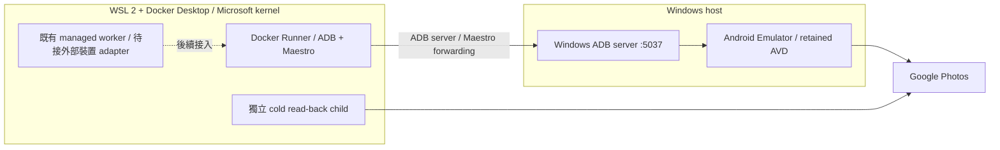

# pixAV

pixAV 將外部媒體來源可靠地轉換成「已驗證、可長期從 Google Photos 恢復播放」的私人媒體資產。Google Photos 是目標架構的持久媒體儲存，本地磁碟承擔 staging 與可重建的播放 cache；PostgreSQL 始終保存 domain 事實。Jellyfin 負責展示、搜尋、收藏、觀看紀錄與各裝置播放。

本文件整合產品的十項核心目標與完整 BDD 規格，集中描述目標、程式現況、行為契約、開發順序及操作方式。[AGENTS.md](AGENTS.md) 定義開發與資料安全規則；[CLAUDE.md](CLAUDE.md) 僅為入口。本文中的「必須」是驗收要求，不表示程式已實作或部署已通過。

Windows 開發方案已改為 [Windows Android Emulator + Docker Runner](#開發環境windows-android-emulator--docker-runner)。操作者回報 redroid 自訂 WSL kernel 造成 Docker／WSL 相容性問題；本專案不再要求為 Android 修改 `.wslconfig` kernel。新開發入口與既有 redroid managed 上傳的遷移分開驗收。

## 完成標準

同一個 `video_id` 必須走完：來源選擇 → qBittorrent 下載 → ffprobe 檢查與必要 FFmpeg 準備 → 指定 Pixel-compatible environment 上傳 → 全新 cold path 回載與完整性驗證 → `RemoteAsset.DURABLE` → `PlayableAsset.READY` → `.strm + .nfo + artwork` 發布 → Jellyfin 實播及 seek → 安全刪除 staging → 清空可重建播放 cache 後，再由 Photos 恢復播放及 seek。

全程不能重複上傳或重複計入成功用量。上傳 UI 成功、分享頁 HTTP 成功、local finalize、單段可播、CLI exit 0、coverage 達標，均不足以宣告這條流程完成。未在真實環境穩定通過前，Phase 0 與 production playback 保持未驗收。

## 五個核心邊界

### 本次階段 3–5 隔離驗收契約

操作者已授權本輪以固定版本 Restic 的本機加密完整備份、`check --read-data` 與同機空白環境的完整還原，替代 cleanup 前的離機目的地要求。repository 必須位於部署 data、staging、cache 及 cleanup 掃描範圍之外；保留 100 GiB／10% disk latch，先盤點 guest、volumes、完整還原空間與底層實體磁碟。備份包含 DB／roles／ledger、upload／usage／execution／queue checkpoint、runtime journal／guest、正確 staging／錯誤副本、Jellyfin config／觀看紀錄、publication／完整影音 evidence，以及 source／設定／映像／secrets；一致快照禁止直接複製正在變動的 DB 或 Jellyfin 資料檔。還原不得覆寫現有實例，guest 外連须封鎖並實測，worker 不得自動取得 execution ownership。此為授權契約，尚非已完成的 backup／restore 收據；離機備份、整機故障恢復與 production promotion 保持 OPEN。

階段 3 的登入原帳號下載須在獨立瀏覽器完成，僅匯出必要認證資料，不匯出 profile 或媒體 cache；登入與回載環境不得掛 staging、guest、播放 cache、備份、DB credential 或 Docker socket。同帳號／owner 沿用 UI 互斥，失聯停止。storage verification 與 playback rebuild 必須共用下載 adapter、各次全新 browser context／空白工作目錄；認證模式、帳號／item／session 綁定、原件 digest 與隔離條件以版本化收據驗證，秘密不入收據。登入模式未完成 live contract 前不得宣告已可正常恢復。登入後至多兩輪、每輪三十分鐘查證，原件傳輸沿用 cold timeout；challenge 或 session 過期交人工，不重送帳密或重傳媒體。只有 exact 原件完整性通過，才走原 operation 的 dry-run review／Maxwell apply；四筆成功 operation 與四筆 marker 必須一一對應。

階段 4 須三片 DURABLE／READY／完整 publication、完整 HTTP 與新的第三片 Jellyfin 影音／seek／resume／所有交界證據及操作者覆核；前兩片有效 v2 證據保留。全部上傳結果確定且無 UI writer 後才開始有效容量採樣，每五分鐘一次，gap 超過九百秒重新起算，不補造中斷樣本；連續二十四小時及帳戶外部活動歸因缺一不可。階段 5 只在上述關卡、完整備份還原及 retention 全通過後，依 exact-target manifest／既有 journal、reader 與 path 守衛逐片 cleanup，清 cache 後透過正常 Photos 流程重建，重新錄影並人工覆核；失敗停止下一片清理。登入取不到原件停階段 3，人工／容量證據不足停階段 4，備份／空間／retention／守衛不足停在刪除前（BDD-078、119、122、125、143）。

原帳號下載的工作區實作使用 `PIXAV_PHOTOS_COLD_AUTH_SECRET` 指向 worker 可讀的私有 cookie-only JSON（檔案 0600、所在目錄 0700）；空值維持匿名模式。[認證 adapter](src/pixav/pixel_injector/photos_auth.py) 核對 DB 帳號、retained guest owner 與瀏覽器帳號 digest；只將驗證後的 cookies 經記憶體 stdin 傳入新 browser context，不把 secret、profile 或媒體 cache 掛進 child。storage verification 與 playback rebuild 共用 [download_original](src/pixav/pixel_injector/parts_download.py)，登入模式拒絕預填媒體，要求唯一 exact item、完整檔名、full hash／size、影音探測及全片解碼。[`photos-cold-account-v1`](src/pixav/shared/cold_receipts.py) 收據綁定帳號、owner、session、item／filename digest 與原件 digest；upload review、durability、playback 及使用同一 policy 的 observer 都重驗此收據。匿名歷史收據保持原義，缺少或錯誤的新版本欄位不降級接受。challenge／session 過期使 storage 或 playback execution 進 `USER_ACTION_REQUIRED`，不以匿名、staging 或重傳 fallback。

登入 cold child 只掛該次 `/work:rw`、2 CPU／4 GiB；沿用 [storage-tools](docker/storage-tools.Dockerfile)／[Photos tools](docker/photos-canary.Dockerfile) 的 Playwright 1.55.0（Apache-2.0）、Chromium 與 FFmpeg，依固定映像保留其版本與授權資訊，不增服務或 migration。頁面導覽六十秒、元素三十秒、download event 六百秒，storage activity 上限六小時，playback 依段數乘六小時；FFmpeg 全片解碼也受 activity deadline 限制。隔離 cold 基底實測為 FFmpeg 6.1.1-3ubuntu5（GPL build）；解碼保留輸入原生 time base，避免有效 VFR 影格在名目幀率網格碰撞，仍拒絕非零退出或任何 error 診斷。UI 鎖失聯先停止並移除該 exact child 才結束擁有權；服務 health／metrics 沿用 storage／playback worker，人工處理原因為 `PHOTOS_ACCOUNT_SESSION_REQUIRED`。secret 與必要收據納入私有加密備份，不能以瀏覽器 profile 取代 secret。部署前須固定 source／build context／image digest，成對更新相容的 authority／worker；回退也必須能理解登入收據與人工處理結果，不能交給會忽略新契約的舊 process。上述是工作區實作，尚非新版部署或完整 live／production 驗收。

登入 adapter 修改後的完整檢查為 1,859 passed／8 skipped、coverage 82.49%，包含核對身分的真 PostgreSQL／Redis integration；新真實 FFmpeg 合成回歸另行通過，Ruff／Black／isort／mypy 與兩份 Compose 檢查通過。後續依賴精簡另行驗證，不沿用上述結果。固定 cold 映像已建置，未部署至 live 服務。登入正向控制已取回原件，完整 hash／size／codec／duration 通過；保留原生 time base 後的全片解碼仍產生兩筆非單調輸出 DTS 診斷，即使 exit 0 仍維持 FAIL，不能推定原件損壞或解碼契約通過。第三片第二段本輪原帳號查證未啟動；容量與正向控制解碼皆為阻塞，沒有 apply／重傳／媒體 cleanup。

### Docker 資料磁碟搬移前置

操作者已明確授權立即搬移 Docker 資料並在守衛通過後釋放舊 C 槽副本，同時減少 D 槽占用及精簡專案。2026-10-10 盤點：Docker Desktop 4.30.0 使用 WSL2 的 `docker-desktop-data`，資料 VHD 約 135.07 GiB；2026-10-11 搬移 preflight 的 C／D 實體餘額約 12.96／320.83 GiB。Ubuntu 工作資料已在 D 槽。保留 59 個 volumes、195 個映像、原 operation、staging、認證 secret 與證據，停止的其他專案保持停止。數字僅為時點盤點，不能取代執行前的實體容量守衛。

搬移前重新核對原 daemon、DB identifier／ledger、帳號／owner／guest／映像、三筆成功上傳／三筆 usage 及唯一 Maxwell；當時全部 bind 的實際 device／inode／內容一致，包含 Jellyfin `/media` 與 `/cache`。以自身 pause token 停寫，保存完整 DB custom dump、roles、逐表 digest、ledger 與 queue checkpoint，記錄 exact 容器及原 restart policies，全部服務與 Desktop 已停止。這些 sidecar 不能代替完整 VHD 備份還原或階段 5 完整應用還原。

固定 [Restic 0.19.1](https://github.com/restic/restic/releases/tag/v0.19.1) 的官方簽章與 SHA-256 已核實，但完整備份尚未建立：兩個 Docker distro 停止後，WSL 仍持有資料 VHD，官方 [export VHD](https://learn.microsoft.com/en-us/windows/wsl/basic-commands#export-a-distribution) 亦回報 sharing violation。操作者於 2026-10-11 接續指示搬移，已授權先前說明的全 WSL 釋鎖中斷範圍。重新核對全部 15 個原容器自一致 checkpoint 後未啟動，原映像與掛載欄位不變，28 個 bind 的 host 路徑／inode／內容已記錄；Desktop 已再次停止。Windows 背景作業的語法、SHA-256 與 dry-run 通過，串接完整加密備份、實際全碟還原、精確演練暫存清除、受支援搬移及原實例核對；未有成功收據的步驟仍未完成。Docker 要求 [VHD 備份前完全停止 Desktop](https://docs.docker.com/desktop/settings-and-maintenance/backup-and-restore/)。

釋鎖後先以本機加密 repository 備份、`check --read-data`，再實際還原至新空白目錄並核對 full hash。容量預算同時保留完整 135.07 GiB 還原、100 GiB／10% reserve 及額外餘裕，repository 上限 80 GiB；壓縮不足即停止，不先刪原件。WSL 2.6.3 實機 help 已核對 `--manage ... --move`，可維持原 registration 搬至新空白 `D:\DockerDesktopData`；先精確清除已驗證的演練暫存，保留加密備份及還原收據，避免第三份大副本。重新啟動後仍須核對原 daemon、完整集合、DB／queue、實際 mounts 與唯一 Maxwell，再只解除自身 pause。VHD compact 另驗正確 filesystem、卸載條件與實體配置量。原 C 資料尚未刪除或搬移，離機、整機恢復、階段 5 與 production 關卡保持 OPEN。

### 架構邊界

```text
多個外部來源 adapter
        ↓
SourcePolicy → MediaWorkflow → GooglePhotosStorage
                                      ↓
                              PlaybackResolver
                                      ↓
                              LibraryProjection → Jellyfin

PostgreSQL：以上各邊界的 domain facts
唯一 execution authority：活動派送、attempt、timer、retry 與恢復
Redis／播放 cache／library projection：衍生狀態
```

| 核心 | pixAV 維護的決策 | 委派的能力 |
| --- | --- | --- |
| SourcePolicy | normalization、去重、eligibility、品質與政策評分、cooldown、候選切換、provenance | 外部 adapter／indexer 發現候選 |
| MediaWorkflow | execution 生命週期、checkpoint、下載與準備政策、失敗分類、恢復、storage handoff | qBittorrent 執行 torrent；ffprobe／FFmpeg 檢查、remux 及必要轉換 |
| GooglePhotosStorage | 帳號 LRU、quota、cooldown、lease、上傳 reconciliation、remote reference、cold read-back、durability、刪除資格 | 指定 Pixel-compatible environment 執行上傳；Google Photos 儲存媒體 |
| PlaybackResolver | 穩定 URL、播放資格、遠端重新解析、cold materialization、Range／seek、分段完整性、cache 與 reader 保護 | 經驗收的 OSS 傳輸能力；播放器負責解碼 |
| LibraryProjection | effective metadata、`.strm`／`.nfo`／artwork、原子發布、reconciliation、撤架與重建 | Jellyfin 掃描、展示、搜尋、收藏與觀看狀態 |

這是業務邊界，並不要求立刻改成五個獨立服務或更名現有目錄。不自行實作 torrent、codec、播放器、transcoder、通用 crawler、queue/DLQ/retry framework、UI automation framework、media proxy 或 catalog/search framework。PlaybackResolver 保留 Photos 專屬政策與穩定入口，傳輸實作以成熟元件的已驗證契約承接。

不預選 orchestrator；選定後只有一套 execution SSOT。upload concurrency 固定為 1。不並行維護 Stash／MetaTube 兩套 metadata 系統，不安排 Rust rewrite。現有 fallback 必須等完整 Phase 0 通過，再按各自替代契約逐段退休。

## Domain 與狀態契約

下列為目標模型；目前 schema 對應與缺口見後文。不要把來源、執行、遠端儲存、播放、發布狀態全部塞進 `Video.status`。

| Entity | 身分與事實 | 狀態／約束 |
| --- | --- | --- |
| Video | 穩定 `video_id`、媒體身分、metadata 與 provenance | 候選故障不得污染媒體身分；不同 info hash 不代表已證明相同媒體 |
| SourceCandidate | 所屬 Video、provider identifier、正規化欄位、排名、失效證據 | hard eligibility 優先於分數；來源 cooldown 可恢復 |
| Execution | domain task 與各次 attempt、owner、外部 operation reference、checkpoint、due time | `READY / RUNNING / WAITING_RETRY / WAITING_QUOTA / USER_ACTION_REQUIRED / SUCCEEDED / FAILED / CANCELLED` |
| RemoteAsset | provider=`google_photos`、account、可重新取得媒體的 reference、預期內容、驗證證據 | `REQUESTED → CREATED → VERIFIED → DURABLE`；全段冷回載成功即提交 `VERIFIED`，manifest 整體通過才 `DURABLE`。完整性失敗不得 durable；已 DURABLE 的資產重新驗證失敗才轉 `INVALID`，share URL 過期不是失效 |
| PlayableAsset | RemoteAsset／manifest 版本、可播放物件、完整性與播放驗證 | `PREPARING → READY`；過期準備為 `STALE`，不可恢復為 `INVALID` |
| Account | LRU、quota 使用與重設、cooldown、lease ownership | DB clock 決定資格；lease 覆蓋實際執行且不可並行擁有 |
| LibraryPublication | video、projection 版本、有效 metadata、必要檔案與發布結果 | `PENDING / PUBLISHED / STALE / FAILED`；只有 READY 可發布 |

Models immutable；外部 payload 在 adapter 邊界驗證。metadata 以 provider namespace 合併並保留 provenance；manual override 優先於 scraper，refresh 不得覆蓋人工值。未知的演員、studio、backdrop 等 optional 欄位不阻擋發布，也不捏造內容。

短命 CDN URL 只能在 TTL cache，不能作永久 identity。`share_url`／provider reference 只是重新解析的線索，其存在不證明內容 durable。URL 到期不應使已驗證 RemoteAsset 失去 durability；確認遠端內容毀損或遺失，才走相應 invalidation 與恢復。

每個有外部副作用的 business operation 必須有可辨識的穩定鍵、intent 與 reconciliation 依據。crash 後先確認 qBittorrent、輸出檔或遠端上傳是否已成功，再決定重做。無法證明是否上傳成功時，保留本地檔並進入 reconciliation／人工處理，不能以盲目重送換取表面成功。確認遠端建立與成功用量應以可重入的同一交易提交；重試 commit 不重扣，未確認的副作用不得直接當成零用量重傳。

持久 retry／quota 用 PostgreSQL clock；heartbeat 間隔用 monotonic clock。worker 回報活動結果，唯一 execution authority 決定有限 retry 與 timer。terminal failure 不自動 replay；人工 replay 建立可追蹤的新 attempt／execution，保留原始歷史。

## 五塊核心的驗收要求

### SourcePolicy

adapter 回傳合法候選才進入正規化；錯誤 payload 記錄 adapter error，其他候選仍可使用。保留 provider identity，不發明跨來源媒體關聯。同樣輸入與政策版本產生確定的排序；最高分違反硬性條件時選下一個合格候選。

`num_seeds=0` 不能單獨判定永久失效。確認 `SourceUnavailable` 才讓該候選 cooldown 並切換；Redis、網路或 worker 故障走 infrastructure retry，不污染候選。全部來源暫不可用時明確等待來源恢復，不產生假下載；新發現可重新使媒體具備執行資格。

### MediaWorkflow

選定來源後關聯 execution 與 qBittorrent 工作；下載完成記錄 artifact，再由 ffprobe 取得 container、影音 codec、解析度及 duration。媒體無法解析就拒絕 upload-ready。相容格式跳過不必要轉碼；remux 後重新 probe，duration 必須在明確容許誤差內，失敗保留可恢復原始檔。

下載成功但 checkpoint 未提交、remux 輸出完成但 transition 未提交，都須重新驗證既有結果並接續。domain task 與 attempt 分開觀測。候選失效交 SourcePolicy；暫時依賴故障有限重試，耗盡後 terminal。保留 FIFO、in-flight recovery、後段處理與 single-flight 的既有安全語意。

### GooglePhotosStorage

以 LRU 在 quota 足夠、未 cooldown 的帳號中取得 lease，執行中維持 ownership，終止或失聯後安全釋放／過期。沒有合格帳號時 `WAITING_QUOTA` 並保留 staging。指定環境不可用就失敗或等待，不得默默改走一般直接 upload。rclone fallback 若使用，必須明確計入 quota，不能宣稱具有同樣的儲存或配額效果。

登入 challenge 進 `USER_ACTION_REQUIRED`，停止自動提交帳密。上傳建立 RemoteAsset 後，必須使用新的 retrieval session、空的回載 cache，且不掛載可冒充遠端回載的原始下載或上傳片段。驗證政策要記錄版本、預期 byte count、duration 誤差、codec 及必要 hash；完整原件驗證要求全量 byte count／SHA-256 一致。若未來允許 provider 轉換，必須另定且實測完整性政策，不可在 hash 失敗時臨時放寬。

只有 remote creation、cold read-back 與政策檢查都成功，才能提交 `DURABLE`。單次成功不保證未來永遠可取回；後续失效、定期重新驗證的觸發條件與恢復策略也須有可觀測狀態。分段 manifest 完整且不可變，每段有身分、順序、時間範圍、size、hash、codec 與 account/reference；所有段及交界通過才能代表整片。

### PlaybackResolver

Jellyfin 永遠使用 `video_id` 的 pixAV 穩定入口，例如 `/stream/{video_id}`。目標契約不得把短命 provider URL 寫入 projection、回 JSON 或以對外 redirect 暴露給 Jellyfin；需要的傳輸能力由經驗收的 OSS 整合提供，pixAV 不擴寫通用 proxy。

只有 durable 遠端內容且準備成功才可 `READY`。完整 GET 的 byte count／SHA-256 要符合可播放物件；HEAD 不傳 body，已知時回正確 Content-Length，不為取得長度無謂全量下載。single Range 驗收首段、中段、suffix 的 206／Content-Range／精確 bytes，以及越界 416。seek 不應為略過內容強制重傳前面全部 bytes，附近重複 seek 可利用 cache。

cold path 可 materialize 暫存內容；首次準備成本須與 READY 後的 Range 效能分開驗收，不能用「整片先下載完才 seek」證明 cold seek 已達標。cache 可丟棄並由遠端重建，TTL 到期仍須等 active reader 釋放。缺段、只完成第一段或 manifest 版本不符都拒絕整片播放；分段交界必須驗證畫面、聲音與 seek。

### LibraryProjection

只有 `PlayableAsset.READY` 可發布；RemoteAsset durable 本身不夠。輸出穩定 URL 的 `.strm`、Jellyfin-compatible `.nfo` 與有效 artwork；metadata 含可用的 title、description、release、演員、studio、tags。已保留的封面不得因外部 provider 暫時故障而消失，backdrop 可缺省。

準備全部必要檔案後才原子啟用完整版本，更新失敗保留先前有效發布，不能露出半寫檔案。重跑不產生重複 library item。metadata 變更可刷新，缺檔與整個生成目錄遺失可從 PostgreSQL 的發布資料及保留的 artwork 原件重建；DB 保存 artwork 的 provenance/reference，保留的原件也納入備份。Jellyfin DB 遺失不影響 domain facts。

PlayableAsset 變 INVALID 後撤下／停用 active projection；撤架不刪遠端資產。Jellyfin 驗收包含掃描、封面、tags 導覽／搜尋或篩選、實際 client 播放、seek 與續播。收藏、觀看紀錄與裝置體驗由 Jellyfin 管理，其個人狀態備份由 Jellyfin 部署負責，不能宣稱只靠 pixAV DB 可還原觀看紀錄。

## Cleanup 與存取安全

staging 的刪除資格必須同時成立：`RemoteAsset.DURABLE`、完整性證據有效、`PlayableAsset.READY`、播放驗證通過、完整 library publication、retention 到期、沒有 active execution／reader，以及 path、symlink、ownership 與操作備份守衛通過。disk 壓力或 retry 耗盡不取代這些條件；`pixav-local://` 媒體不是遠端備份。

資格檢查與真正 unlink 之間必須防止 reader／execution 新增或版本變更造成競態。dry-run 不改 DB、queue 或檔案；apply 僅刪當次核准的 exact target/count，不能以擴大 glob 取代目標。刪除成功記 audit、更新 local reference；crash 後重查檔案系統並 reconciliation，不能把 missing file 當成遠端完整的證據。

cache eviction 與 staging cleanup 有不同用途，但都保護 active readers。private playback 由部署的認證與授權邊界保護；未授權 client 與已撤銷裝置的新請求必須被拒絕。projection、log、model repr、metrics、fixture、Maestro YAML 不得洩漏 credential、cookie 或 Photos token。不要把目前 HTTP route 的存在當成已實作 private access control。

## Repository 現況與差距

以下依實際程式、callers、migration、Compose 與當次隔離驗收核對。實作契約、隔離 live evidence 與 production promotion 分開記錄；版本、instance、manifest 與 evidence 保存在私有驗收資料。測試檔存在不代表已執行，隔離成功也不宣告正式部署通過。

| 邊界 | 可確認的實作依據 | 尚需補齊與證明 |
| --- | --- | --- |
| Windows Android 開發環境 | [獨立 runner Compose](docker-compose.android-runner.yml) 與 [smoke flow](config/maestro/android-runner-smoke.yaml)：Docker 只執行工具，經 Windows ADB server 操作 exact Emulator serial；不建立 Android guest 或 execution | 新入口不接 DB／queue，也不替換 managed runtime。Windows／Docker 同時運行、ADB／Maestro forwarding、指定上傳環境與新一輪 Golden Path 都需實測；既有 redroid evidence 不自動沿用 |
| SourcePolicy | [policy](src/pixav/sht_probe/policy.py)、[discovery caller](src/pixav/sht_probe/service.py)、[authority](src/pixav/maxwell_core/media_workflow.py)：provider observation、hard eligibility、確定排序、DB-clock cooldown 與候選切換 | managed 模式 opt-in；provider live access／parity 與 production promotion 仍需當次 evidence |
| MediaWorkflow | [authority](src/pixav/maxwell_core/media_workflow.py)、[activity worker](src/pixav/media_loader/activity.py)、[preparation](src/pixav/media_loader/preparation.py)、[managed segmentation](src/pixav/media_loader/segmented_preparation.py)、[014 migration](migrations/014_media_workflow_recovery.sql)：execution／attempt 分離、DB clock retry、有限失聯恢復、operation intent、原始檔 hash 綁定的 lossless-mp4-v1 準備；超過 transport target 時以既有 FFmpeg segmenter 產生完整分段 manifest | 隔離 contract 與 production 驗收分開；legacy orchestrator 僅服務未 admit 的 video，不自動接手受管 execution |
| GooglePhotosStorage | [storage authority](src/pixav/maxwell_core/storage_workflow.py)、[activity worker](src/pixav/pixel_injector/storage_activity.py)、[Photos adapter](src/pixav/pixel_injector/photos_storage.py)、[repository](src/pixav/shared/remote_assets.py)、[013](migrations/013_remote_storage.sql)／[017 migration](migrations/017_remote_asset_reverification.sql)：execution-owned account lease、WAITING_QUOTA、USER_ACTION_REQUIRED、實際提交的 `REQUESTED→CREATED→VERIFIED→DURABLE`，以及 [versioned policy registry](src/pixav/shared/storage_models.py)：`photos-original-v1` 凍結保留、`photos-original-v2` 為現行版本，除全量 hash 外要求回載收據帶 ffprobe 觀測事實，並在促成前以 `segment_plan` 的同一判準重驗持久化 manifest 的時間軸；`reverify_due` 依 `PIXAV_REMOTE_REVERIFY_INTERVAL_DAYS`（預設 30，0 停用）開只走 verify stage 的 execution，重新驗證失敗才 `invalidate`；[segment staging](src/pixav/pixel_injector/segment_staging.py) 以硬連結呈現 canonical 檔名，[retained guest](src/pixav/pixel_injector/managed_runtime.py) 與 [015 migration](migrations/015_managed_runtime.sql) 將 guest 建立記為可 reconciliation 的 intent，帳號切換退休 runtime 而非共用裝置 | 指定 Pixel-compatible 環境的一筆既有資產，以及本輪一筆自有合成 MP4，已由真帳號 cold read-back 通過 v2 並由 authority 促成 DURABLE；後者經 operator-supplied 入口，不計為來源下載驗收。三筆新下載到上傳與 24 小時 quota 觀察仍未驗收。contract 測試使用 fake，不能作 promotion 證據。回載收據形狀屬容器契約：`photos-original-v2` 的資產必須由重建過的 [storage-tools](docker/storage-tools.Dockerfile) 映像回載，舊映像產出的收據會被拒（刻意 fail-closed） |
| 分段隔離流程 | [010](migrations/010_video_parts.sql)、[011](migrations/011_first_4k_heartbeat.sql)、[video_parts](src/pixav/shared/video_parts.py)、[單片 CLI](scripts/first_4k_movie.py)：manifest、checkpoint、usage marker、heartbeat 與 cold preparation | 隔離設計與一般 worker 尚有差異；需實測完整 Photos／24 小時 quota／Jellyfin／刪 staging 後再播，不能直接 promotion |
| PlaybackResolver | [routes](src/pixav/strm_resolver/routes.py)、[managed playback](src/pixav/strm_resolver/playback.py)、[cache janitor](src/pixav/strm_resolver/cache_janitor.py)、[playback authority](src/pixav/maxwell_core/playback_workflow.py)、[playback worker](src/pixav/pixel_injector/playback_activity.py)、[019 migration](migrations/019_playable_assets.sql)：有 RemoteAsset 的 managed video，`/stream` GET／HEAD 只從 SHA-256 已驗證的 playback cache 提供 bytes；非 READY 或 remote 非 DURABLE 回 409，HEAD／416 只讀 READY 記錄，cache MISS 寫 demand 並在同一請求等待重建，逾時回 503 + `Retry-After`；`/resolve` 不回 provider URL。PlayableAsset 的準備與重建是 `playback` stage execution，eviction 以 `flock` 等待 reader。legacy video（無 RemoteAsset）維持舊 `/stream` 302 與 `/local` | 隔離環境的單段及兩段 Photos durability、READY、完整 GET／hash／HEAD／Range／416，以及人工影音／跳播／續播已有當次證據；多段另驗分段交界。獨立還原環境清 cache 後的 Photos rebuild 已通過；刪 staging 後的完整 client 契約仍 OPEN。cold 狀態下的中途 seek 要等整片重建完成才回 bytes；跨容器 `flock`、裝置撤銷與未授權存取須各保留當次 evidence，不能推定 production 已通過 |
| LibraryProjection | [metadata](src/pixav/library_projection/metadata.py)、[artwork](src/pixav/library_projection/artwork.py)、[render](src/pixav/library_projection/render.py)、[writer](src/pixav/library_projection/writer.py)、[reconciler](src/pixav/library_projection/reconciler.py)、[020 migration](migrations/020_library_projection.sql)：只發布 READY、remote DURABLE 且已保留 poster 的 video；缺少 poster 回報 `POSTER_REQUIRED`；`.strm` 只含穩定 URL，`.nfo` 依 `metadata-merge-v1`（manual > Stash > video 列，tags 取聯集）並逐欄保留 provenance，artwork 只用以 SHA-256 保存並驗證的原件。完整版本目錄驗證後才以 symlink `rename` 切換。Maxwell tick 定期 level-triggered 收斂：缺檔或整個 root 遺失就重建，失效就撤架，撤架不碰 RemoteAsset | 隔離 Jellyfin 掃描（含相對 symlink）、單一 video 項目、封面與 tags 已有證據；本輪前兩片完整影音／seek／續播已人工確認並登錄 v2，第三片仍 OPEN。Jellyfin 與認證 gateway 由 playback overlay 提供；目前只有人工 artwork 匯入，沒有 provider 封面擷取 |
| Cleanup | [janitor](src/pixav/maxwell_core/gc.py) 檢查 `verified_playback_evidence`、`exact_target_backup_authorization`、RemoteAsset、publication、open execution、reader lease、DB-clock retention 與 path／symlink containment；後者要求 [018](migrations/018_cleanup_authorization.sql) 的未過期授權列，其 path 與 janitor 當場重算的 sha256／size 相符且指向本 video 的 DURABLE asset；dry-run 不寫 DB／audit／檔案，apply 拒絕時寫 audit | `verified_playback_evidence` 要求同一 video 有 READY PlayableAsset、其 `playback_verified_at` 已由 [manage_playback](scripts/manage_playback.py) `verify` 寫入，另有版本化 `jellyfin-client-v1`／`jellyfin-client-v2` 實播登錄綁定相同 video／remote／playable ID、preparation version、size／hash，觀察時間介於 READY 與 DB 現在之間，且所屬 remote 仍 DURABLE；`complete_publication` 要求 `library_publications` 為 PUBLISHED 且指向目前 READY 的物件，並以設定的 `library_root` 重讀 `.strm + .nfo + poster`，核對完整 projection digest；缺檔、內容異動或路徑外逃均拒絕。cleanup 與 publication reconciliation 共用 advisory lock，持有至 unlink 結束；exact-target 授權須綁定該 READY 物件的 remote asset。[真 PostgreSQL 測試](tests/integration/test_cleanup_gate.py)涵蓋完整條件下的單一目標刪除與 audit；client 證據與 publication 檔案守衛由同一隔離測試覆蓋。live 播放驗證、備份授權與實際刪除後由 Photos 恢復仍未實測，BDD-058／063／134 的 production 驗收保持 OPEN |
| Domain | [models](src/pixav/shared/models.py)、[storage models](src/pixav/shared/storage_models.py) 有 Video、Task、Account、SourceCandidate、VideoPart、RemoteAsset、RemoteAssetSegment；[playback models](src/pixav/shared/playback_models.py) 與 [repository](src/pixav/shared/playable_assets.py) 有 PlayableAsset；[library repository](src/pixav/library_projection/repository.py) 有 LibraryPublication、metadata override 與 retained artwork；[migrations](migrations/) 為 001–021 | 既有 frozen models 不等於所有 secret repr 已合格 |

[單元測試](tests/)、[真實 repository／migration 測試](tests/integration/)、[segmented HTTP 測試](tests/strm_resolver/test_segmented_routes.py) 與 [E2E 入口](tests/e2e/) 可作後續基礎。`pyproject.toml` 尚無 pytest-bdd dependency 或 `tests/bdd/`；BDD 情境索引目前是規格，不是已可執行的 suite。

## 開發順序與交付門檻

| 順序 | 可審查的交付 | 通過條件 |
| --- | --- | --- |
| 0. 固定相容的 Windows 開發環境 | Microsoft WSL kernel、Windows Android Emulator、獨立 Docker Runner；再將既有 retained runtime 遷移為外部裝置 adapter | Docker／WSL／WHPX 共存、exact AVD／帳號／owner 綁定、ADB／Maestro forwarding 與唯一 UI writer；先完成原 guest／未知上傳 reconciliation，不能用換 kernel 解決 |
| 1. 保護現有 artifact、建立事實模型 | 先補一般 cleanup 的完整拒絕條件；新增 domain 模型／migration／repository，定義驗證政策與 operation identity | 真 PostgreSQL 測 transition、constraint、舊 schema 對應、競態與 restore；既有 AVAILABLE／share URL 不自動升級為 DURABLE |
| 2. 打通隔離 Golden Path | 以合成媒體、單帳號、upload concurrency 1，串接五塊核心；完成 Photos cold read-back、READY、原子 projection 與 Jellyfin | 全 GET／hash、HEAD／Range、影音／seek、刪 staging 且清 cache 後再播；無重複 upload／quota |
| 3. 證明故障恢復與安全 | 注入 upload 後 commit 前、verification 後 cleanup 前、unlink 中、URL expiry、Redis／projection 遺失等失敗 | 副作用 reconciliation、有限 retry、人工 replay audit、reader guard、private access 與精確備份還原通過 |
| 4. 選定 execution 與替代 adapter | 以相同 BDD 比較成熟 OSS，確認 ownership、timer、FIFO、single-flight、後段優先與恢復 | 完整 Phase 0 先過；新舊 executor 不得同時寫同一 execution，保留 domain facts 並完成 rollback |
| 5. 分段 canary 與退休 fallback | 各 adapter／execution 邊界有版本、health／metrics、secret、volume、資源限制、備份及 rollback 契約 | contract、隔離 integration、live、recovery、rollback 全過；任何 critical 情境失敗或無 evidence 均阻擋 promotion |

不以「更換 orchestrator」代替 cold durability 與 remote-only playback 的驗收。候選 execution 工具可比較 Taskiq／Windmill／Temporal，尚未選定；來源 adapter 替代須通過 access-gate、bare-hash-only、同範圍非空 parity，才能退休既有 fallback。Maestro、MediaFlow、MetaTube 等僅為待驗證的替代整合選項，不是目前已接管的服務。任何替代都不能遺失來源政策、帳號政策、Photos resolver、projection 或 cleanup guard。

每次交付在既有測試目錄加入能驗證行為的測試；需要 pytest-bdd 時才新增工具與 `tests/bdd/features/`、`steps/`、`fixtures/`，按五個核心及 system／Jellyfin 分組。保留本文件情境 ID 作 traceability，不建立另一份 roadmap 或測試報告作長期規格。

## 驗證層級與證據

| 層級 | 要驗證的邊界 | 限制 |
| --- | --- | --- |
| contract | 純 domain／adapter contract，以已實測契約建立 fixture | fake Photos 不證明 live upload 或 cold recovery |
| isolated | 專用 Compose、真 PostgreSQL／Redis／qBittorrent 及所需 Jellyfin；外部副作用可用經驗證 fixture | 先核對 instance；不能使用正式 queue |
| live | 指定 upload environment、專用 Google account、Photos、cold reload 與真實播放器 | 需當次版本、identity、完整性與播放 evidence |
| production canary | production-like 單片完整 Golden Path，加 recovery／rollback | 完成前不得標 Phase 0／production playback PASS |

原 BDD 的 `@contract / @isolated / @live / @production_canary` 是設計層級，`@critical / @destructive / @chaos / @security / @jellyfin / @promotion` 表示驗收屬性；不是目前 pytest 已註冊的全部 markers。現有 `integration`／`e2e_live` 是 opt-in，設定與 instance guard 見 [conftest](tests/integration/conftest.py) 及 [integration_guard](scripts/integration_guard.py)，不要只設啟用旗標就對未知服務執行。

程式變更執行 [AGENTS.md 的完整檢查](AGENTS.md#驗證)。live evidence 要能關聯 revision／image、DB identifier/database、Redis run ID、execution／video、manifest／verification version、驗證時間及結果；敏感 reference 與媒體保存在私有 evidence，不放本文件。PASS 要有實測，缺資料、等待 24 小時 quota 或未實播保持 OPEN／未驗收。模擬規則測試、container healthy 或過去主機的數字均不能代替當次 runtime evidence。

故障恢復至少包含：upload 成功但 DB 未提交時不重傳且只扣一次；verification 後 crash 保留 durable facts；unlink 中 crash 安全收斂；Redis 遺失不遺忘遠端資產；Jellyfin／projection 遺失可重建；播放途中 URL 到期可重新取得。監控要區分 source-unavailable、WAITING_QUOTA、upload failure、remote verification failure、publication lag，並保留 queue／retry／DLQ、disk／pause 與實際播放信號。

## 開發環境：Windows Android Emulator + Docker Runner

### 已知 WSL kernel 相容性限制

2026-10-12 操作者回報：在 Windows 使用者的 `.wslconfig` 啟用下列 redroid 自訂 kernel 後，Docker 與 WSL 發生相容性問題。這是本機已回報的限制，尚未重新測定根因或所有版本組合，不能推論每個自訂 kernel 都不相容。

```ini
# 已知有相容性問題的舊設定；不要用於 pixAV 開發環境。
[wsl2]
kernel=C:\\Users\\charl\\.pixav\\wsl-kernel\\bzImage-6.6.87.2-pixav-redroid
```

`.wslconfig` 是所有 WSL 2 distributions 的全域設定；`kernel` 未設定時使用 Microsoft 提供的 kernel。詳見 [Microsoft WSL 設定](https://learn.microsoft.com/en-us/windows/wsl/wsl-config)。因此本專案採用預設 Microsoft WSL kernel，不編譯／載入 binder kernel、不為 redroid 改全域 kernel，也不以 privileged Android container 作開發前置。Docker 的 netfilter／TUN 問題仍須獨立驗證，不能把更換 redroid kernel 當作修復方案。

若目前仍有這項 override，復原方式是移除或註解該 `kernel=`，並核對是否有與它綁定的 `kernelModules=`；保留原有 memory、processors、swap、networking 等其他設定。使設定生效所需的 Desktop／WSL 停機屬另一項主機操作：先確認中斷範圍、停寫與備份守衛，取得當次授權後執行，再核對原 daemon、DB／Redis identity 及實際 bind mounts。**本次文件與 runner 入口修改不會變更 `.wslconfig` 或重啟主機。**

### Windows 與 Docker 的分工

Android Emulator 原生執行於 Windows，使用 [Windows Hypervisor Platform（WHPX）](https://developer.android.com/studio/run/emulator-acceleration#accel-vm)。Android 官方要求 VM acceleration 的 Emulator 直接在 host 執行；本方案不在 WSL／Docker 內啟動 Emulator，不需要 `/dev/kvm`、binder、host PID namespace 或 privileged runner。



| 元件 | 責任與持久資料 | 開發限制 |
| --- | --- | --- |
| Windows Android Emulator | Android system image、Photos／Google Play、AVD userdata、登入狀態 | 專用 AVD 綁定一個帳號；Windows 管理啟停與磁碟，不掛進 Docker。Pixel hardware profile 或 `getprop` 名稱不能證明原始品質／不計容量 |
| Windows ADB server | 保留 host ADB keys，提供 5037 控制入口與 Maestro 所需 forwarding | 只有受控 Docker 路徑可達；不對 LAN／公網開放，不讓 runner 接管其他裝置或停止共用 server |
| Docker `android_runner` | 現有 ADB／Maestro／JRE 工具，唯讀 `/parts` 與單一 smoke flow | 獨立 `android-dev` profile、無自動重啟、1 CPU／2 GiB、swap 上限同 memory、256 PIDs；不掛 Docker socket、AVD、帳號 secret、DB／queue 或 cold work |
| 既有 domain／activity workers | PostgreSQL domain SSOT、唯一 Maxwell authority、帳號 LRU／lease／quota 與 operation journal | 新 runner 不是 executor；managed runtime 接入 Emulator 尚待實作，不啟動另一套 DB／Redis 或搶既有 execution |
| cold read-back／playback rebuild | 新 browser context、空 work、完整原件驗證 | 繼續使用獨立 cold child，不掛 AVD、runner staging 或原始上傳媒體；`DURABLE`／`READY`／cleanup 門檻照舊 |

新入口重用 [Photos tools Dockerfile](docker/photos-canary.Dockerfile)，Maestro 2.10.0（Apache-2.0）與 Playwright 1.55.0（Apache-2.0）沿用既有版本；ADB、OpenJDK 21、FFmpeg 與基底的實際版本／license 清單依固定映像記錄，不把 apt 套件當作已固定的 SDK 版本。Windows Emulator、Platform-Tools、system image package／revision、Photos／Play 版本與 AVD 設定 digest 也必須記錄，SDK／system image 遵循 [Android SDK 授權](https://developer.android.com/studio/terms)。runner 要指定已存在的 immutable image ID 或 digest，`pull_policy: never` 防止開發時拉取另一版本；Compose 的必填檢查不會替代 image identity 驗證。

AVD 起始預算為 2 cores／4096 MiB，使用 Windows 的固定 SDK 與專用 AVD；這是 guest 配置，host RAM／GPU 開銷須另量測，開機與 UI timeout 也須實測。runner 的 `/tmp`、`/root`、`/work` 都是有限 tmpfs，CLI 狀態與報告不持久化；要保存 evidence 時另由操作者寫入私有 0700／0600 目錄。Windows AVD、WSL／Docker VHD 與 staging 所在實體分區各自檢查容量，不以 WSL `df` 代替 Windows 實體餘額。

### Docker Runner 開發入口

[docker-compose.android-runner.yml](docker-compose.android-runner.yml) **獨立使用**，不與 base／prod／direct／acceptance 合併；它只宣告一個工具容器，不啟動應用 worker，也不自動登入、push 或 upload。[`.env.example`](.env.example) 的 `PIXAV_ANDROID_*` 鍵只供這份 Compose 使用，未增加可用的 `PIXAV_PIXEL_INJECTOR_MODE`。

先在 Windows 安裝 Android SDK／Emulator、啟用 WHPX，透過 Device Manager 建立專用 AVD；依 host 架構選 system image，需 Photos／Play 的映像另驗登入及指定上傳能力。以下 PowerShell 的 SDK 路徑與 AVD 名稱是範例，使用前核對實際位置與版本：

```powershell
$pixavSdk = Join-Path $env:LOCALAPPDATA 'Android\Sdk'
$pixavAdb = Join-Path $pixavSdk 'platform-tools\adb.exe'
$pixavEmulator = Join-Path $pixavSdk 'emulator\emulator.exe'
& $pixavEmulator -accel-check
& $pixavEmulator -version
& $pixavAdb version
& $pixavEmulator -list-avds
```

Windows 是唯一 ADB server owner。先核對 5037 listener 與 Windows Firewall，僅允許當次確認的 Docker backend 控制路徑；需變更 firewall 時另取得授權。ADB remote server 本身不是帳號認證邊界，不能以 `-a` 配合開放所有網路的規則。依 [ADB server 選項](https://android.googlesource.com/platform/packages/modules/adb/+/refs/heads/main/docs/user/adb.1.md) 與 [Maestro remote host 說明](https://docs.maestro.dev/maestro-cli/how-to-install-maestro-cli)，在專用 PowerShell 視窗以前景啟動，保持視窗開啟：

```powershell
# 僅在受控 firewall 與無衝突 listener 已確認後使用。
& $pixavAdb -a -P 5037 nodaemon server
```

已有 server 時先核對 owner／版本／listen address，不直接 `taskkill` 或 `kill-server`。另一個 PowerShell 視窗使用相同 SDK 路徑啟動已核對的 AVD；`5554` 被占用就停止查證，不接到另一裝置。禁用 Quick Boot snapshot 載入／保存，保留 userdata；不使用 `-wipe-data`。

```powershell
$pixavSdk = Join-Path $env:LOCALAPPDATA 'Android\Sdk'
$pixavEmulator = Join-Path $pixavSdk 'emulator\emulator.exe'
$pixavAdb = Join-Path $pixavSdk 'platform-tools\adb.exe'
& $pixavEmulator -avd pixav-dev -port 5554 -cores 2 -memory 4096 -no-snapshot-load -no-snapshot-save
```

Emulator 命令持續佔用該視窗；在另一視窗以相同 `$pixavAdb` 執行 `devices -l`，核對範例 serial `emulator-5554`、實際 AVD、system image 與專用帳號。serial 是連線選擇器，不能單獨作為跨重啟的裝置 identity。AVD 的 userdata／設定與帳號綁定須保存於私有 runtime manifest，不能以顯示名稱判定同一裝置。

在 WSL 專案根目錄核對 Docker context／daemon，重用已核實的 tools image；首次需要映像才執行 build。不要為此啟動原 redroid worker：

```bash
docker context ls
docker --context default info --format 'daemon={{.Name}} id={{.ID}}'
# 僅在本機尚無已核實的 tools image 時建置：
docker --context default build -f docker/photos-canary.Dockerfile -t pixav-photos-canary:maestro-2.10.0 .
docker --context default image inspect pixav-photos-canary:maestro-2.10.0 --format '{{.Id}}'
```

在私有 `.env` 填入 `PIXAV_ANDROID_RUNNER_IMAGE`（上一步的 immutable ID）、`PIXAV_ANDROID_SERIAL`、`PIXAV_ANDROID_RUNNER_STAGING_DIR`（既有合成媒體目錄的 daemon-host absolute path）。先核對 Windows 與 runner 的 `adb version` 相容，再對 remote server 發出命令，避免 client 自動替換 server。容器預設透過 [Docker Desktop 的 `host.docker.internal`](https://docs.docker.com/desktop/features/networking/networking-how-tos/) 找 Windows host；它不是 WSL shell 的通用 DNS，也不是容器 `127.0.0.1`。使用其他已驗證 host 地址時明確設 `PIXAV_ANDROID_ADB_SERVER_HOST`；不假設 WSL default gateway 或 `network_mode: host` 等於 Windows loopback。

下列只啟動 runner；開始前確認指定裝置沒有既有 uploader／UI writer 或未釐清的 operation。`default` context 與 `pixav-android-dev` project 均是範例，同一輪必須沿用已核對的值：

```bash
docker --context default compose -p pixav-android-dev -f docker-compose.android-runner.yml --profile android-dev config -q
docker --context default compose -p pixav-android-dev -f docker-compose.android-runner.yml --profile android-dev run --rm --no-deps android_runner adb version
docker --context default compose -p pixav-android-dev -f docker-compose.android-runner.yml --profile android-dev up -d --no-deps --no-build android_runner
docker --context default compose -p pixav-android-dev -f docker-compose.android-runner.yml --profile android-dev exec -T android_runner sh -c 'timeout --kill-after=2s 10s adb -s "$ANDROID_SERIAL" get-state'
docker --context default compose -p pixav-android-dev -f docker-compose.android-runner.yml --profile android-dev exec -T android_runner sh -c 'timeout --kill-after=5s 120s maestro --host "$PIXAV_ANDROID_ADB_SERVER_HOST" --device "$ANDROID_SERIAL" test /flows/android-runner-smoke.yaml'
```

ADB server port 是 **5037**；`adb connect HOST:5555` 連的是裝置 adbd，不能用來替代這份設定。runner health 只核對 exact serial 的 ADB state 與 `sys.boot_completed=1`：每個 ADB command 最長 10 秒，health timeout 25 秒、開機 grace 240 秒。Maestro smoke 最長 120 秒，只開啟 Android Settings 並回 Home，不清除 app data 或操作 Photos。Maestro 必須明確帶 `--host`／`--device`，並驗證它實際使用的 Windows forwarding ports 與受控路由；僅開通 5037 或 ADB health 不能證明 Maestro 可操作。任何版本、device、forwarding 或 UI ownership 不符就停止，不開全域 firewall、改 kernel 或切到另一裝置。

工具 smoke 沒有新的 metrics endpoint；只提供 Docker health 與 CLI exit/result，不能報上傳成功。完成後按 project/service label 核對 exact runner container ID，停止並移除該工具容器，保留 Windows AVD、原 guest、資料 volumes、staging 及私有 evidence；不得 `down -v`、prune 或刪 AVD。需要較長生命週期的 runner 時，也須由操作者管理，不能隨 daemon 恢復自動啟動。

### managed 上傳的遷移契約與驗收

目前 [Settings](src/pixav/config.py)、[storage caller](src/pixav/pixel_injector/storage_worker.py)、[ManagedRuntime](src/pixav/pixel_injector/managed_runtime.py)、[Maestro upload](src/pixav/pixel_injector/maestro_parts.py) 與 [canary Maestro](src/pixav/pixel_injector/canary_maestro.py) 仍採 redroid guest／container identity、`network_mode=container:<guest>` 與 `127.0.0.1:5555`。本次只交付設計與開發工具入口，**尚未將 managed 上傳接到 Windows Emulator**。`PIXAV_PIXEL_INJECTOR_MODE` 的現有 `redroid/local` 值保持原義，不能設一個未實作的 Emulator mode 並宣稱完成。

後續實作依下列順序接入，沿用原 domain／execution 契約：

1. 停止 storage admission／派送與原 UI writers，核對帳號、owner、lease、guest journal、operation／generation、未知上傳結果並 reconciliation；保留舊 guest `/data` 與 intent，不把缺失 guest 或搜尋未命中當成重新上傳授權。
2. 將 retained runtime adapter 改為「外部 Windows 裝置 + Docker tools」，以可 reconciliation 的 runtime kind、AVD instance／system-image／設定 digest、帳號／owner 與 runner identity 綁定。現有 [015 migration](migrations/015_managed_runtime.sql) 的 container 欄位不能直接塞入 Emulator serial；先驗 expand/contract 與 restore，再切換相容 caller，只有 Maxwell 可推進 execution。
3. 移除 guest container provisioning、container network／`exec_run getprop`／hard-coded ADB target 假設；由同一 Windows server、exact serial、Maestro host/device 選擇器執行活動。每段從 runner 唯讀 `/parts` 經 ADB 傳入指定 AVD，重驗完整 hash、MediaStore 與 canonical filename，再依原 intent 操作。檔案 copy／push 成功不等於遠端上傳成功。
4. 延續單一 UI writer、account LRU／lease／quota／cooldown 與 upload concurrency 1。失聯先停止 exact runner 及其裝置寫入；若需停止 Emulator，核對 AVD／PID 並由受控 host 操作。未證明寫入已停就不能把 lease 交給另一 writer；禁止停止所有 `adb.exe`／Emulator 或自動重送帳密。
5. 新版本與專用帳號重新驗證 Pixel-compatible 能力、Photos 原始品質、單項／帳戶用量、fresh cold 原件完整性與完整 Golden Path；普通 Google Play AVD、Pixel 名稱、runner health 與舊 redroid evidence 都不抵此關卡。能力或 quota 契約不符時保持阻擋，不默默替換 upload environment。

AVD userdata、system image／SDK rebuild manifest、設定、ADB keys、runtime journal 與必要 secret 都納入一致的私有加密備份；AVD 停止且無 writer 後才備份，restore 至另一個空白位置並阻擋外連，不覆寫既有 AVD，也不假設 redroid `/data` 可直接移植。備份／rollback 包含既有 operation／usage marker 與帳號 ownership。開發入口 rollback 只停止並移除 exact runner；managed 切換失敗先停派送、保留兩邊資料並人工 reconciliation，不以重新啟用不相容 `.wslconfig` 作回退。

| 新方案需證明的關卡 | BDD 對應 | 本次交付界線 |
| --- | --- | --- |
| Microsoft kernel 下 Docker／WSL 與 Windows WHPX Emulator 共存；原 daemon／mounts 不變 | BDD-044、141–142 | 設計限制；主機相容性 live OPEN |
| exact AVD／帳號／owner；多裝置不誤選；ADB／Maestro forwarding／UI 失聯安全停止 | BDD-040–045、127、141 | runner Compose／smoke 入口；live OPEN |
| 切換／crash 沿用 intent，未知結果不重傳、成功用量不重扣 | BDD-003、048–049、113、128 | 既有守衛保留；新 adapter／migration 待實作 |
| 原始品質、quota、cold read-back、READY／publication、刪 staging 與清 cache 後恢復 | BDD-047–063、109–118、130–143 | 完整新環境驗收 OPEN，不能沿用舊 runtime PASS |

## 部署與資料操作

僅啟動當前階段必要的服務，先核對並重用既有容器，不整組啟動未需要的服務或建立重複部署。臨時驗證容器逐一執行、完成即移除；錯誤或已被取代的部署以 exact container ID 移除，保留資料 volumes、staging 與證據，不使用 prune。階段 3／4 不需要重新啟動已完成的來源、下載、媒體準備或 migration 服務。

目前 repository 使用 Python 3.10+、uv、FastAPI、PostgreSQL、Redis 與 Docker Compose。先按 [.env.example](.env.example) 建立私有 `.env`、配置所選入口需要的設定。Windows 開發使用前述獨立 Android runner；以下 base／prod／direct 為**既有尚未遷移的 worker 部署**，不是新 Emulator 上傳入口。程式的 `PIXAV_PIXEL_INJECTOR_MODE` 仍預設 `redroid`，managed 上傳只在 `redroid` 且 `PIXAV_MANAGED_MEDIA_WORKFLOW=true` 時啟動；本機不得為它啟用已知不相容 kernel。明確設 `local` 才是 local finalize，該模式保留本地媒體，不滿足遠端 durability。legacy 的 `PIXAV_STORAGE_STAGING_DIR` 是 tools 唯讀 staging root，`PIXAV_STORAGE_GUEST_DATA_DIR` 是 guest 的 `/data`，兩者都不得指向下載目錄或播放 cache。

正式部署只保留兩組：VPN 使用 base＋prod；non-VPN 使用 base＋prod＋direct。integration／first-4k Compose 僅供隔離測試。入口 [start_workers.sh](scripts/start_workers.sh) 必填 `--mode vpn|direct`、`--context`、`--project` 與 Compose command，只啟動容器，不再建立 tmux workers。以下 `default` 是 context 名稱範例，必須先確認它指向預期 Docker Desktop daemon；專案名稱必須沿用既有 volume ownership。

```bash
uv sync
docker context ls
docker --context default info --format 'daemon={{.Name}} id={{.ID}}'
scripts/start_workers.sh --mode direct --context default --project pixav config -q
scripts/start_workers.sh --mode vpn --context default --project pixav config -q
scripts/start_workers.sh --mode direct --context default --project pixav ps -a
scripts/start_workers.sh --mode direct --context default --project pixav exec -T postgres sh -c 'psql -U "$POSTGRES_USER" -d "$POSTGRES_DB" -Atc "SELECT system_identifier, current_database() FROM pg_control_system();"'
scripts/start_workers.sh --mode direct --context default --project pixav exec -T redis redis-cli INFO server
```

以上 identity 查詢不構成 apply 授權。既有環境先確認 Docker daemon/context、DB identifier/database、Redis run ID、container labels 與 volumes，不能建立空白環境代替原資料。所有操作沿用同一 context/project；不要繼承 `COMPOSE_PROFILES`。`config` 不加 `-q` 可能輸出解析後的 credential，不可存入公開 evidence。

以下建置／切換命令保留供已驗證相容的既有部署使用；受影響的 Windows host 在 managed adapter 遷移前不得啟動 redroid 上傳 worker。legacy runtime 的 immutable Pixel-compatible image、binder、ADB／Maestro 與登入需求不能透過改本機全域 kernel 滿足。新 Windows AVD 使用獨立 system-image／AVD manifest，不套用 [redroid profile](config/android_profiles.yml) 的 image／`ro.*` container arguments。VPN 模式的 TUN、host bind 與指定上傳能力在各自環境實測；缺任一項保持阻擋。依 [.env.example](.env.example) 設 managed 的獨立 DB 角色、固定 `PIXAV_STORAGE_WORKER_OWNER` 與 `PIXAV_HOST_PROJECT_ROOT`。`data` 必須在 loader／storage／resolver 看到相同路徑；guest staging、guest `/data` 與 cold read-back 分開。相容的既有部署先建置 [storage-tools](docker/storage-tools.Dockerfile) 與 [Maestro tools](docker/photos-canary.Dockerfile)，確認 profile 指定映像已存在，再建置 Compose workers：

```bash
docker --context default build -f docker/storage-tools.Dockerfile -t pixav-storage-tools:1 .
scripts/start_workers.sh --mode direct --context default --project pixav build
# 完成下述 migration／ownership／副作用守衛後才 up：
scripts/start_workers.sh --mode direct --context default --project pixav up -d
```

切換模式前先以目前模式停止 admission／authority 與 activity workers（`sht_probe maxwell_core media_loader storage_worker pixel_injector`），核對 active attempt、guest、operation intent 與未知上傳結果，完成 reconciliation；不可把未知結果當失敗重傳。確認沒有 host/tmux 重複 executor，managed execution 只能由 Maxwell authority 推進，upload concurrency 固定 1。接著以舊模式 `stop qbittorrent`；VPN → direct 還需以 VPN 組合 `stop vpn_sentinel gluetun`，profile 排除不會停止既有容器。重新檢查新模式 `config -q` 後，以新模式 `up -d`。direct 透過 `qbittorrent` 連線且關閉 loader egress monitor；VPN 透過 `gluetun` 並等待 tunnel healthy，不可失敗後自動切 direct。

rollback 也先停止派送、核對 ownership／外部副作用，再使用相容映像與同一 mode/context/project；需要資料回復時使用已驗證的同實例備份。保留 guest、媒體與 volumes，不使用 `down -v`，不把 managed execution 交回 legacy worker。完整 Phase 0 前保留 fallback。

[migrate](docker/migrate.Dockerfile) 會執行 pending migration，worker 以其成功作啟動依賴。008 新增來源候選、009 移除 CDN 欄位、010／011 新增分段與 heartbeat、012 建立 managed execution 與其資料庫角色、013 建立 RemoteAsset、account lease、reader lease 與 cleanup audit；014 補上失聯恢復記錄、自訂 lease 與舊 task 的 ownership 守衛；015 把上傳 guest 的建立記成 journal，crash 後由人工判定而非重建；016 只補上 activity worker 實際執行的 accounts 讀取；017 加上 `remote_assets.reverified_at` 與到期索引，並把每段都已冷回載卻停在 CREATED 的資產推進到 VERIFIED（只依資料庫既有事實，不新增判斷）；018 建立 `cleanup_authorizations`，授權對象是一個 exact target 而非 glob，且只授予 execution authority 讀取權；019 建立 `playable_assets`（每 video 至多一個 READY，每個 remote asset 與準備版本至多一個 PREPARING 或 READY）、衍生的 `playback_cache_requests` demand 訊號、`executions.stage` 的 `playback`，以及只能讀播放資格與寫 demand 的 `pixav_playback_reader` group role，RemoteAsset invalidate 會在同一交易把其 PlayableAsset 轉 INVALID；020 建立 `library_publications`（四態，PUBLISHED 必須記錄 active digest／version 與所串流的 PlayableAsset）、`video_metadata_overrides`（依欄位檢查 JSON 型別）與 `video_artwork`（每 video／kind 至多一個 retained 原件），authority 只能寫 publication、只讀 override 與 artwork。升級前停會推進狀態的 worker，核對相容性、同實例 full backup／sidecar 與 restore；舊 process 不可跨不相容 schema 繼續執行。完成必要驗收後才部署，rollback 使用已驗證 restore 與相容映像，不手寫反向 SQL、不在正式環境 `down -v`。

[base Compose](docker-compose.yml) 的 qBittorrent 共用 gluetun network namespace，VPN kill switch 必須以 tunnel failure 實測阻流。`vpn_sentinel` 與 loader 使用相同 `PIXAV_VPN_EGRESS_ECHO_URL`，出口 IP 比對只告警，過期為 unknown。WebUI 預設 8085、indexer 9117、browser helper 8191、resolver 8000、worker health 8001–8005 與 8007（`storage_worker` 為 8005，`playback_worker` 為 8007）；`stash`、`monitoring` 為 optional profiles。production override 的存在不代表版本/license、資源限制或安全 gate 全部已合格。

migration runner 以 PostgreSQL session advisory lock 序列化 ledger 讀取與套用；每份 SQL 與 `_migrations` 記錄在同一交易提交，連線關閉釋放鎖。managed storage／playback cold worker 使用 storage-tools 映像內程式，不以工作區 source bind 覆蓋；須重建並固定映像後才能建立新版 live evidence。歷史 cold reconciliation 仍接受既有只讀 source＋work 契約，新 worker 僅允許 work mount。HTTP 重驗保留同一 READY 物件且身分、hash、size 與觀察時間均有效的既有版本化 client 證據；v2 另重核當前完整 manifest、prepared source digest 與所有交界；不符者不沿用。以上為目前實作契約，完整新版本 Golden Path 與正式切換仍未驗收。

Cookie 用 `PIXAV_CRAWL_COOKIE_FILE` 指向私有檔案；`.env`、`secrets/`、`backups/` 不進版控。`PIXAV_ARTWORK_ROOT` 保存 artwork 原件，與 PostgreSQL 一起納入備份；`PIXAV_LIBRARY_ROOT` 與 playback cache 是衍生資料，不需備份。備份目錄 0700、檔案建立即 0600，離機加密保存；dump 可能含 credential。備份須核對 identity sidecar、`pg_restore --list`，並定期隔離 restore；execution 更換時另保留 Redis volume snapshot 及恢復契約。

來源 adapter 選擇目前以解析後的 HTTP scheme、明確 hostname 與預設 port 判定，拒絕 userinfo、冒充網域與 URL 路徑／query 中的網域字串。正常 worker 使用 [SourceSession](src/pixav/sht_probe/source_session.py)，Netscape export 保留 domain、path、Secure、expiry 與 `#HttpOnly_`；raw header 綁定 seed 的 exact host。目的地只允許已配置 seed origins，每次 redirect 在送出下一個請求前檢查，最多十次；HTTP timeout 沿用 generic 30 秒／retained adapter 60 秒。檔案內容、cookie 與外部錯誤 payload 不寫入解析例外。未帶 scope 的舊 parser 仍供其他既有 callers 使用，不能用它取代正常 worker 的 session 邊界。

帶登入 session 的 FlareSolverr fallback 尚無瀏覽器 redirect 隔離證據，因此停止並回報 `USER_ACTION_REQUIRED`。來源 401／403、challenge 或不能確認登入的 retained source page 也停止自動 crawl；狀態存於 `PIXAV_CRAWL_EMPTY_CYCLES_KEY` 加上 `:session_status`，操作者更新 session 並驗證後重啟 source worker。已登入頁缺少預期 thread／post 結構屬 parser failure，不能當成空列表。這些行為已有合成 HTTP 契約測試，但 authenticated live discovery 仍為 OPEN；實際 cookie、TLS、登入／空列表 DOM 與跨站防護必須另外取得 live evidence。對應 BDD-007–035、BDD-120。

`PIXAV_CRAWL_USER_AGENT` 可指定匯出 session 時的瀏覽器 User-Agent，兩個正常 crawler 都使用此設定，設定驗證拒絕 header 控制字元；raw cookie header 不出現在 Settings repr。只有 cookie 檔案存在、scope 相符或 User-Agent 已設定，都不能證明 Cloudflare clearance 與網站登入有效。

來源 session 判定拒絕 `cf-mitigated: challenge`、challenge form／options 及 CAPTCHA 標記；正常已登入列表附帶的背景 JavaScript Detections 路徑不單獨視為 challenge，仍須同時核對登出入口與預期文章結構。文章宣告的容量由 extractor 傳入原生 observation，authority 依正常 size hard gate 評估；宣告值不是下載後的實際媒體測量。

隔離 Compose 的 `acceptance-native-source` profile 使用同一固定應用映像，以 `sht_probe --once` 重新 discovery 私有 cohort；session／cohort 僅以唯讀目錄掛入，正常 threshold 固定 0。來源 host／IP、seed 範圍與 User-Agent 由私有設定記錄；指定 IP 仍保留 hostname、SNI 與 TLS 驗證。來源 timeout 沿用 adapter，health／metrics 沿用 worker 的 8004；one-shot exit 與原生 observation 另行核對，不把容器退出視為完整下載通過。來源容器限制為 1 CPU／1 GiB，不掛下載資料或 Docker socket；更新 session 後由操作者重啟，不自動處理 challenge。來源設定及 persistent cohort 屬私有還原資料，回退維持目前 schema／facts，不重建已成功的副作用。

`PIXAV_CRAWL_COHORT_FILE` 是可選的私有範圍控制，檔案 0600、父目錄 0700，使用 `SourceCohort` v1：`schema_version=1`、`policy_version=source-policy-v1`、`min_score=0`，以及三個 `items`（`slot`、`page_url`、`info_hash`）。slot 恰為 `direct / remux / segmented`，文章與候選 hash 必須各自不同，文章 origin 必須屬於配置的 seed origins。它只允許 managed workflow，拒絕 query discovery 與不同正常 threshold；正常 crawler 重新發現文章後，只有文章／hash 同時符合凍結範圍才發布原生 observation。SourcePolicy hard rejection、排名、cooldown 與 Maxwell admission 均維持原契約，不直接建立 upload-ready task。slot 是待驗證的選片要求，不同 info hash 不代表已完成媒體去重；實際 ffprobe、download／prepare、來源 live 選片與 evidence 仍須另外驗收。對應 BDD-007–035、BDD-109–118。

隔離下載期限由私有 `PIXAV_ACCEPTANCE_DOWNLOAD_TIMEOUT_SECONDS` 設定，本輪依外部 swarm 的實際速度採有限 24 小時；既有 operation 的起算時間保留，逾時停在 reconciliation，不自動換 operation 或重置時鐘。準備 worker 的本輪資源上限為 4 CPU／4 GiB，以容納完整 4K 解碼；固定映像、設定 digest 與變更前後的 operation 集合另存私有收據。

本輪三片來源驗收以 MP4 為主，第二片也接受符合正常媒體政策的 MP4；至少一片仍必須實際分段。v1 manifest 保留 `remux` slot 名稱作範圍身分，實際 prepare 結果以下載後的 container／streams 判定，只有需要改容器時才無損 remux；不為填滿 slot 改寫媒體。非 MP4 的 remux 契約另以受控合成媒體驗證，不算指定來源的實片。

managed storage worker 的容量 baseline 現在由同一 PostgreSQL pool 的 `clock_timestamp()` 包住 UI 讀取，保存 `observation_started_at`、`observed_at`、account／owner／指定 profile binding 與實際顯示精度；時間無時區或倒退會拒絕。既有不提供 DB clock 的 callers 不會自動補造時間，也不能承接本輪新 cohort 的 baseline 驗收。獨立 observer 的 guest／lease 互斥、逐項容量／品質歸因與連續 24 小時 live 證據仍為 OPEN；baseline 欄位存在不代表 quota 或儲存效果已驗收。對應 BDD-036–063、BDD-109–118。

| 操作入口 | 必要守衛 |
| --- | --- |
| [backup_postgres](scripts/backup_postgres.py) | 預設 container 是 `pixav-postgres`，必須另核對 instance；`--output` 指向本次私有備份 |
| [manage_system_pause](scripts/manage_system_pause.py) | `status/pause/resume`；只以自己的 `--token` 解除 pause，不覆寫他人的 ownership |
| [manage_download_pause](scripts/manage_download_pause.py) | 在正確 network 操作；resume 重查 100 GiB／10% disk latch，不直接刪 key |
| [phase0_backlog](scripts/phase0_backlog.py) | `status/backup-one/run-one/upload-one`；先停會產生或 claim 工作的 worker，核對 full／selected-row／queue backup、exact task/video/head/count |
| [phase0_cohort](scripts/phase0_cohort.py) | `snapshot/sample/mark/report`；`snapshot --task-id UUID` 可重複指定固定 cohort；managed 模式以唯讀 repeatable-read 採樣 execution／attempt／operation、RemoteAsset／segment 與帳號用量（不含 credential／checkpoint／share URL）。Redis restart 後重核 run ID 與副作用，缺 span 不算通過 |
| [cleanup](scripts/cleanup_watermark_garbage.py)、[replay](scripts/replay_task.py) | 資料清理先 dry-run、exact target/count、可恢復備份；replay 指定 task 並保留操作者、原因及有限 retry cycle audit |
| [manage_execution](scripts/manage_execution.py) | managed execution 專用 `list/inspect/replay/cancel/resume/retry-now/reopen`，另有 `invalidate-asset`（對象是 RemoteAsset，不是 execution）；寫入前印出 DB identity，`--db-identity` 不符即中止。除 `list/inspect` 外全部必填 `--operator` 與 `--reason`，只輸出 Execution／ExecutionAttempt 的分類與識別碼，不印 checkpoint 或任何 credential。`resume` 只能清除 credential guard，記錄遠端效果的 recovery fact 一律拒絕；`invalidate-asset` 用於操作者自己確認遠端副本已消失，share URL 解析失敗不是這件事 |
| [canary_upload](scripts/canary_upload.py) | 把操作者手上的檔案以 `operator-supplied` provenance 送進受管 pipeline（`admit`）並觀察（`status`）；download stage 只接受 40-hex info_hash，這是唯一合法入口。重新計算 hash 不採信宣告值，輸出不含 credential、share location 或本機路徑 |
| [provision_workflow_roles](scripts/provision_workflow_roles.py) | 建立／授予 `pixav_execution_authority` 與 `pixav_activity_worker` 的登入角色；credential 只從環境取得，不寫入 SQL 或 evidence。可選的 resolver 登入（僅隸屬 `pixav_playback_reader`）尚未納入此腳本 |
| [manage_playback](scripts/manage_playback.py) | `status` 列出 PlayableAsset 狀態與待處理 demand；`verify <video_id>` 對執行中的 resolver 跑穩定 URL 驗收（HEAD、完整 GET 對 READY 記錄的 size／SHA-256、首／中／suffix Range 與 416），全部通過才寫 `playback_verified_at`，必填 `--operator`／`--reason`，`--db-identity` 不符即中止；不印 evidence、share location 或本機路徑 |
| [manage_library](scripts/manage_library.py) | `status`（單一 video 另列 override 與 artwork）、`override set/clear`（performers／tags 以 JSON array 傳入）、`artwork import`（只收 JPEG／PNG／WebP，依 SHA-256 保存）、`reconcile`（預設 dry-run，`--apply` 才執行一輪，與 tick 共用 advisory lock）；寫入必填 `--operator`／`--reason`，並先印 DB identity |

完整參數從專案根目錄使用 `uv run python -m scripts.<name> --help`，例如 `uv run python -m scripts.phase0_cohort --help`；模組入口可正確載入 script 間的共用程式。`run-one --apply` 要求 full 模式且尚無 local_path；下載完成只 route task。`upload-one --mode local --apply` 要重新取得 upload stage 的 full／selected backup，不沿用 download 快照；它仍不能驗證 Photos。解除 owned pause 的操作必須有失敗恢復 pause 的保護，resume 失敗就停止。

### 本次 Photos 驗收範圍

至少三個不同媒體必須從既有來源流程下載，至少一個分段，全部以 `photos-original-v2` 驗證每段 size／duration／codec／hash 與 manifest。全新 session 的 cold read-back 不掛原始 staging；舊 v1 DURABLE、local finalize 或單段成功不抵此門檻。自 admission 採樣直到最後一筆成功上傳後至少 24 小時，並以私有 evidence 關聯 revision／image／daemon／DB／Redis 身分及時間。cohort 的本地 quota 數字不代替 Photos quota 證據，report 不自動 promotion。

需完成一次受控 worker 重啟，核對同 operation 接續、全部片段與用量僅提交一次（BDD-113、127、141–142）。VPN gate 必須用已證明可達的受控 TCP／UDP peer 實測無 tunnel 阻流；成功 tunnel 的中斷恢復另驗。本輪範圍包含 Jellyfin、完整 publication、安全刪 staging、清 cache 後由 Photos 恢復，以及多段與至少 24 小時 quota 觀察；BDD-109–112、134、138–143 在取得本輪證據前保持 OPEN。本地媒體保留，cleanup 繼續拒絕不合格目標。

目前驗證限制：2026-09-19 Docker Desktop API 可回應，既有 non-VPN 容器仍運行；指定 guest 的 Pixel profile 與工具可查，但尚無本次三媒體 v2 cold read-back／24 小時 quota 驗收。隔離 VPN probe 的受控 TCP／UDP peer 直連可達，gluetun 在建立 `conntrack` firewall 規則時失敗退出，故 namespace 阻流及 tunnel recovery 均 OPEN；需先補齊 Docker daemon 所在核心的 netfilter 能力。新版 direct monitor 設定需依前述 execution／reconciliation 守衛部署，不能把工作區修改當作已生效。

未被 runtime caller 使用的 `first_4k` CLI／MovieFlow 拆分副本已移除；隔離單片入口仍是 `scripts/first_4k_movie.py`。保留被 supervisor、adapter 或實際操作入口使用的 guards、contracts、recovery 與 evidence；既有 fallback 的退休仍依 Phase 0 驗收。coverage 持續計入所有保留的 `src/pixav` 程式並產生完整報告，不設全域百分比門檻；CI 以保留的行為測試與核對實例身分的 PostgreSQL／Redis 核心整合測試為門檻。 CI 只依序啟動 `docker-compose.integration.yml` 的 PostgreSQL／Redis，從 exact container 取得 DB identifier／Redis run ID，再由測試 fixture 核對；完整報告作為 artifact 保留。重啟演練、torrent contract 與 live E2E 仍需各自 opt-in，未執行不算通過。

已移除舊 pipeline／搜尋 demo、一次性 Redis／ADB 探針與無 caller 的 embedding backfill／repository 搜尋方法；worker 的 embedding 寫入、資料 schema、現用 CLI 與 first-4k supervisor／recovery 保留。測試保留核心行為、immutable model、trace identity 與 secret redaction。2026-10-10 精簡移除五個無 caller 的 dependency 及未使用 Maxwell Protocol 模組，lock 由 119 減至 106 packages；其他版本、metadata 與 embeddings group 不變。ADB／FFmpeg 仍用現有 CLI，`lxml`／`numpy` 與現用 adapter 保留。本機 pytest／coverage 為 1,639 passed／228 skipped、74.12%；Ruff／Black／isort／mypy、lock、兩份 Compose、文件連結與 143 個 BDD ID 通過。真 PostgreSQL／Redis 驗證待 Docker 恢復，不能宣稱本次完整軟體驗證通過。

歷史產物清理只處理可重建的 kernel 來源／中間產物與分析暫存，保留原路徑 kernel 映像、設定、checksum 與重建入口。本輪依 exact hash／size／inode／count 清除 6,914 個可重建檔案，保留 kernel 及設定 hash；編譯中間檔約 528 MiB，工具 cache 可在驗證時再生。預設 `.venv` 實測由約 250.6 降至 219.2 MiB，保留 optional embeddings lock。上述是檔案清理證據，尚未證明 Windows VHD 已釋放實體容量。私有影音候選缺完整備份／還原收據，failed split 的 execution 守衛亦未結案，因此有效 stage2 證據、staging、guest 與播放 cache 保留；目前停機狀態不代表 Golden Path、live 或 production 通過。

### SourcePolicy → MediaWorkflow 的 managed 接口

`PIXAV_MANAGED_MEDIA_WORKFLOW` 預設 false。開啟前完成 012–020 migration／restore 驗證、停止同 cohort 的舊 admission 並 reconciliation。Maxwell 使用獨立非 superuser login，隸屬 `pixav_execution_authority`；media activity worker 使用僅隸屬 `pixav_activity_worker` 的另一 login。Compose 透過 `PIXAV_MAXWELL_DB_USER/PASSWORD`、`PIXAV_ACTIVITY_DB_USER/PASSWORD` 分別設定；未設定時沿用 legacy DB 設定，但 managed runtime 會拒絕不符角色的連線。credential 僅置於私有設定，不放 SQL 或 evidence。

Source adapter 產出 `source-observation-v1`，保留 provider／provider_id、正規化 torrent identity、title、seeders、size 與安全 provenance。Maxwell 才能建立 domain task；同 hash 保留不同 provider observation，不以同標題合併不同 hash。`PIXAV_SOURCE_MIN_QUALITY_SCORE` 由 discovery 與 authority 共用；hard rejection 優先，排名以分數、provider、provider_id、info hash 確定排序。`num_seeds=0`、不完整回應與 timeout 不單獨證明來源不可用。

`MediaWorkflow.admit/observe/ingest_observation/next_activity/consume_results/recover_expired` 是來源到執行的 Python 接口；`inspect` 回傳 immutable Execution／ExecutionAttempt，不含原始外部 payload。`cancel/replay` 必填操作者與原因；取消保留 artifact，replay 僅接受 FAILED／CANCELLED。`observe_states` 供 tick 匯出 WAITING_QUOTA、source-unavailable、USER_ACTION_REQUIRED 與 terminal 分類的 gauge，讓等待與失敗在監控上分得開。操作入口是 [manage_execution](scripts/manage_execution.py)；舊 `replay_task` 仍只服務 legacy task。資料操作須先核對 instance、exact target 與備份，這些接口不取代操作守衛。

Redis `pixav:media-activity:v1` 僅傳送 `ActivityRequest`；每次包含 task／execution／attempt／operation、owner、generation 與 stage。worker 對照 DB intent，取得單次 claim，只提交 `ActivityResult`，提交成功後 ACK。PostgreSQL 決定 due time；heartbeat 每 15 秒、預設 lease 120 秒。來源 cooldown 沿用 `PIXAV_SOURCE_CANDIDATE_COOLDOWN_HOURS`；retry 使用 `PIXAV_DOWNLOAD_MAX_RETRIES` 與 `PIXAV_RETRY_BACKOFF_SECONDS`。失聯恢復保留 operation identity，超過有限恢復額度進 USER_ACTION_REQUIRED；一般 infrastructure retry 耗盡進 FAILED。下載 pause 不阻止 prepare／storage 後段。

`TorrentClient.reconcile_download` 只接續帶相同 operation tag 的 torrent，未知 ownership 停待處理。`prepare_media` 先 probe 全部串流、計算 SHA-256，接受一條 H.264／HEVC video 及至少一條 AAC／AC3／EAC3／ALAC audio；額外或不支援串流直接拒絕。相容 MP4 直接使用，其餘 stream-copy remux；保留全部支援音軌，duration 誤差最多 0.05 秒。ffprobe 預設 timeout 30 秒、FFmpeg 600 秒，timeout／取消會回收 subprocess。輸出及 0600 intent 存於 operation 專屬目錄，重用時須核對輸入 hash、政策與重新 probe 結果；沒有 intent 的舊輸出不自動升級。來源、準備輸出及 execution facts 都保留，不因失敗刪原檔。

分段驗證比較完整解碼畫面、PCM 音訊、encoded streams 與合併時間軸。少量解碼時間標記相同且畫面相同時，另要求原始 video packet 的 presentation timestamps 全部唯一，且 packet 數與解碼幀數一致；反向時間、原始重複時間、缺幀及大量標記重疊仍拒絕。診斷為驗證器缺陷的 `FAILED / prepare / invalid_media` 可由唯一 authority 呼叫 `MediaWorkflow.revalidate_preparation`：必填操作者、原因及 validator revision digest，重新驗證原生下載 artifact、保留 intent 與完整輸入 hash，拒絕既有 remote facts、storage handoff 或其他 active execution。它保留同一 operation、失敗 attempt 與重試額度，僅交回正常 prepare；activity 再核對固定輸入 hash，不直接接受媒體。這是實作契約，實片分段、重啟重用與獨立完整比對須另有當次私有 evidence（BDD-028–035、112、118）。

managed runtime 的資源限制由 Compose 的 `PIXAV_STORAGE_GUEST_CPUS/MEMORY_MB`（預設 2 CPU／4096 MiB）、`PIXAV_STORAGE_TOOLS_CPUS/MEMORY_MB`（1 CPU／2048 MiB）傳給 Docker 建立的 sibling 容器；`PIXAV_STORAGE_WORKER_CPUS/MEMORY`（1 CPU／1g）限制 worker 本身。guest/tools 禁用超過 memory limit 的 swap；限制不是預留量，Docker CPU 百分比 200% 約等於兩個核心。改設定只對重新建立的 guest/tools 生效，既有容器須先核對 ownership，再明確更新並 inspect limits，不能只看 worker 的限制。CPU 限制可能延長 Android 開機與 Maestro 操作；若 timeout，保留 intent 並查證，不能取消限制後盲目重傳。

恢復被移除的 runtime 時，保留原 `/data`、staging、固定 owner、profile image 及 operation／segment recovery。先停止 storage 派送並留存同實例 full／selected-row／queue backup、加密離機副本及隔離 restore；建立前記錄恢復 intent，核對 Photos 原項目的 backup／分享狀態後才更新 journal IDs 並續跑。`getprop` 的 Pixel XL 與 feature 僅證明映像身分；Photos 的原始品質、單項不計容量與完整 cold read-back 仍須分別驗證。rollback 使用原映像與保留的資料，未知效果交人工 reconciliation，不刪除舊上傳記錄。

Photos 詳細資訊檢查會暫停影片播放，避免 software GPU 在等待備份時持續解碼；已開啟的資訊面板可重入，並以有限捲動取得完整檔名。若畫面出現其他 canonical 檔名，立即停止並要求 reconciliation，不等待六小時、不建立分享連結，也不以相同 hash 推定不同資產已完成上傳。

2026-09-20 恢復實測：指定 Pixel XL guest／tools 已使用保留的 Android data 與固定 owner 重建，實際限制為 2 CPU／4 GiB、1 CPU／2 GiB。原帳號、staging／DCIM hash 與 MediaStore identity 核對通過；Photos 原項目顯示 Backed up、Original quality 與不占帳戶空間，但顯示的 canonical 檔名屬於另一筆相同 hash 的舊資產，需要明確 reconciliation。依操作者指定，本次備份設定與加密副本留在專案根目錄私有 `backups/`，完成隔離 PostgreSQL restore 及 Android data 加密往返核對；不代表已有離機備份。冷回載實測另發現 storage-tools 缺少媒體 probe 需要的 `httpx`，已補齊固定版本並在建置時檢查 import；新映像通過合成影音 probe，既有遠端副本以無 staging 的 browser cold path 回載完整原始檔，size／hash／duration／codec 與 v2 manifest 唯讀比對通過。2026-09-21 01:41 UTC，明確 reconciliation 後，Maxwell 在原 execution／同一 verify operation 完成新的冷回載並促成 DURABLE；重試前後核對新增 upload attempt 為 0、帳戶用量增量為 0。這是既有副本恢復驗收，不計為三筆新下載到上傳。下載端另有一筆約 5.52 GB 完成，仍等待既有 download execution 釋放 stage 後接續，尚未上傳。三媒體 v2、24 小時 quota 與完整 Golden Path 仍 OPEN。

既有 Photos 原始檔與待處理 segment 內容相同時，可使用 `uv run python -m scripts.manage_execution --db-identity IDENTIFIER reconcile-existing EXECUTION_UUID --segment-index 0 --source-asset-id SOURCE_ASSET_UUID --source-segment-index 0 --evidence PRIVATE_JSON --operator OPERATOR --reason REASON`，預設 dry-run，`--apply` 才變更資料。只接受 held upload、同帳號、已 verified／記帳的 DURABLE donor，以及一小時內綁定 donor／分享位置 hash 的獨立 cold evidence；仍按接收資產的 policy 驗 size／hash／duration／codec，不採信舊 v1 promotion。先完成同實例 full／selected-row／queue backup 與 restore，停止不相容 process。交易記錄 provider filename 對應、操作者、原因與零新增用量，保留 operation／recovery／attempt 歷史，只接回原 authority；其後仍須新的 verify，不能直接標 DURABLE。重複 apply 不重複扣帳；rollback 只能使用理解 provider identity 對應的相容映像，不清除對應來觸發重傳（BDD-002、047、052、054、113、127）。

已確認上傳、但 verify 因 `READBACK_FAILED` 終止時，可用 `uv run python -m scripts.manage_execution --db-identity IDENTIFIER retry-verification EXECUTION_UUID --segment-index 0 --evidence PRIVATE_JSON --operator OPERATOR --reason REASON`（預設 dry-run）。只有一小時內、綁定目標資產與分享位置 hash、通過目標 policy 的新 cold evidence 才可套用；同樣先備份與隔離 restore，`--apply` 保留原 operation／失敗 attempt，只交回 authority 重做 verify，不重傳、不扣 quota、不直接 promotion。每次 cold read-back 建立新的 session 工作目錄；browser／依賴不可用交既有有限 infrastructure retry，byte／hash 不符仍拒絕完整性驗證。infrastructure 重試成功後會清除 execution 的目前錯誤分類與錯誤碼，失敗 attempt 與結果仍保留；完整驗收依當次測試與 live evidence 判定。

`phase0_cohort sample` 另採樣每個 torrent 的 download／torrent-upload bytes/s 與進度、單一 owned guest namespace 的網路 counters，以及成功備份的有效 bytes/s。guest egress 含背景流量，不等於 Photos upload speed；tools 共用 namespace 不重複計數，容器重啟／counter reset／缺樣本回報 unknown。成功備份速度以 backup intent 至結果確認計算，排除重用副本。不可變 samples 保留歷史，私有 `transfer-latest.json` 原子更新最新速度與 storage execution 階段；qBittorrent／Docker 採樣 timeout 10 秒，失敗記錄 unavailable，不推進 workflow。觀測不中斷不代表 quota 或 24 小時驗收已通過。

retained guest/tools 缺失時，runtime 記錄 `REVIEW_REQUIRED` 並保留原 container ID、account 與 recovery；同帳號重試或換帳號都不得跳過此守衛重建。Maestro／runtime 的 `CanaryBlockedError`（包含登入 challenge）由 storage activity 回報 `user_action`，交 authority 推進 `USER_ACTION_REQUIRED`，不當成 infrastructure 自動重試。這是錯誤分類與保留資料的契約；人工確認遠端副作用及指定上傳環境前，不能視為流程已恢復。

目前工作樹已有 storage authority，準備完成後以同一 Maxwell execution 交易建立 REQUESTED RemoteAsset、更新 checkpoint 並進入 upload stage；不再派發可競寫的 legacy upload task。這是持久交接，不是 DURABLE／READY。既有 storage worker 的部署、Photos cold read-back、quota 及後續 Golden Path 分別驗收。本次不引入新 orchestrator／第三方服務或退休 fallback；工具與映像沿用既有 Compose。rollback 先停新派送、fence owner、reconciliation，再以相容程式讀取保留的 PostgreSQL／artifact；不得把受管 execution 直接交給舊 worker。

| BDD 範圍 | 行為驗證入口 |
| --- | --- |
| 007–018 | [policy tests](tests/sht_probe/test_policy.py)、[真 PostgreSQL workflow tests](tests/integration/test_media_workflow.py)：normalization、provider identity、排序、cooldown、耗盡／恢復 |
| 019–024、031–035 | [activity tests](tests/media_loader/test_activity.py)、[workflow tests](tests/integration/test_media_workflow.py)：ownership、attempt、retry、取消、checkpoint、重複回報與 Redis 恢復 |
| 025–030、035 | [preparation tests](tests/media_loader/test_preparation.py)、[合成 FFmpeg contract](tests/integration/workflow_media_contract.py)：完整 probe、無損準備、原檔保留與輸出重用 |
| 024、034 | [隔離 torrent contract](tests/integration/test_workflow_torrent.py)：專用無外部出口 network、合成 torrent、operation ownership 與已完成 artifact 重用 |
| 004–005、130–133 | [cleanup refusal tests](tests/integration/test_cleanup_gate.py)：證據不足拒絕、dry-run 零資料變更；不代表正向刪除／播放已通過 |
| 008、015 | [service tests](tests/sht_probe/test_service.py)、[worker tests](tests/maxwell_core/test_worker.py)：壞掉的 provider 列被計入 `pixav_source_adapter_errors` 且不影響其餘候選；[workflow tests](tests/integration/test_media_workflow.py)：infrastructure 失敗不改動 `source_candidates` |
| 036–057、059–062 | [policy tests](tests/shared/test_storage_models.py)、[storage activity tests](tests/pixel_injector/test_storage_activity.py)、[真 PostgreSQL storage tests](tests/integration/test_storage_workflow.py)：account lease／quota、`CREATED→VERIFIED→DURABLE`、v2 整片一致性與 manifest 時間軸、重新驗證與失效 |
| 058、063、134 | [cleanup gate tests](tests/integration/test_cleanup_gate.py)：具名條件缺一即拒絕（含 READY 但未做串流驗證、remote 被收回、publication 指向已被取代的物件）；全部成立時 dry-run 不動，apply 只刪核准目標並寫 audit。隔離證據，不代表 production 刪除已驗收 |
| 085～108 | [metadata](tests/library_projection/test_metadata.py)、[artwork](tests/library_projection/test_artwork.py)、[render](tests/library_projection/test_render.py)、[writer](tests/library_projection/test_writer.py)、[reconciler](tests/library_projection/test_reconciler.py) tests 與 [真 PostgreSQL projection tests](tests/integration/test_library_projection.py)：只發布 READY／DURABLE、`.strm` 無 provider URL、重跑不變、override 優先且不被 scrape 覆蓋、provenance、保留封面、半寫不啟用、原子替換、刪整個 root 後重建、撤架不動 RemoteAsset |
| 066、067、069、083、084 | [receipt tests](tests/shared/test_playback_models.py)、[真 PostgreSQL playback tests](tests/integration/test_playback_workflow.py)：只有 DURABLE 才開準備、receipt 須對上 RemoteAsset 預期事實與全部 segment／交界、缺段或錯 bytes 不 READY、角色分權 |
| 066、078、081、083、084 | [worker tests](tests/pixel_injector/test_playback_activity.py)、[容器入口 tests](tests/pixel_injector/test_playback_materialize.py)：驗證回載檔以 hardlink 重用、缺檔退回 Photos、rebuild 從空目錄開始、host 重算 SHA-256 後才發布、發布不影響開啟中的 reader |
| 064、065、067～082 | [route tests](tests/strm_resolver/test_playback_routes.py)、[janitor tests](tests/strm_resolver/test_cache_janitor.py)、[真 HTTP／PostgreSQL tests](tests/integration/test_playback_http.py)：409、HEAD／416 不碰 cache、精確 Range 與 seek 不讀前段、cold demand → rebuild、TTL／budget eviction 等待 reader、cache 刪除不改 domain 列、reader role 足以執行全部查詢 |

上述為可執行測試入口；integration 仍須 opt-in 並通過 instance guard。host 沒有 FFmpeg 時可在既有 media-loader image 以唯讀 repository、獨立暫存目錄及 `--network none` 執行 standalone contract。新 adapter 的 live contract、VPN 失效阻流、完整 rollback 與 production Golden Path 證據未齊前保持 OPEN，coverage 不代替這些驗收。

### 穩定播放入口與 playback cache

Photos 是 durable backing store，pixAV 的已驗證 playback cache 是播放來源；Jellyfin 永遠以 HTTP Range 打 `/stream/{video_id}`。每個 video 只準備最新的 DURABLE remote asset。Maxwell 為它開立 `playback` stage execution（`purpose=prepare`），經 Redis `pixav:playback-activity:v1` 派給獨立的 `playback_worker`。該 worker 與 storage worker 同用 `pixav_activity_worker` 登入（`PIXAV_ACTIVITY_DB_USER/PASSWORD`），concurrency 1，health 8007。materialization 在 storage-tools 映像的隔離容器內執行，使用映像內程式，只掛載全新的 `/work:rw`，容器只回報錯誤類型。

- **prepare**：C 元件冷回載且已驗證的原檔，若 receipt、size 與完整 SHA-256 都相符，就 hardlink 進 work 目錄重用；否則由同一入口從 Photos 下載。
- **rebuild**：一律從空目錄開始，保證 bytes 來自 Photos。
- **發布**：host 重算 size 與 SHA-256 後，以 link + rename 發布 `<PIXAV_PLAYBACK_CACHE_DIR>/objects/<playable_asset_id>.mp4`。
- **READY**：authority 依 RemoteAsset 預期事實、全部 segment 與交界核對 receipt 後才標 READY，同一 video 較舊的 READY 轉 STALE。
- **失敗**：
  - 準備失敗：PlayableAsset 轉 INVALID。
  - rebuild 產出與 READY 記錄不同的 SHA-256：轉 STALE，下一輪重新準備。
  - 其他 rebuild 失敗：保留 READY，等待新的 demand。
  - infrastructure 失敗：走一般有限 retry。
  - 以上都不改動 RemoteAsset。

有任何 RemoteAsset 列的 video 視為 managed，永不退回 share URL 302：

- 非 READY 或 remote 非 DURABLE 回 409。
- HEAD 與 416 只讀 READY 記錄，不開檔也不觸發重建。
- 命中回 200／206 精確 bytes。
- 未命中時寫入 `playback_cache_requests` demand，並在同一請求輪詢至 `PIXAV_PLAYBACK_COLD_WAIT_SECONDS`（預設 60）；逾時回 503 + `Retry-After`，重建繼續，client 重試即命中。4K 整片重建通常超過等待窗。

eviction 在 resolver 行程內每 `PIXAV_PLAYBACK_CACHE_SWEEP_SECONDS` 執行一次：

- 會移除：已非 READY／DURABLE 的物件、超過 `PIXAV_PLAYBACK_CACHE_TTL_HOURS` 未讀的物件，以及在 `PIXAV_PLAYBACK_CACHE_MAX_BYTES`（0 為不限）超標時最久未讀的物件。
- 等待 reader：刪除前以非阻塞 `LOCK_EX` 取鎖，reader 持有 `LOCK_SH` 時留待下輪。
- 從不移除：PREPARING 物件（已發布、等待 authority 接受）。
- 只刪 `objects/` 下自己命名的一般檔，從不改 DB 列。

cache 與 `PIXAV_STORAGE_READBACK_DIR` 必須在同一檔案系統，因為重用與發布都是 hardlink；Compose 讓 worker 與 resolver 共用 `./data`。單段物件與回載檔共用 inode，驅逐後空間要等回載檔也刪除才釋放。

部署注意：

- **一起升級**：`ActivityRequest`／`ActivityResult` 新增欄位且拒絕未知欄位，舊 worker 會拒收新 authority 的所有 request。先停 worker、套 019，再讓 maxwell_core、media_loader、storage_worker、playback_worker 與 strm_resolver 同版上線。
- **resolver 登入**：可用 `PIXAV_RESOLVER_DB_USER/PASSWORD` 指定僅隸屬 `pixav_playback_reader` 的登入，未設定時沿用 legacy DB 設定。
- **work 目錄**：`<cache>/.work/<playable_asset_id>/<attempt_id>/` 成功或 infrastructure 失敗後移除，被拒的結果保留作證據。crash 殘留不會自動清掃，需先確認沒有 open playback execution 再人工移除。
- **播放驗證**：[manage_playback](scripts/manage_playback.py) `verify` 必填 `--db-identity`；HTTP 通過只記錄傳輸驗證，不能放行 cleanup。另提供 `--client-evidence PRIVATE_JSON --recording PRIVATE_RECORDING` 才登錄人工實播。JSON 契約為 [ClientPlaybackEvidence](src/pixav/shared/client_playback_evidence.py)，要求 client/server 版本、操作者、觀察時間、同一資產身分、錄影 SHA-256，以及片頭／中段／片尾影音、seek、續播的 PASS。CLI 重算私有錄影 hash，repository 以 DB clock 核對觀察時間。這是人工報告登錄，不能自動證明錄影內容真實，也不取代整輪實播與刪 staging 後再播。

單段與兩段 live Photos prepare、穩定 HTTP 契約及使用者確認的 Jellyfin 影音／跳播／續播已有本輪隔離證據，多段另有交界影音確認；私有錄影及 cleanup 登錄依操作者決定保持 OPEN。另一個實際還原的 DB 與獨立快取已驗完整 GET／hash／Range、相容前版 resolver 回退、跨容器 reader 阻擋 eviction，以及清空該快取後由新 Photos session 重建；upload attempt 與已記帳用量沒有增加。原始 staging 與主 Jellyfin cache 均保留，不能算刪原檔後的 Golden Path 通過。首次 cold 請求超過等待窗回 503，重建完成後重試通過；cold seek 延遲、刪原檔後的實播及正式部署仍需驗收。

managed prepare 使用 `PIXAV_MEDIA_SEGMENT_TARGET_BYTES`（預設 9,500,000,000，必須大於 0 且小於 10,000,000,000）。小檔整片上傳，大檔以既有 `PartMedia` stream copy 分段，先驗完整合併的影音 fingerprint 與逐段獨立解碼，再產生 `PreparedArtifact.segments` 交給同一 storage authority。source 與 transport target 綁定私有 intent；完成 receipt 以全段 size／hash 檢查恢復，不重跑 FFmpeg。writer lock 持有到工具停止，lease 取消會先停止自己的工具，再釋放鎖。此路徑遵循 `PreparationPolicy`，不改來源候選的 4K eligibility，也不改 first-4k CLI 的 4K 要求。

程式以各段在來源時間軸的起點計算合併間距，保留前段結尾到下段起點之間的原始間隔。MP4 movie timescale 採各 stream time base 分母與 1,000 的最小公倍數，使 edit list 可表示原始影音時基；無法在 FFmpeg 的 signed 32-bit movie clock 中表示時拒絕 prepare。完整影音 fingerprint、codec、duration 與所有片段獨立解碼的門檻維持原值，不以降低時間精度通過分段。此修正的 live 驗證使用合成變動幀率及非整數微秒交界；實片與實際部署結果另依私有 release／operation 證據核對。

Photos 原件回載的 browser navigation timeout 為 60 秒、選單操作 30 秒，下載啟動等待最多 10 分鐘，整個隔離程序仍受 6 小時 deadline 約束。managed cold path 只接受分享頁唯一的影片，等到影片檢視可用後，選取該檢視的選單並使用原件 Download 操作；provider filename、完整 size／SHA-256 及媒體資訊仍須符合 manifest。這個操作已在新 session 實測取得完整原件；Download all 的 ZIP 建立則曾反覆逾時。錯誤檔名、播放用 rendition、缺段或多個候選都不能放行 DURABLE；逾時仍交既有 infrastructure retry，不回到 upload stage。

resolver 有設定 PostgreSQL 時，啟動連線最多等待 10 秒；失敗即退出，由容器 restart policy 重試，避免 DB 恢復後仍持續回 503。`/health` 在有設定 DB 時，以最多 2 秒的 `SELECT 1` 核對依賴，讀不到 facts 就回 503；Redis 仍可降級為無 cache。

cleanup 增補 [021 migration](migrations/021_cleanup_journal.sql) 與單檔 `cleanup_journal`。janitor 在 publication advisory lock 後取得 video row lock，重查掃描時的 `local_path`；依 canonical path 核對其他 video、workflow artifact、remote segment 與有效 reader 引用。共用路徑目前一律拒絕，尚未提供整組授權／一次 unlink。單一目標在 unlink 前以獨立交易提交 intent，保存 device／inode、size、mtime／ctime、hash 與 parent identity；unlink 後 fsync parent，domain 路徑、audit 與 journal 完成狀態在同一交易提交。`LocalFileJanitor.recover()` 預設唯讀，只接受已有 committed intent、parent identity 及 domain path 一致的缺檔；存在或被替換的檔案保留 pending，不重刪。此功能須先套用 expand migration；正式 cleanup apply 維持關閉。

真 PostgreSQL 的合成媒體測試涵蓋共用引用／路徑 alias、掃描後換路徑、intent 前後／unlink 後／domain commit 後 SIGKILL、唯讀 recovery、可重入 audit 與同 bytes 換 inode 拒絕。這些是隔離軟體證據。所有 reader／writer 的共同檔案鎖、安全 parent descriptor unlink、整組 exact binding、備份 restore receipt 授權與 operator CLI 尚未完成，不能據此宣告 cleanup race gate 或 production staging 刪除通過；Drive 離機備份暫緩，live staging 保留。

managed authority 在 DURABLE 提交交易中，以 `durable_at + PIXAV_LOCAL_CLEANUP_SUCCESS_HOURS` 設定本地保留期限（預設 24 小時，至少 1 小時），保留既有較長期限；重新驗證不重設 durability 時間，也不縮短期限。`pixav-local://` 或沒有本地檔案的項目不排程。到期只是 cleanup 候選，仍須完整實播登錄、publication、exact-target 備份授權及所有 reader／execution 守衛通過。此排程不補寫已完成 execution 的歷史事實，既有缺期限資產須由後續 authority re-verification 收斂。

### 獨立 managed 隔離部署

[acceptance Compose](docker-compose.acceptance.yml) 是獨立的 direct-mode 部署，不與正式 Compose 合併。所有映像必須指定 immutable ID／digest；應用程式服務使用同一映像，cold worker 使用映像內程式。專用 PostgreSQL／Redis／qBittorrent volumes 與所有 bind mount 位於獨立 project／私有 root；公開連接埠只綁 loopback，Docker socket 僅交給 storage／playback workers。預設保留指定 Pixel profile、單一 Maxwell service，並關閉 cleanup apply。Compose 的單一 service 本身不等於唯一 execution ownership；managed Maxwell 啟動另取得同一 PostgreSQL database 的 session advisory lock，第二個 authority 拒絕啟動，持鎖連線中斷取消排程 task。此守衛不取代既有 attempt lease／fencing，也不等於完整 Golden Path 通過。

`migrate` 在任何 DDL 前核對新 PostgreSQL system identifier，migration SQL 與 ledger 同交易提交，整輪以 advisory lock 串行化。`provision` 建立 authority／activity／reader 三種登入並排除高權限及混合 runtime group；resolver 啟用 `PIXAV_RESOLVER_REQUIRE_READER_ROLE`，啟動時不符合 reader 權限即退出，且只掛 playback cache 與認證 token。

[manage_acceptance](scripts/manage_acceptance.py) 目前提供唯讀 `preflight`／`report`，要求明確 Docker context／daemon ID、project、私有 root、0600 env file 與證據輸出路徑。它核對固定映像、bind／volume ownership、DB identity、Redis run ID，僅在記憶體解析含秘密的 Compose 設定，輸出設定 hash 與身分。deployment contract 通過仍將 runtime、Golden Path 與 production promotion 保持 OPEN；`run`／`resume` 與完整正常來源協調尚未提供；自動影音 capture 由下述獨立腳本執行。此部署尚未完成當次 24 小時容量觀察、離機 restore 與 staging 刪除後回播驗收。

隔離 Compose 的 `acceptance-source` profile 提供獨立 `source_seed`／`source_http` fixture。seeder 使用固定 qBittorrent 映像及原生 embedded tracker，1 CPU／1 GiB，`/config` 為暫存，僅唯讀掛載 seeder 原檔；HTTP 入口使用固定 capture 映像中的 Python `http.server`，0.5 CPU／256 MiB，僅唯讀掛載合成來源頁。兩者均無 host port，workflow network 的 DNS alias 為 `source-seed`／`source-http`。torrent 由 mktorrent 1.1（GPL-2.0）產生；qBittorrent（GPL-2.0-or-later）及 Python（PSF license）版本／image ID 隨私有 manifest 記錄。WebUI credential 僅留在私有設定／記憶體；API timeout 15 秒，crawler timeout 30 秒，健康與 peer bytes 以實際 API／HTTP 採樣，服務啟動不代表下載或 Photos 通過。

`PIXAV_ACCEPTANCE_DOWNLOAD_TIMEOUT_SECONDS` 設定隔離下載的有限期限，預設 3,600 秒；期限仍從原 operation 的 DB 起算時間計算，重啟不重設期限。正常 hard eligibility、磁碟守衛及 timeout／stall 分類維持原契約。

`PIXAV_ACCEPTANCE_QBIT_EXTRA_TRACKERS` 設定受控 tracker；managed adapter 核對 exact operation tag 後，才重新套用 tracker，使 metadata download 可在 worker 重啟後接續。`PIXAV_ACCEPTANCE_SEGMENT_TARGET_BYTES` 可固定合成媒體的 transport target，預設仍為 9.5 GB，不改 SourcePolicy eligibility／scoring 或磁碟守衛。fixture 原檔、recipe／媒體 hash、來源頁與 peer 傳輸證據保留於私有 root；它們不掛入 leecher、cold read-back 或 client capture。停止 fixture 即可撤回測試來源，保留既有 execution／operation 與原檔；有 timeout 或結果不明的 execution 不清 queue、不盲目 replay。離機備份及 restore 仍是後續真實 cleanup 的前置條件。

本輪隔離驗收已完成三支不同的受控合成媒體：完整 MP4、無損 remux 與實際兩段媒體。三支均經正常來源 crawler／SourcePolicy／managed admission、獨立 leecher 下載及指定 Pixel／Photos 上傳；四個上傳片段均以獨立 cold session 通過 size／hash 完整性，三支達到 DURABLE、READY 與完整 publication。當次真 Jellyfin Web 錄影及獨立重算通過片頭、中段、片尾、全部分段交界、seek 與續播；靜音、凍結、錯誤音調、seek 不移動及錯誤續播均被實際影音分析拒絕。成功 upload operation 與計帳片段各四筆，client 驗收未增加上傳或計帳；原 staging 保留。這是受控來源的隔離主流程證據，外部來源 parity、本輪下載／prepare 中斷恢復、24 小時 Google 容量觀察、離機 restore、staging 刪除後清 cache 再回播與 production promotion 仍 OPEN。私有報告依當前 asset／manifest、錄影 hash 與實際映像身分核對，不把舊實驗或預置下載成品當本輪證據。

新的外部來源三片 cohort 已在另建的空白 DB／Redis／download location 完成 authenticated discovery、正常 threshold 0 的 SourcePolicy 判定與原生 observation admission；未使用 operator-supplied 入口。初始三筆 download intent 在 media worker、authority 設定更新與 qBittorrent 正常重啟後保留相同 operation／torrent tag。其後低速候選由唯一 authority 取消，torrent 停止且資料／候選歷史保留；替換項目依正常排名重新 discovery／admission，另兩筆既有 operation 接續。

2026-10-07 隔離驗收：三片均完成外部 swarm 下載、正常 prepare、獨立完整 SHA-256／streams／duration 及全片解碼驗證。大型媒體依既有 9,500,000,000 bytes target 實際分段，完整合併影音 fingerprint 及各段獨立解碼均通過。實片在完整 receipt fsync 後、activity 回報前中斷 media worker，由唯一 authority 恢復同一 operation，核對原輸出 inode／hash 重用。最後保留檔案的完整 hash 與檔案身分另行核對。階段 2 PASS；新 cohort 的 Photos 上傳、cold read-back、Jellyfin 影音與整體 Golden Path 仍 OPEN。新版完整檢查為 1,713 passed、7 skipped、coverage 82.56%；來源 live E2E、Redis restart、disposable qBittorrent 及四項媒體 opt-in 的 skip 分別列示，新增 fractional-clock 媒體測試另以真 FFmpeg 通過，其他 critical gates 依各自證據判定。前版固定映像已完成受控合成 remux、4K 分段／完整合併／輸出重用與損壞拒絕，以及 completed-receipt 重啟測試；合成結果不計為三片實片。重啟造成的 qBittorrent 空掛載已在停止 exact torrents 後修復，保留原 config volume、檔案身分、operation tags 與傳輸計數，三片重新檢查完成後維持 stopped。新 cohort 的指定 Pixel 預檢已通過，單一 storage worker 由 Maxwell 推進；完整逐段 Photos 驗收仍 OPEN，staging 保留，備份及其後 cleanup／promotion 關卡暫緩。

指定 storage profile 的自有 guest、persistent owner 與 account 已完成隔離預檢；Android 初始設定 provider 的崩潰在同一 guest 修正並保存可撤回設定的收據，映像及 profile 未替換。首次 Google 額外身分驗證由操作者完成，原 credential intent 與 challenge 歷史保留，未自動重送帳密。人工操作沿用本機已安裝的 scrcpy 4.1（Apache-2.0），只連 loopback ADB、不錄影、不自動同步剪貼簿，六小時上限與 uploader 互斥；視窗已關閉並核對指定帳號加入裝置。後續預檢不讀密碼檔，已確認 Original 品質及上傳前 DB-clock 容量 baseline，才啟用 account 與單一正常 storage worker，由 Maxwell 推進 upload／verify。2026-10-07 在同一 guest 的逐項 UI 核對中，兩個完整 MP4 均顯示 Backed up、Original quality 與不占帳戶空間；其 canonical filename、segment hash binding 及 4K 尺寸符合保留的 manifest。兩筆先前停止的 execution 已透過既有 Maxwell 恢復介面接續，未清除傳入、發布、備份或 credential intent；受控 ownership 交接核對 operation／attempt 歷史與 migration ledger 不變，正常 authority 與單一 storage worker 已恢復。第三片已完成實際兩段 prepare、同 operation 重啟接續及完整獨立影音驗證。正常流程已提交兩筆成功上傳及兩筆唯一用量 marker，沿用各自原 upload operation，未再次傳入或發布這兩段媒體。UI 備份及 upload 收據仍須逐段 cold read-back 才能通過 DURABLE；本輪共四段，完整階段 3 與最後成功上傳後的連續 24 小時容量觀察仍 OPEN，staging 保留。當時的只讀容量 observer 等待全部三片 DURABLE、四段 cold 驗證完成、無 active upload／account lease 且來源 admission 服務停止後，才讀取同一 guest 的帳戶容量；每五分鐘採樣、超過 900 秒缺樣重新起算，並在有效 24 小時窗口後重讀全部四段的 Original／不占容量資訊。時間、精度、項目綁定與拒絕 credential／upload 操作的控制檢查已通過，這些控制結果不算 live 容量驗收。

2026-10-07 階段 0–4 更新：已核對當前隔離 Docker／PostgreSQL／Redis identity、單一 account／guest／authority 與磁碟保留空間，沒有新增 migration。首筆新資產的獨立 Photos 原件通過完整 hash／媒體驗證並達到 DURABLE；播放 prepare 重用該 cold session 的已驗原件，已由正常 Maxwell 促成 READY 及完整原子 publication。快速排程漏傳 playback transport 的問題已修正，缺 transport 時不領取 execution；一次 exact preparation 恢復保留 operation／attempt、quota markers 與重試計數。原 Pixel、storage worker、帳號與 staging 保留；公開 Docker 建置補上程式可讀權限，另以實際 UID 1000 核對固定映像啟動。client gateway 部署改動後，已修正仍向原服務注入 port 的舊測試，另加入三項繞過邊界的拒絕案例；錄影器啟動同步修正前的完整 Python 檢查為 1,752 passed、7 skipped、coverage 82.22%。修正後新增四項啟動／fresh PTS 拒絕測試，capture 控制共 15 passed，格式、import 與型別檢查全部通過；容器中斷後重新核對同一隔離實例及新的 Redis run ID，當前完整檢查為 1,756 passed、7 skipped、coverage 82.22%。完成檢查即移除兩個隔離測試容器並保留其 volumes。PostgreSQL 派送／恢復合約另為 145 passed；skip 仍是來源、Redis restart、disposable torrent 與四項媒體 opt-in，控制結果不代替實片驗收。首片的完整 GET／hash、HEAD／Range／416 通過；Jellyfin 掃描範圍限於 active library，恰有一個對應 item。gateway 改以 Docker DNS 重解析 resolver，實際 Jellyfin network 的原件 ffprobe 通過；真 UI 跳到片頭與 30% 位置的排程觀測在兩秒內，但仍須錄影內容與聲音證據。原服務的匿名 static stream 實測曾回傳媒體 bytes，已以 nginx client gateway 收斂存取邊界：未登入及已撤銷裝置的新請求均拒絕，六種原生 token／cookie 傳遞方式以各自全新 client 驗證授權／撤銷，測試通過，錄影網路不能直接連到原服務。第二筆資產已由正常 retry 完成獨立 Photos 原件回載並促成 DURABLE、READY 與 publication；第三筆首段已完成唯一上傳／記帳，第二段的 guest 暫存原件 hash 正確但相機目錄副本 hash 不符，MediaStore 大小仍為 NULL，保持 USER_ACTION_REQUIRED 並核對未知結果，不重傳或清除原 intent。 原生 VIEW／About 的只讀檢查仍顯示前一段檔名，不能把該頁的 Backed up 當作第二段證據，既有不一致副本保留。三片獨立全片／分段影音 fingerprint 及保留檔案檢查已完成，另以當前 DB facts、operation 與檔案身分重新核對，階段 2 PASS；階段 3 仍 OPEN。首片曾實際呈現 4K 畫面；前兩片的完整錄影及分析已產生，仍需人工覆核，不能把 CAPTURED 當作影音 PASS。錄影器新增 bounded 啟動同步，要求活著的 encoder 及 fresh FFmpeg PTS 才安排窗口；native Jellyfin encoding threads 固定為四，隔離資源仍為原有 8 CPU／4 GiB。錄影 client 經原生 Playback 設定將允許的轉碼解析度上限設為 1080p，保存後重讀確認；prepared media 與 Photos 原件品質不變，這不證明正式環境的 4K client 契約。前兩片均已完成包含片頭、中段、片尾、真 UI seek／resume 的完整 capture 與獨立參照分析，結果為 CAPTURED／REVIEW_REQUIRED；第一片片尾、第二片中段的自動內容位置仍需人工比對。第三片的完整 capture、全部分段交界、影音／seek／resume 人工覆核及有效 24 小時 Photos 容量觀察仍 OPEN。本輪容器中斷後已核對原 PostgreSQL／migration ledger、兩筆既有成功上傳與記帳、guest ownership 及 Jellyfin item，再恢復階段 3／4 必要的 11 個常駐容器。已移除 19 個舊／錯誤部署及已完成的一次性容器，所有資料 volumes、staging、映像與證據保留；來源、下載與 prepare 服務保持停止。臨時 client／離線分析容器逐一執行、完成即移除。中斷時間不能算入連續 24 小時容量窗口。備份、真實 cleanup、清 cache 後恢復、正式切換與 production canary 繼續延後，整體 Golden Path 保持 OPEN。

2026-10-08 階段 3／4 後續：軟體新增 `review-upload-outcome`，預設 dry-run；`--apply` 僅登錄原 execution／segment 的覆核請求，由唯一 Maxwell 驗證 instance、account、owner、operation、generation、recovery／artifact digest 及一小時內的 evidence。接受後沿用原 operation，storage activity 跳過 push／publish，重新執行 provider-only cold 驗證，成功結果與用量由既有交易提交一次；保留原 intents，不新增 migration。`upload-outcome-review-v1` 接受有可用分享位置及完整 cold proof 的既有原件；新增 `upload-outcome-review-v2`／`EXISTING_ITEM_REQUIRES_COLD`，供操作者已確認同帳號、完整檔名、已備份及原始畫質，但尚無分享位置的既有項目。v2 只授權原 operation 的 exact-item 核對、分享與 cold 驗證，不表示遠端結果已確認；本地發布替換及完整備份還原 executor 尚未完成。固定錯誤碼區分 staging、發布副本、錯 item 與未知遠端結果；新增同 account／owner 的 PostgreSQL UI 互斥及失聯停止保護。這些程式尚未更新至 live application 映像，不能視為部署驗收。

隔離查證已完成兩輪有界 Photos 原生 UI 調查：三個正向控制可開啟 exact-item 資訊，但目標搜尋內容與輸入不一致，最近新增列表未完整讀取，沒有目標原件或 operation-bound 未建立證明。結果明確為 `REMOTE_OUTCOME_UNKNOWN`，維持 `USER_ACTION_REQUIRED`；最後可核對快照仍為三筆成功 operation／三筆 marker、兩片 DURABLE／READY／PUBLISHED，沒有重傳。下一步須同帳號 Photos 網頁核查 exact item 與發布時間範圍；搜尋未命中、本地壞副本或缺 marker 都不是遠端不存在證據。

影音工具新增相容舊 trace 的 `supplemental_seconds`、完整必要窗口與連續交界檢查、seek／resume 操作時間映射及私有短片覆核包。前兩片已由 hash 驗證的 reference 選出補充位置，舊錄影／分析與衍生覆核包保留；補充窗口須重新完整錄製，不能拼接舊 trace。恢復前的兩次補錄未產生合格新錄影，失敗畫面包括 Jellyfin `Server Unavailable`。主機恢復後前兩片均已各自完成新的一份完整錄影，包含全部必要及補充窗口、真 UI seek／resume、獨立 reference／重算分析及操作前後短片；不同片的完整證據分開保存，沒有拼接錄影或 trace。近片尾補充窗口改安排於中段 seek 之前，使 Resume 接續可保存的中段位置；已有合成資料回歸測試。已核對兩份 bundle 與十二份瀏覽器 reference 預覽的 digest、私有權限及全部本機連結。預覽僅為衍生物，原 reference 不變。自動分析仍有一片中段、另一片片頭／片尾的位置不明確，未放寬門檻；所有短片維持 `REVIEW_REQUIRED`，未完成操作者實看實聽；第三片及全部交界仍待 DURABLE 後驗收，僅沿用 1080p client 契約。

容量判定新增 `WAITING_UPLOAD_RECONCILIATION`、`WAITING_UI_OWNERSHIP`、`OBSERVING`、`GAP_RESTARTED`、`CAPACITY_REVIEW_REQUIRED`、`COMPLETE`。新版私有 collector 的單次檢查停在上傳對帳等待，沒有開始有效採樣；所有結果確定且 UI 無 writer 才能讀取，cold／DURABLE 仍是最終通過條件。起點不早於最後結果確認與最新連續區間，每五分鐘採樣，gap 超過 900 秒重新起算；保留原 baseline，外部帳戶／Drive 活動未獨立歸因不能通過。尚無有效 24 小時證據。

主機在 13:33（Asia/Taipei）曾因核心 iptables `addrtype` 問題無法啟動 Docker；操作者恢復後已重新核對原 daemon、PostgreSQL identifier／database、變更後的 Redis run ID、migration ledger、account／guest 映像及唯一 Maxwell ownership，重用原有十一個必要常駐服務，來源／下載／prepare 保持停止。原成功 operation、provider 與 usage 集合未變。最終新版完整 PostgreSQL／Redis 檢查為 1,819 passed、7 skipped、coverage 82.52%；Ruff、Black、isort、mypy、兩份 Compose config 與 diff whitespace 檢查通過。先前 daemon 停止時的離線結果為 1,604 passed／221 skipped、coverage 73.92%，當時未達門檻；不以該次結果或被程式修改中斷的測試宣告通過。完成後兩個整合測試容器以 exact ID 移除，volumes 保留。新 client 透過原生設定同時保存 1080p 轉碼上限與 supported-resolution 限制，並選擇原生 8 Mbps 品質；重新載入核對設定及每個窗口的實際畫面尺寸，避免 direct play 原件繞過解析度上限。Photos 原件、完整性政策及分析門檻不變。補錄、人工確認與 24 小時觀察分開驗收；中斷時間不計入容量窗口。離機備份目的地仍未配置，沒有資料替換、cleanup、清 cache 或 production 切換。

2026-10-08 後續只讀核對：再次重啟後 Redis run ID 改變，已按原 daemon、容器 ID、資料 volumes、PostgreSQL／database、ledger、account、guest 映像與唯一 Maxwell ownership 重新綁定。核對時僅 PostgreSQL、Redis、Maxwell、Jellyfin 四個容器運行；兩個 gateway、resolver、playback worker、storage worker、guest／tools 停止，沒有為等待人工證據而自動啟動。held execution 的 generation／intents 及三筆成功 operation／三筆 usage marker 不變，兩片 DURABLE／READY 的 domain 狀態保留；這不代表目前停止的播放路徑可實播。兩份完整錄影、bundle 與十二份 reference 預覽重新核對 hash 一致，確認欄仍空白，指定證據目錄未收到 Photos 網頁結果。私有交接清單補上精確帳號、三個正向控制及空白觀察模板；它不授權重傳或提交成功覆核。現在分別等待同帳號網頁 exact-item 證據與操作者實看實聽，容量維持 WAITING_UPLOAD_RECONCILIATION。程式未變，沿用前次完整軟體檢查，僅驗證本次文件連結、BDD 保留與差異範圍。


同日手機查證續接：操作者已確認同驗收帳號的兩段完整檔名、可播放、約定長度、已備份、原始畫質與 3840 × 2160；像素數不當作檔案大小，這些人工資訊也不代替 full hash 或 Jellyfin 覆核。v2 由 Maxwell 驗證綁定後才安排原 operation，storage activity 只取回同帳號、同 owner 的已記錄 guest；拒絕重新 provision、切換帳號、login、push 或 publish。受控 guest 必須已顯示唯一 exact filename、Backed up、Original quality 及預期尺寸，錯 item、不完整頁面、多帳號或 challenge 均保持人工處理。先保存項目觀察及 share／link intents；中斷後重用既有連結或只讀 clipboard，不能重建連結。恢復期間只允許分享 journal 增長，原 push／publish／backup facts 不可改變。分享後仍須全新 provider-only 回載並驗證完整 hash、size、codec、duration，才交既有成功交易一次記帳；此路徑不依賴可能損壞的本地 MediaStore URI，也不自動重跑已用完的兩輪搜尋。

本次實例只讀核對仍為三筆成功 operation／三筆 usage marker、兩片 DURABLE；candidate review dry-run 拒絕了已超過一小時的手機觀察，原始時間未刷新、checkpoint／recovery 未改、未 apply。受控端 exact-item 定位與新觀察、分享及 cold read-back 仍未完成；手機回報不能宣告階段 3 PASS。程式與映像準備、實際部署、遠端恢復、人工實播及連續 24 小時容量證據分別記錄。本次新版完整 pytest（含真 PostgreSQL／Redis integration）為 1,843 passed、7 skipped、coverage 82.56%；Ruff、Black、isort、mypy 與兩份 Compose 檢查通過。新 application 映像尚未部署，不能把軟體檢查當作 live 恢復成功。


後續取得操作者提供的既有分享位置後，新的匿名瀏覽器已確認相簿只有一個影片，資訊頁完整檔名符合未確認的第二段；定位缺口已解除，連結僅保存於私有 evidence。獨立 cold session 未取得原件，另一個全新隔離 session 的有界診斷明確看到 Google 顯示 `Video is still processing & can be downloaded later`，沒有 download event 或媒體 bytes。現況為 `WAITING_PROVIDER_ORIGINAL_PROCESSING`：候選項目存在，但完整 hash／size／codec／duration 尚未驗證，不能宣告正確原件、DURABLE 或階段 3 PASS。兩個臨時容器已移除，診斷與原始觀察保留；不重傳、不建立新連結、不 apply 覆核，也未部署 application 新版。原三筆成功 operation／三筆 marker、兩片 DURABLE 及四個運行服務保持不變。原件可下載後，先完成新的獨立完整回載，再走 v1 正向覆核與原 operation 的 Maxwell 恢復；手機報告與此次定位資訊不代替 cold proof。容量仍為 WAITING_UPLOAD_RECONCILIATION；人工實播及有效 24 小時觀察仍 OPEN。


2026-10-09 續查：重新核對原 daemon、PostgreSQL／database、Redis run ID、account／guest ownership 與唯一 Maxwell。新的匿名隔離 session 首次資訊頁未載入完整檔名，記為證據不足，未判成錯誤原件；另一次有界刷新等待 exact filename 可見後，確認仍是單一目標影片，Google 仍顯示原件處理中、稍後才可下載，沒有 download event 或媒體 bytes。兩個新臨時容器均已移除，仍為原四個服務、三筆成功 operation／三筆 marker及兩片 DURABLE，held generation／intents 不變，沒有 apply、重傳或新版部署。當前阻塞維持 WAITING_PROVIDER_ORIGINAL_PROCESSING；原件可下載後才重做獨立完整回載及 v1 正向覆核。程式／測試／設定 hash 與 1,843 passed 的版本一致，因此僅檢查本次私有 evidence binding、文件連結與差異範圍，不重跑完整測試。該次 provider 查證未改變影音驗收；後續人工確認及登錄結果如下，第三片及有效 24 小時容量驗收仍 OPEN。


同日人工覆核完成：操作者確認前兩片影音、播放及三處待判定窗口與 reference 對齊。兩份完整錄影重新分析均與原 analysis 完全一致，原自動辨識的不確定結果保留，人工對齊確認另行綁定；沒有改門檻或宣稱操作者提供了數值量測。全部十二個必要／補充窗口、原生 seek／resume、錄影／trace／reference／manifest digest 與當前 DB 資產重新核對，完整 GET／hash、HEAD、Range、suffix、416、Jellyfin 唯一 item 與未授權存取拒絕通過後，兩片正式登錄 `jellyfin-client-v2`。第三片及其分段交界尚未驗收，不能把前兩片結果升級為整輪 PASS。

當次 live 核對另發現 Maxwell 與 Jellyfin 在主機恢復後看到空的 bind mount，導致兩片 publication 變成 `PROJECTION_WRITE_FAILED`，主機檔案仍完整。保留診斷後重啟同一 Maxwell、以原映像及原 config volume 重建唯一 Jellyfin，重新核對 host／container 的 device、inode 與目錄內容；由唯一 Maxwell 正常收斂回 PUBLISHED，未替換媒體或手動改 publication。原 client gateway 埠被主機拒絕綁定，保持原映像與認證設定改為本機 `127.0.0.1:18096`，只恢復必要 resolver／gateway。目前七個必要服務 healthy，上傳 worker／guest 仍停止，三筆成功 operation／三筆 marker、兩片 DURABLE／READY／PUBLISHED 不變。十四項報告分別記錄前兩片 v2 已完成、第三片 `WAITING_PROVIDER_ORIGINAL_PROCESSING` 與容量 `WAITING_UPLOAD_RECONCILIATION`；沒有 cleanup、清 cache、資料替換或 production 切換。程式碼未變，沿用 1,843 passed 的軟體檢查，本次另外完成上述 live 驗證與文件檢查。


### 自動 Jellyfin 影音 capture

[capture runner](scripts/capture_jellyfin_av.py) 與 [capture image](docker/jellyfin-capture.Dockerfile) 操作 headed Chromium 的真 Jellyfin Web。影像由 FFmpeg `x11grab` 錄製，聲音取自 PulseAudio sink monitor；Xvfb／Openbox／xdotool 只提供隔離桌面與原生全螢幕操作，不自行維護 UI automation framework。建置時核對 tools base，部署以 `PIXAV_ACCEPTANCE_CAPTURE_IMAGE` 固定映像 ID。`acceptance-av` profile 使用專用 internal network，只連 Jellyfin；只掛私有 capture 設定與輸出目錄，不掛原始影片、staging、guest 或 Docker socket。capture 為 8 CPU／4 GiB，shm 1 GiB；隔離 Jellyfin 為 8 CPU／4 GiB，供 4K 軟體轉碼；單輪 UI capture 最長 600 秒，FFmpeg 分析每個程序最多 30 秒。

[synthetic recording analyzer](src/pixav/strm_resolver/av_acceptance.py) 使用帶 checksum 的畫面時間碼、移動圖案及每五秒改變的已知音調。畫面時間由錄影解碼，不能以 DOM clock 代替；同時檢查 marker 以外的 motion、至少兩段音訊 RMS／頻率／幅度及進度，seek／resume 誤差最多兩秒。產生合成原件的容器只供 seeder／獨立 client contract，不能把 local 項目宣稱成 Photos Golden Path。錄影、UI trace、逐點分析、client／server／session／item identity 與 hash 存私有位置。`--fault mute|freeze|wrong-tone|seek-stuck|resume-wrong` 是本專案的故障入口。

新 capture 使用 `pixav-synthetic-av-v2` recipe，時間碼移至畫面內部，避免 Jellyfin 頂端控制列遮住 checksum；不放寬解碼政策。分析器保留 v1 recipe 的 hash／時間碼位置供舊錄影重算。不同 recipe 與素材必須建立新證據，舊 receipt 不可冒充 v2 或另一個 Jellyfin item。

影音故障探測仍錄製真實 X11／PulseAudio；靜音／錯誤音調先等待 Jellyfin 的暫時音量提示消失，採樣標為 `audio_fault_probe`，不冒充正常片頭驗收。正常與故障流程結束均透過 Jellyfin Back 停播再關閉瀏覽器，避免留下未結束的串流工作。

畫面與實際音訊以共同 wall-clock 原點轉成相對 PTS，避免兩個擷取裝置分別歸零造成音畫偏移。checkpoint 取 FFmpeg encoder media PTS；PTS 缺失或超過一秒未更新即拒絕。seek 就緒先核對畫面時間持續前進；resume 首次畫面先核對位置，兩者的實際錄影都須證明持續前進，正確但停住的時間碼不能放行。離開播放器後先唯讀核對 Jellyfin 已保存續播位置，再重載詳情頁並等待真正的 Resume action；首次顯示位置與錄影窗口都須在兩秒內，不能等待從頭播放自行走到預期位置。每個完成的 checkpoint 分別保存 PASS／FAIL，任一失敗使整輪失敗。分段採樣連續錄製四秒跨越 manifest 交界，解碼時間碼必須從交界前持續到交界後，並在整個窗口核對音訊；獨立驗證必須傳入當前 manifest 的全部 `expected_junction_seconds`，缺交界或錯誤交界即拒絕。`CAPTURE_BROWSER_CHANNEL=chrome` 可在 capture 映像內安裝正式 Google Chrome，client config 明確指定 `browser_channel=chrome`；此 channel 用於 H.264／AAC，避免 bundled Chromium codec 不足造成額外轉碼。Chrome 為 Google proprietary freeware，Playwright 控制介面不變，browser version 與 immutable capture image 一併記錄；預設仍為 bundled Chromium。`verify_capture` 另接受獨立的當前 binding／合成 recipe，核對 artifact hash、client identity、必要採樣位置與首次續播，實際重算錄影並比對分析；這個函式不寫 domain state，也不授權 cleanup。

合成模式成功分析產生 `automated-jellyfin-av-v1` capture receipt，失敗保留 FAIL 與錄影。真實媒體模式使用私有 `real_spec`（`pixav-real-av-v2`，完整時長、manifest digest、全部交界），不依賴條碼或短片時長上限；只產生 `CAPTURED／REVIEW_REQUIRED`，DOM 時鐘僅供安排操作。片頭、中段、片尾、seek、resume 各錄製至少十秒，每個交界連續錄製交界前後各五秒以上。真 UI seek 讀取 Jellyfin 的實際 slider track，拒絕不能表達一秒精度的控制，不直接設定 `video.currentTime`。真實模式 UI 上限 1,800 秒，reference／分析各 FFmpeg 程序分別最多 180／120 秒；capture 4 CPU／4 GiB，離線分析 2 CPU／2 GiB。

[真實影音分析](src/pixav/strm_resolver/real_av_acceptance.py) 與 [覆核入口](scripts/review_jellyfin_av.py) 從已驗 hash 的 prepared source 建立私有畫面／PCM reference，獨立重算錄影的候選位置、音訊相關性、靜止／靜音與採樣不確定性。reference 只掛離線分析容器，client 與播放服務不得掛入；自動分析不代替操作者實看實聽。新 cohort 使用 `jellyfin-client-v2`，綁定資產、完整 manifest、reference source、reference／錄影／trace／analysis digest、Jellyfin item／session、全部交界、實際 resume bookmark 及署名確認時間。每個位置誤差加上不確定性須 ≤2 秒；原片靜止或靜音的必要窗口保留，另需可辨識補充窗口。`review_jellyfin_av.py reference / analyze / validate` 不推進 execution；`manage_playback.py verify` 登錄 v2 時必須提供 `--client-evidence --recording --trace --reference --analysis`，重新分析錄影並核對當前 DB manifest。cleanup 讀取 v1／v2，但不把舊 v1 自動升級；本輪 real v2 實播、人工聲音確認、有效 24 小時容量觀察與刪檔後恢復仍依當次證據判定（BDD-056、058、063、069、080、081、084、131、134、135–143）。

播放 prepare 可重用具有原 cold 收據且完整 hash 相符的獨立 session 原件；不同 Docker 掛載不能 hardlink 時，改以 0600 私有 copy 並重新 hash，僅供初次 prepare。cache rebuild 仍從空 work 目錄與 Photos 新 session 開始。Maxwell 主迴圈與快速排程均傳入 playback transport；缺少 stage transport 時不領取 execution。`resume_unclaimed_preparation` 只恢復經 exact generation／review digest 核對、無未完成 claimed attempt／未消費 result、仍完整 DURABLE 的 PREPARING execution；保留 operation、attempt 與重試計數。操作者仍須持有唯一 authority 並確認沒有已發布 cache 效果；未知效果保持待 reconciliation。

### 私有 Jellyfin 部署

[playback Compose overlay](docker-compose.playback.yml) 加在已選定的 base／prod／網路模式之後，不能另起第二套 authority。它使用固定 digest 的 Jellyfin 12.1 與 nginx 映像；client gateway 只對 host loopback 的 8096 開放，Jellyfin 原服務沒有公開 port，不接錄影用 client network。library root 整體唯讀掛為 `/media`，掃描 `/media/library`，保留 publication 的相對 symlink。服務仍須通過當次實播，不因容器 healthy 就 promotion。[官方容器說明](https://jellyfin.org/docs/general/installation/container/)不支援 Windows／macOS Docker 部署；Docker Desktop 上的本機環境只作隔離驗收，硬體轉碼與正式部署不能據此宣告通過。

[client gateway 設定](docker/playback-gateway/jellyfin-auth.conf) 使用 nginx [`auth_request`](https://nginx.org/en/docs/http/ngx_http_auth_request_module.html)，每個非公開 bootstrap 請求都向 Jellyfin 的受保護 `/Users/Me` 驗證原生 client token；不快取授權。相容 Authorization、X-Emby-Authorization、X-Emby-Token 與 Jellyfin Web 自己的 `api_key`／`ApiKey`，上游仍由 Jellyfin 決定身分及權限；沒有 provider credential，也不引入 pixAV 的帳號服務。固定 Web／登入 bootstrap routes 以完整路徑相容大小寫，其餘包含原始 stream、HLS、音訊與 API 都經認證。Web 的 image 請求不帶原生 header，gateway 只在原生認證成功後將同一裝置 token 映入 host-only、HttpOnly、SameSite=Strict 的 session cookie；每次使用仍向 Jellyfin 驗證，logout 後舊 cookie 也拒絕。cookie 不另存 identity 或 session SSOT。當前 listener 僅為 loopback／internal HTTP；正式對外入口的 TLS 仍須另過部署關卡。access／request error logs 關閉，避免 client URL token 落入 log。必須實測正常播放、未登入、已撤銷裝置及繞過 gateway 連原服務的拒絕；只有 API 資料頁拒絕不足以通過（BDD-119、122）。gateway 的 Docker DNS 有十秒有效期；connect timeout 十秒，串流 read／send timeout 三百秒，health 使用原服務 `/health`。兩個 nginx instance 各為 0.5 CPU／128 MiB、採相同固定映像（BSD-2-Clause）；只掛唯讀設定，沒有新增持久 volume 或 secret。設定可由 release manifest 重建；回退保留 client 認證邊界及原 Jellyfin config，不能重新公開匿名媒體端點。離機備份與完整 restore 仍依既有備份關卡，不以 gateway 可重建代替。

Jellyfin 經只在 `playback_private` internal network 存在的 nginx gateway 取得媒體；gateway 沒有公開 port，也不接受 provider URL。`.strm` 使用 `http://playback-gateway:8080/stream/{video_id}`；設定 Jellyfin 播放者的 `ForceRemoteSourceTranscoding=true`，讓媒體由 server 取得，再分別驗證播放器、重封裝／轉碼及 seek。此設定需經 live playback 驗證，不是已完成的 client 相容性承諾。短合成片驗續播時，另核對 Jellyfin 的 `MinResumeDurationSeconds`；預設 300 秒會排除短片，可在隔離驗收環境明確調整，不能據此宣稱已實播續播。

resolver 啟用 `PIXAV_RESOLVER_AUTH_REQUIRED` 後，`/stream/`、`/resolve/`、`/local/` 都需要 Authorization bearer。`PIXAV_RESOLVER_TOKEN_HOST_FILE` 指向私有 0600 一般檔，內容為 43–128 個 URL-safe 字元；gateway 的啟動程式從同檔產生 0600 nginx 設定，不把 token 放在命令參數、STRM 或公開 env 範本。resolver 每個新請求重讀 token，遺失／格式錯誤／權限錯誤時拒絕服務。輪替時原地更新私有檔並重啟 gateway，另驗證舊 token 被拒絕；若以 rename 替換 host 檔，需重建兩個容器的單檔 bind mount。Jellyfin 的裝置撤銷由 Jellyfin 自己驗證，不能以服務 token 輪替代替。CLI HTTP 驗證使用 `--token-file PRIVATE_FILE`，禁止 query-string token。未啟用認證的 legacy 部署不能稱為 private playback。

| 元件 | 執行與恢復契約 |
| --- | --- |
| Jellyfin（GPL-2.0） | image digest 固定於 overlay；2 CPU／2 GiB；`/health` 每 30 秒檢查、timeout 5 秒；config／cache 分別存 `data/jellyfin/config`、`data/jellyfin/cache`。config 含使用者及個人觀看狀態，需停寫後私有加密備份並驗 restore；cache 可重建。回退須使用相容版本及其 config 備份，不能把新版 DB 直接交給舊映像。 |
| nginx gateway（BSD-2-Clause） | image digest 固定於 overlay；0.5 CPU／128 MiB；連線 timeout 10 秒、讀寫 timeout 300 秒；`/health` 每 30 秒檢查、timeout 5 秒；access log 關閉、容器錯誤 log 有限輪替。沒有 domain state；保存版本化 template 與私有 token 即可重建。 |
| resolver／playback worker | resolver 的 `/health`、`/metrics` 與既有 reader／cache 守衛繼續使用；Docker socket 及 host project mapping 由 `playback_worker` 提供，resolver 不需要 socket。部署 019／020 前先驗同實例備份、隔離 restore、唯一 execution ownership 及相容 rollback。 |

### Library projection

Maxwell 每 `PIXAV_LIBRARY_RECONCILE_SECONDS`（預設 300，0 停用）跑一輪 reconciliation。同一時間只有一輪：tick 與 `manage_library reconcile --apply` 共用一把 advisory lock。

**發布條件與內容**：只有 READY PlayableAsset 且其 remote 仍 DURABLE 的 video 會發布。每項固定以 `video_id` 命名，改 title 只更新同一項，不會產生重複：

- `pixav-<video_id>.strm`：內容只有 `PIXAV_RESOLVER_BASE_URL/stream/<video_id>`。base URL 帶帳密、query 或 provider 主機時整項拒絕。
- `pixav-<video_id>.nfo`：Kodi／Jellyfin `<movie>`，含 `lockdata`，並以 `uniqueid type="pixav"` 標記。
- `poster.*`／`backdrop.*`：只在有 retained 原件時產生。

**metadata**（`metadata-merge-v1`）：

- 每欄依序取 manual override、Stash 命中結果、video 列。
- 沒有 override 時，tags 取 video、discovery、Stash 的聯集並排序。
- provider namespace 只讀列出的欄位，檔案路徑等資訊不會進入 projection。
- scraper 從不寫 `video_metadata_overrides`，refresh 無法覆蓋人工值。

**artwork**：只能由 `manage_library artwork import` 匯入，以 SHA-256 內容定址保存於 `PIXAV_ARTWORK_ROOT`；發布時讀回並驗證 digest，從不連外抓圖。原件損毀時該項轉 FAILED `ARTWORK_UNAVAILABLE`，先前發布的版本保留。

**磁碟配置**：

```text
<PIXAV_LIBRARY_ROOT>/library/pixav-<video_id>  ->  ../versions/<video_id>/<n>-<digest12>
<PIXAV_LIBRARY_ROOT>/versions/<video_id>/<n>-<digest12>/
```

- **發布**：新版本在暫存名稱下寫完、fsync 並逐檔讀回驗證後，才 rename 成正式版本，再以 symlink `rename` 切換。保留前一版給仍在讀的 reader，更舊的版本才清除。
- **只管自己建立的內容**：item 名稱被非 pixAV 的內容占用時，該項轉 FAILED `PROJECTION_PATH_CONFLICT`，不刪除那些內容。
- **自我修復**：link 或檔案遺失、整個 root 被刪都會在下一輪重建。
- **crash 收斂**：link 已切換但 DB 未提交時，下一輪讀回 bytes 驗證後直接記錄，不重寫。

**撤架**：PlayableAsset 不再 READY 或 remote 不再 DURABLE 時，下一輪移除 link 與版本目錄，列轉 PENDING 並記 `withdrawn_reason=NOT_PLAYABLE`。撤架不碰 `remote_assets`、segment 或 provider。

**Jellyfin 設定**：媒體庫指向 `<PIXAV_LIBRARY_ROOT>/library`，並需掛載整個 library root，讓相對 symlink 能解析。

**隔離驗收與限制**：本輪單段合成項目已經 Jellyfin 掃描，確認單一項目、相對 symlink、封面、人工標題與 tags；使用者確認影音、跳播與續播正常。這些證據不代表 production、多段交界或 cleanup 後再播已通過；完整影音登錄仍缺私有錄影。內容遭同大小竄改只有在重新發布時才會發現。

### 隔離 Photos 與分段驗證

[單片 CLI](scripts/first_4k_movie.py) 使用 [first-4k Compose](docker-compose.first-4k.yml) 的專用 DB／Redis 與 `.verify/first-4k/`。需備妥指定 Android profile／映像、media 工具、Maestro、專用帳號與私有 secret／cookie。該 Compose 的 qBittorrent 直連，不能用作 VPN gate 證據。

```bash
uv run python scripts/first_4k_movie.py --help
uv run python scripts/first_4k_movie.py status
```

`status` 唯讀；`preflight` 會寫 evidence 並核對 instance、mount、image、disk；`boards` 探索來源，`run` 啟動隔離單片，來源資訊只透過私有參數提供。其後沿用原 `--run-id`：

| 命令 | 行為與限制 |
| --- | --- |
| `resume` | 依 PostgreSQL checkpoint 與原設定／映像接續；`--max-parts 1` 限本次新增確認一段，0 不限段數 |
| `prepare-playback` | 全新 Photos cold 回載、逐段 size／hash／codec 驗證、合併及隔離 resolver；不得借用原始下載／上傳片段 |
| `verify` | movie、automation、24 小時 quota 各自判定；未到期保持 OPEN，不把 CLI 成功當 promotion |
| `recovery-drill` | 僅 upload_paused、恰好第一段確認、其餘未動、原 guest/tools running 且 ownership/image/mount 吻合；會重啟容器，已有 drill 不重試 |
| `reset` | 退休隔離 run，可能停止 owned runtime；先核對副作用，不用於繞過恢復守衛 |

完整來源驗證先提交 PostgreSQL 的 `source_validation` checkpoint；resume 重算完整來源 SHA-256 並核對 size、codec signature、duration 及 verification version。已驗證來源可省略重複解碼，但各段與合併物件仍需驗證；未提交的分段不可直接當成已完成 manifest。JSON 只是 evidence，DB 才是 checkpoint 事實。

QUOTA_WAIT 依 DB 時間恢復；STALE 先核 heartbeat、ownership 與外部副作用；USER_ACTION_REQUIRED 停止重送帳密。保留 guest/checkpoint 供恢復。HTTP 驗收完整 GET/hash、HEAD、首／中／suffix Range、416；headless VLC 的 `--no-audio` 只能證明畫面。實際播放器須驗片頭、中段、片尾、分段交界前後的畫面、聲音與 seek，私有 evidence 記版本及 artifact hash。這套隔離 CLI 尚不能取代完整 Jellyfin、cleanup 後清 cache 再播的 Golden Path。

### 監控

[monitoring](monitoring/) 使用 Prometheus／Alertmanager optional profile；Telegram token/chat ID 由私有檔提供。同版映像執行 `promtool check config`、`promtool test rules`、`amtool check-config` 後，另驗 firing／resolved／跨日 heartbeat 實收。health 只代表 readiness／heartbeat，日常須核對 domain metrics 與播放結果：等待與失敗分開的 `pixav_executions_waiting_quota`／`pixav_executions_source_unavailable`／`pixav_executions_user_action_required`／`pixav_executions_terminal`，遠端儲存的 `pixav_remote_assets_durable_total`／`pixav_remote_upload_failures_total`／`pixav_remote_verification_failures_total`，以及 `pixav_source_adapter_errors_total`（provider 列讀不懂）、`pixav_remote_assets_invalidated_total`（已 DURABLE 的副本被收回，最嚴重的一條）、`pixav_remote_assets_due_reverification`（多久沒被重新看過的積壓）。播放面另有：

- `pixav_playable_assets{state}`
- `pixav_playback_materializations_total{purpose,outcome}`
- `pixav_playback_requests_total{outcome}`：`cold_timeout` 持續上升代表重建跟不上 demand，`incomplete` 是 managed video 還不能播。
- `pixav_playback_cache_evictions_total{reason}`
- `pixav_library_publications{state}`：STALE 或 FAILED 持續存在就是 publication lag。
- `pixav_library_projection_failures_total{code}`

`pixav_local_cleanup_rejections_total` 持續計數是預期的：cleanup 仍然 fail-closed，理由會指名缺的條件，例如尚未做串流驗證時的 `verified_playback_evidence`，或尚未完整發布時的 `complete_publication`。

Managed download 採單次最長 30 秒的 owned-torrent check；qBittorrent 在背景下載。Maxwell 依 DB `due_at` 每隔 `PIXAV_MANAGED_DOWNLOAD_POLL_SECONDS`（預設 15，範圍 1–60 秒）安排下一次檢查，正常 `pending` 不消耗失敗 retry。整體期限沿用 operation 建立時間與 `PIXAV_QBIT_DOWNLOAD_TIMEOUT_SECONDS`；無進度期限為 `PIXAV_MANAGED_DOWNLOAD_STALL_SECONDS`（預設 900 秒），metadata 期限沿用 `PIXAV_QBIT_NO_PEER_GRACE_SECONDS`。逾時保留 torrent／檔案並進入 `USER_ACTION_REQUIRED`，不把零 seeds 判為來源永久失效。完成 artifact 與 prepare READY 同交易提交，重複／過期結果不能重複推進（BDD-019、023、024、034、035）。

Maxwell 仍是唯一 authority，managed 排程以每秒短 tick 接續結果；各 stage 至多一筆 RUNNING。media-loader 使用兩個 transport consumers，使一筆 prepare 與一筆下載檢查可同時工作；Photos upload concurrency 維持 1，torrent 並行數由 qBittorrent 原生 queue 設定限制。只有 operation 的首次 attempt 可新增缺席 torrent；恢復後缺席或 ownership 不符須 reconciliation。`phase0_cohort` 唯讀 evidence 增加到期未檢查旗標、due wait、最近檢查時間與 torrent completion 至 prepare 首次 attempt 的延遲；qBittorrent 未提供 completion timestamp 時延遲保持未知。

`phase0_cohort` 的 `managed_window` 分開報告上傳 age 與連續觀察時間。連續窗口須有採樣序列，從最後成功上傳與當前無中斷窗口的較晚時間起算；間隔超過 900 秒重新起算，保留所有 `observation_interruptions`。重複採樣時間或上傳時間晚於最後觀察拒絕計算。滿 24 小時的時間事實仍不等於 Photos 單項／帳戶容量已驗證，`provider_quota_verified` 與 promotion 保持 OPEN。

此結果契約須成對部署 Maxwell／media-loader：核實實例、暫停派送、保存同實例 full／selected／queue 備份並驗證 restore，停止舊兩服務，使用相同 project/context 與 direct Compose 組合 `up -d --no-deps --no-build maxwell_core media_loader`，再以自己的 pause token 恢復。上傳有未知副作用時保留 storage operation。回退前停止派送並核對未消費 `pending` 結果；舊版不支援新結果契約，不可直接回退後消費，應使用相容版本。不刪 volumes、不重加未知 torrent／upload。本次沒有 schema migration。

歷史 managed download 版本的完整套件記錄為 1,550 passed、2 skipped，coverage 82.17%；Ruff、Black、Isort、Mypy 與 base／prod／playback Compose 檢查通過。skipped 是未啟用的 live crawl 與 Redis restart；後者另在已核對身分的隔離實例實跑通過，前者保持 OPEN。實際 FFmpeg remux、分段往返與 qBittorrent ownership contract 已執行；這些結果不代表 production Golden Path 通過。既有 non-VPN Maxwell／media-loader 的部署與 retained upload operation 保留；本輪隔離驗收期間暫停正式 Maxwell／storage-worker／pixel-injector，避免指定帳號與 guest 同時被另一套 authority 使用。正式部署尚未切換至本輪工作區版本。備份在專案根目錄私有加密保存並已完成隔離 restore，**不是離機備份**；實播錄影登錄、安全刪原檔後再播、24 小時 quota 仍 OPEN。

## 完整 BDD 情境索引

以下保留輸入規格的每一個 Scenario、Given／When／Then／And／But 與標籤，以固定 ID 供後續測試對應；各列都是**待證明的規範**，不是 PASS 清單。共計 143 個情境。上文對「cold path」「不暴露 provider URL」及完整 cleanup 門檻的定義同時適用；端到端情境中任何簡寫不豁免全域安全條件。

### 2. Global Invariants

| ID／情境 | Given／When／Then 契約 |
| --- | --- |
| BDD-001 · PostgreSQL remains the domain source of truth<br>@critical | Given Redis, Jellyfin and execution infrastructure contain derived state<br>When any derived state conflicts with PostgreSQL domain facts<br>Then PostgreSQL domain facts win<br>And derived state must be reconciled |
| BDD-002 · A remote URL is not permanent identity<br>@critical | Given Google Photos returns a temporary playback or CDN URL<br>When the URL later expires<br>Then the video remains resolvable by video_id<br>And the expired URL is refreshed<br>And the expired URL is not treated as durable domain identity |
| BDD-003 · External side effects are idempotent<br>@critical | Given an external operation may already have succeeded<br>When an execution is retried after a crash<br>Then pixAV reconciles existing external state before repeating the operation<br>And the same business operation is not applied twice |
| BDD-004 · Local media is not removed before remote durability<br>@critical | Given a local staging file exists<br>And Google Photos upload has not reached durable verified state<br>When cleanup evaluates the file<br>Then the local file is preserved |
| BDD-005 · Incomplete projection blocks destructive cleanup<br>@critical | Given a remote asset is durable<br>But playback or library projection is incomplete<br>When destructive cleanup evaluates the artifact<br>Then cleanup is rejected |
| BDD-006 · Database time controls durable timing<br>@critical | Given a retry or quota wait is scheduled<br>When its due time is calculated<br>Then PostgreSQL time is authoritative<br>And local process wall clock does not determine durable eligibility |

### 3. Component A — SourcePolicy

| ID／情境 | Given／When／Then 契約 |
| --- | --- |
| BDD-007 · Provider output becomes a normalized candidate<br>@contract | Given a source adapter returns a valid result<br>When SourcePolicy normalizes the result<br>Then a SourceCandidate is created<br>And provider-specific fields are preserved as provenance<br>And scoring fields use the normalized schema |
| BDD-008 · Malformed provider output is rejected<br>@contract | Given a source adapter returns an invalid payload<br>When normalization runs<br>Then no valid SourceCandidate is created<br>And the adapter error is recorded<br>And other candidates remain usable |
| BDD-009 · Provider-specific identity is preserved<br> | Given two providers expose different identifiers<br>When their results are normalized<br>Then each provider identifier remains available<br>And pixAV does not invent an unverified common media identity |
| BDD-010 · Highest eligible candidate wins<br> | Given several normalized candidates exist<br>And every candidate satisfies hard eligibility rules<br>When scoring executes<br>Then the highest ranked candidate is selected |
| BDD-011 · Hard rejection overrides score<br> | Given a candidate has the highest numeric score<br>But it violates a hard eligibility rule<br>When selection executes<br>Then the candidate is rejected<br>And the next eligible candidate is considered |
| BDD-012 · Stable input produces stable ranking<br> | Given the same normalized candidates<br>And the same scoring configuration<br>When scoring runs repeatedly<br>Then candidate ordering is deterministic |
| BDD-013 · Zero seeds alone does not prove permanent death<br>@critical | Given a candidate reports zero current seeds<br>And no independent source-unavailable evidence exists<br>When availability is evaluated<br>Then the candidate is not marked permanently dead solely from seed count |
| BDD-014 · Confirmed unavailable source enters cooldown<br> | Given the selected candidate returns a classified SourceUnavailable failure<br>When failure policy executes<br>Then that candidate enters cooldown<br>And another eligible candidate may be selected |
| BDD-015 · Infrastructure failure does not poison candidate<br> | Given a candidate request fails because Redis, network or a worker is unavailable<br>When failure classification executes<br>Then the candidate is not marked unavailable<br>And the execution follows infrastructure retry policy |
| BDD-016 · Alternate source is selected after source failure<br> | Given source A is selected<br>And source A becomes unavailable<br>And source B remains eligible<br>When SourcePolicy handles the failure<br>Then source A enters cooldown<br>And source B becomes the next selected source |
| BDD-017 · No candidate remains<br> | Given every known candidate is temporarily unavailable<br>When source selection runs<br>Then the workflow becomes source-unavailable<br>And no fake download task is created |
| BDD-018 · New discovery may recover a source-unavailable video<br> | Given a video currently has no usable source<br>When a later discovery adds a new eligible candidate<br>Then the video may become eligible for execution again |

### 4. Component B — MediaWorkflow

| ID／情境 | Given／When／Then 契約 |
| --- | --- |
| BDD-019 · Only one execution authority advances execution<br>@critical | Given a task is owned by the active execution system<br>When a legacy worker sees the same task<br>Then the legacy worker cannot advance execution state |
| BDD-020 · Worker does not schedule its own retry<br>@critical | Given an activity fails with a retryable error<br>When the worker reports the failure<br>Then the execution authority determines retry timing<br>And the worker does not independently enqueue a duplicate retry |
| BDD-021 · Domain task and execution attempt are distinct<br> | Given one domain task has already had two failed attempts<br>When a third attempt starts<br>Then the same domain task remains<br>And a distinct execution attempt is observable |
| BDD-022 · Selected source starts download<br> | Given an eligible source has been selected<br>And the execution is ready<br>When MediaWorkflow invokes the torrent adapter<br>Then the download is associated with the execution<br>And execution state becomes RUNNING |
| BDD-023 · Download completes<br> | Given qBittorrent reports completion<br>When MediaWorkflow receives the completion<br>Then the resulting file path is recorded as an execution fact<br>And the workflow proceeds to media inspection |
| BDD-024 · Worker crashes during active download<br> | Given qBittorrent still contains the active torrent<br>And the worker crashes<br>When execution resumes<br>Then pixAV reconciles qBittorrent state<br>And does not add a duplicate torrent unnecessarily |
| BDD-025 · ffprobe records media facts<br> | Given a completed download exists<br>When ffprobe succeeds<br>Then container is recorded<br>And video codec is recorded<br>And audio codec is recorded<br>And width and height are recorded<br>And duration is recorded |
| BDD-026 · Invalid media is rejected<br> | Given a completed file cannot be parsed as expected media<br>When ffprobe validation runs<br>Then media preparation fails<br>And the file is not promoted to upload-ready |
| BDD-027 · Compatible media avoids unnecessary conversion<br> | Given ffprobe reports a supported container<br>And codecs require no transformation<br>When preparation policy evaluates the media<br>Then unnecessary transcoding is skipped |
| BDD-028 · Container requires normalization<br> | Given ffprobe reports a container requiring remux<br>When preparation runs<br>Then FFmpeg remuxes the media<br>And the resulting file is probed again |
| BDD-029 · Remux does not silently alter expected duration<br> | Given a source duration is known<br>When remux completes<br>Then the output duration is within the configured tolerance |
| BDD-030 · Failed remux preserves recoverable source<br> | Given the original downloaded artifact exists<br>When FFmpeg fails<br>Then the original recoverable artifact is preserved<br>And execution follows retry policy |
| BDD-031 · Infrastructure failure is retryable<br> | Given an activity fails because a dependent service is temporarily unavailable<br>When failure is classified<br>Then execution becomes WAITING_RETRY<br>And a finite retry is scheduled |
| BDD-032 · SourceUnavailable follows source policy<br> | Given the selected source is classified unavailable<br>When download fails<br>Then generic infrastructure retry is not blindly used<br>And SourcePolicy is asked for candidate fallback |
| BDD-033 · Retry limit is exhausted<br> | Given an execution has reached its configured retry limit<br>When another retryable failure occurs<br>Then execution becomes FAILED<br>And it is not automatically replayed forever |
| BDD-034 · Crash after download before checkpoint commit<br>@critical | Given qBittorrent completed the download<br>But pixAV crashed before committing the completion fact<br>When execution resumes<br>Then qBittorrent is reconciled<br>And the existing downloaded artifact is reused |
| BDD-035 · Crash after remux before workflow transition<br>@critical | Given FFmpeg already produced a valid output<br>But execution crashed before advancing state<br>When workflow resumes<br>Then the existing output is verified<br>And it is not remuxed again unnecessarily |

### 5. Component C — GooglePhotosStorage

| ID／情境 | Given／When／Then 契約 |
| --- | --- |
| BDD-036 · Eligible account is selected<br> | Given several upload accounts exist<br>And some accounts have available daily quota<br>And some accounts are not cooling down<br>When account allocation runs<br>Then one eligible account is leased according to scheduling policy |
| BDD-037 · Exhausted account is not selected<br> | Given an account has exhausted its daily quota<br>When upload allocation runs<br>Then that account is not selected before quota reset |
| BDD-038 · Cooldown account is not selected<br> | Given an account is in cooldown<br>And cooldown has not expired<br>When allocation runs<br>Then that account is not selected |
| BDD-039 · No account is available<br> | Given all configured accounts are unavailable<br>When upload allocation runs<br>Then execution becomes WAITING_QUOTA or equivalent wait state<br>And the media remains locally preserved |
| BDD-040 · Account lease covers actual execution<br>@critical | Given an account is allocated to an upload execution<br>When upload is still in progress<br>Then the lease remains owned by that execution |
| BDD-041 · Successful terminal execution releases lease<br> | Given an upload finishes successfully<br>When completion is committed<br>Then the account lease is released |
| BDD-042 · Failed execution releases or expires lease safely<br> | Given an upload worker crashes<br>When its lease expires without a heartbeat<br>Then another execution may eventually acquire the account<br>And concurrent ownership is prevented |
| BDD-043 · Production upload uses the configured Pixel-compatible environment<br> | Given production remote storage mode is enabled<br>When a Google Photos upload begins<br>Then the configured Pixel-compatible upload environment is used<br>And a generic direct upload path is not substituted silently |
| BDD-044 · Upload environment is unavailable<br> | Given the required upload environment cannot start<br>When upload execution runs<br>Then no remote-success state is recorded<br>And the local file is preserved |
| BDD-045 · Authentication challenge requires operator action<br> | Given the Google account presents a login or verification challenge<br>When the adapter detects the challenge<br>Then execution becomes USER_ACTION_REQUIRED<br>And automatic credential submission stops |
| BDD-046 · Upload creates a remote asset<br> | Given a valid upload account<br>And a verified local media artifact<br>When upload completes<br>Then a RemoteAsset is recorded<br>And its provider is google_photos<br>And its durable reference is persisted |
| BDD-047 · UI success alone is not durable success<br>@critical | Given the upload UI indicates success<br>But no independent remote read-back has succeeded<br>When storage state is evaluated<br>Then the RemoteAsset is not DURABLE<br>And local deletion is forbidden |
| BDD-048 · Duplicate execution reconciles existing upload<br> | Given the same logical upload may already exist remotely<br>When a retried execution starts<br>Then pixAV first reconciles the remote operation<br>And avoids a duplicate upload when the existing asset can be proven |
| BDD-049 · Quota is counted exactly once<br>@critical | Given a remote upload succeeded<br>When upload success is committed<br>Then uploaded bytes are charged once<br>And retrying the commit does not charge them again |
| BDD-050 · Failed upload is not charged as successful usage<br> | Given remote creation did not succeed<br>When execution fails<br>Then successful-upload quota is not applied |
| BDD-051 · Quota reset uses database time<br> | Given an account is waiting for quota reset<br>When PostgreSQL time reaches the configured reset<br>Then the account may become eligible again |
| BDD-052 · New session can reacquire remote media<br>@critical | Given Google Photos upload completed<br>When pixAV creates a fresh independent retrieval session<br>Then the remote media can be located again |
| BDD-053 · Remote media metadata is consistent<br> | Given a remote asset is retrieved<br>When media probing runs<br>Then duration matches within tolerance<br>And codec expectations match<br>And expected media size constraints are satisfied |
| BDD-054 · Full read-back validates content<br>@critical | Given full verification is required<br>When the remote asset is read back completely<br>Then byte count matches the expected artifact<br>And content hash matches the expected artifact |
| BDD-055 · Verification failure invalidates remote durability<br> | Given a remote asset exists<br>When read-back verification fails<br>Then the asset does not become DURABLE<br>And local staging remains protected |
| BDD-056 · Verified remote asset becomes durable<br> | Given remote creation succeeded<br>And independent read-back succeeded<br>And configured integrity checks succeeded<br>When durability is committed<br>Then RemoteAsset becomes DURABLE |
| BDD-057 · Durable state survives temporary playback URL expiry<br> | Given a RemoteAsset is DURABLE<br>And a cached Google playback URL expires<br>When the video is requested again<br>Then durability remains valid<br>And only the ephemeral URL is refreshed |
| BDD-058 · Durable remote copy permits deletion candidate<br>@critical | Given the RemoteAsset is DURABLE<br>And playback projection is complete<br>And no active execution needs the file<br>And path safety checks pass<br>When cleanup evaluates the local staging artifact<br>Then it may become eligible for deletion |
| BDD-059 · Upload success without verification cannot delete<br>@critical | Given Google Photos reports successful upload<br>But RemoteAsset is not DURABLE<br>When cleanup runs<br>Then the local file is retained |
| BDD-060 · Active reader blocks deletion<br>@critical | Given the local file is currently serving an active playback or verification operation<br>When cleanup runs<br>Then deletion is rejected |
| BDD-061 · Unsafe path blocks deletion<br> | Given the deletion target is outside the configured staging root<br>When cleanup evaluates it<br>Then deletion is rejected |
| BDD-062 · Symlink escape blocks deletion<br> | Given the candidate path resolves outside the permitted root through a symlink<br>When cleanup evaluates it<br>Then deletion is rejected |
| BDD-063 · Successful deletion is audited<br> | Given a file is eligible for cleanup<br>When deletion succeeds<br>Then the result is recorded<br>And the domain no longer considers the local file authoritative |

### 6. Component D — PlaybackResolver

| ID／情境 | Given／When／Then 契約 |
| --- | --- |
| BDD-064 · Video has stable playback URL<br>@critical | Given a video is playback-ready<br>When its library projection is generated<br>Then the URL uses stable pixAV video identity<br>And does not embed an expiring Google Photos CDN URL |
| BDD-065 · Temporary provider URL expires<br> | Given Jellyfin requests the same stable pixAV URL<br>And the cached provider URL has expired<br>When PlaybackResolver handles the request<br>Then a fresh provider URL is resolved<br>And Jellyfin does not require a new library item |
| BDD-066 · Durable asset can become playback-ready<br> | Given a verified durable RemoteAsset exists<br>And playback preparation succeeds<br>When eligibility is evaluated<br>Then a PlayableAsset becomes READY |
| BDD-067 · Unverified remote asset cannot play<br> | Given RemoteAsset is not DURABLE<br>When a stream request arrives<br>Then playback is rejected<br>And unverified remote media is not exposed as complete content |
| BDD-068 · Full GET returns complete media<br> | Given a PlayableAsset is READY<br>When a client performs a full GET<br>Then the response succeeds<br>And the complete media bytes are returned |
| BDD-069 · Full GET matches verified artifact<br>@critical | Given expected byte count and SHA-256 are known<br>When a full verification GET completes<br>Then returned byte count matches<br>And SHA-256 matches |
| BDD-070 · HEAD returns media size<br> | Given a PlayableAsset is READY<br>When a client sends HEAD<br>Then no media body is returned<br>And Content-Length represents the playable object where known |
| BDD-071 · HEAD does not trigger full transfer<br> | Given a remote media is large<br>When HEAD is requested<br>Then pixAV does not read the complete remote object unnecessarily |
| BDD-072 · Initial range<br> | Given a playback-ready media asset<br>When the client requests "bytes=0-65535"<br>Then pixAV returns 206<br>And Content-Range is correct<br>And exactly the requested range is returned |
| BDD-073 · Middle range<br> | Given a playback-ready media asset<br>When the client requests bytes from the middle of the media<br>Then pixAV returns 206<br>And does not require transfer of all preceding bytes |
| BDD-074 · Suffix range<br> | Given a playback-ready media asset<br>When the client requests "bytes=-65536"<br>Then pixAV returns the final 65536 bytes<br>And returns 206 |
| BDD-075 · Out of range<br> | Given a media object has a known size<br>When the client requests a starting offset beyond the end<br>Then pixAV returns 416 |
| BDD-076 · Jellyfin seek does not require full replay from byte zero<br>@critical | Given playback has started<br>When Jellyfin seeks near the middle of the video<br>Then PlaybackResolver services an appropriate range request<br>And previously skipped media does not need to be downloaded in full |
| BDD-077 · Repeated nearby seek can use cache<br> | Given a temporary playback cache contains relevant bytes<br>When another request overlaps cached data<br>Then cached data may be reused |
| BDD-078 · Cold playback may materialize temporary content<br> | Given no local permanent media exists<br>And the remote asset is durable<br>When playback requires local materialization<br>Then a temporary cache artifact may be created |
| BDD-079 · Cache is not domain truth<br> | Given a temporary playback cache exists<br>When the cache is deleted<br>Then the durable RemoteAsset remains authoritative |
| BDD-080 · Cache expiry waits for active readers<br> | Given a cached artifact exceeded its TTL<br>But an active stream still reads it<br>When cache cleanup runs<br>Then the file is not deleted until the reader releases it |
| BDD-081 · Cache can be regenerated<br> | Given playback cache is missing<br>When the same video is requested later<br>Then PlaybackResolver can recreate required playback data from the durable remote asset |
| BDD-082 · First segment is not the complete movie<br>@critical | Given only the first segment has been prepared<br>When the stable stream endpoint is requested<br>Then pixAV returns an incomplete-media response<br>And does not expose segment one as the full video |
| BDD-083 · Completed segmented preparation becomes playable<br> | Given all required segments exist<br>And their junctions have been validated<br>When playback preparation finishes<br>Then the resulting PlayableAsset becomes READY |
| BDD-084 · Missing segment invalidates playback<br> | Given one required segment cannot be recovered<br>When playback preparation runs<br>Then PlayableAsset does not become READY |

### 7. Component E — LibraryProjection

| ID／情境 | Given／When／Then 契約 |
| --- | --- |
| BDD-085 · Only playback-ready media is published<br>@critical | Given a Video exists<br>And its PlayableAsset is READY<br>When publication reconciliation runs<br>Then the video is eligible for publication |
| BDD-086 · Durable storage alone is insufficient<br>@critical | Given a RemoteAsset is DURABLE<br>But PlayableAsset is not READY<br>When publication runs<br>Then no active Jellyfin projection is exposed |
| BDD-087 · Published item contains STRM<br> | Given a playback-ready video<br>When LibraryProjection exports it<br>Then a STRM file exists<br>And the STRM contains the stable pixAV playback URL |
| BDD-088 · STRM never contains temporary provider URL<br>@critical | Given Google Photos returned an expiring CDN URL<br>When LibraryProjection creates a STRM file<br>Then the CDN URL is not written<br>And the stable pixAV resolver URL is written instead |
| BDD-089 · Re-export is idempotent<br> | Given the STRM already contains the correct stable URL<br>When projection runs again<br>Then no duplicate library item is created |
| BDD-090 · Basic metadata is exported<br> | Given effective title and metadata exist<br>When NFO export runs<br>Then title is represented<br>And description is represented when known<br>And release metadata is represented when known |
| BDD-091 · Tags are exported<br> | Given a video has tags<br>When NFO export runs<br>Then every effective tag is represented in the Jellyfin-compatible metadata |
| BDD-092 · Performers are exported when known<br> | Given effective performer metadata exists<br>When NFO export runs<br>Then performer metadata is included |
| BDD-093 · Studio is exported when known<br> | Given effective studio metadata exists<br>When NFO export runs<br>Then studio information is included |
| BDD-094 · Missing optional metadata does not block publication<br> | Given a video has no known studio or performer<br>But playback is ready<br>When NFO export runs<br>Then publication succeeds with available metadata |
| BDD-095 · Manual override beats scraper value<br>@critical | Given a scraper supplied title A<br>And the user explicitly overrode title with B<br>When effective metadata is calculated<br>Then B is exported |
| BDD-096 · Scraper refresh does not erase manual override<br> | Given a field has a manual override<br>When external metadata is refreshed<br>Then the override remains effective |
| BDD-097 · Provider provenance is retained<br> | Given metadata is imported from an external provider<br>When it is stored<br>Then provider provenance remains available |
| BDD-098 · Primary poster is exported<br> | Given a valid local poster asset exists<br>When projection runs<br>Then Jellyfin-compatible poster artwork is present |
| BDD-099 · Backdrop is optional<br> | Given no backdrop exists<br>When publication runs<br>Then the item may still be published |
| BDD-100 · Remote artwork outage does not remove retained artwork<br> | Given poster artwork was previously cached locally<br>And the external metadata provider becomes unavailable<br>When projection is rebuilt<br>Then the retained poster remains usable |
| BDD-101 · Half-written item is not exposed<br>@critical | Given projection contains STRM, NFO and artwork<br>When export fails before all mandatory files are prepared<br>Then the final published directory is not atomically activated |
| BDD-102 · New projection replaces previous projection atomically<br> | Given an existing valid projection exists<br>And new metadata has been prepared<br>When publication succeeds<br>Then the complete new projection replaces the old one<br>And readers do not observe partially updated files |
| BDD-103 · Projection can be recreated from domain state<br>@critical | Given the entire generated Jellyfin projection has been deleted<br>And PostgreSQL domain data remains intact<br>When reconciliation runs<br>Then every eligible playback-ready item is regenerated |
| BDD-104 · Missing projection is recreated<br> | Given PostgreSQL marks an item eligible<br>But its Jellyfin projection is absent<br>When reconciliation runs<br>Then the projection is recreated |
| BDD-105 · Stale metadata projection is refreshed<br> | Given an item is already published<br>And effective metadata changed<br>When reconciliation runs<br>Then the generated metadata is updated |
| BDD-106 · Jellyfin never becomes source of truth<br> | Given a user deletes the generated Jellyfin projection manually<br>When reconciliation runs<br>Then pixAV reconstructs it from PostgreSQL |
| BDD-107 · Invalid playable asset is removed from active library<br> | Given a previously published PlayableAsset becomes INVALID<br>When projection reconciliation runs<br>Then the active Jellyfin projection is removed or disabled |
| BDD-108 · Projection removal does not delete durable media<br> | Given a Jellyfin projection is removed<br>When unpublication completes<br>Then the Google Photos RemoteAsset remains untouched |

### 8. Cross-Component Integration BDD

| ID／情境 | Given／When／Then 契約 |
| --- | --- |
| BDD-109 · Source becomes a private Jellyfin item<br>@e2e | Given an eligible source candidate exists<br>And an eligible Google Photos upload account exists<br>When pixAV processes the video end to end<br>Then the source is downloaded<br>And the resulting media is inspected<br>And required remuxing completes<br>And the media is uploaded through the configured upload environment<br>And Google Photos remote read-back succeeds<br>And the RemoteAsset becomes DURABLE<br>And the PlayableAsset becomes READY<br>And local staging becomes cleanup-eligible<br>And a Jellyfin STRM projection is created<br>And the stable pixAV stream can be played |
| BDD-110 · Local staging is removed only after complete verification<br>@e2e @destructive | Given a media file was successfully uploaded<br>And remote read-back verified its integrity<br>And playback verification passed<br>And library publication completed<br>And no active execution or reader uses the local file<br>When retention cleanup executes<br>Then the local staging file is removed<br>And the RemoteAsset remains durable<br>And Jellyfin playback remains available through pixAV |
| BDD-111 · Video remains playable after local source is removed<br>@e2e @critical | Given the local staging artifact has been deleted<br>And a durable Google Photos RemoteAsset exists<br>When Jellyfin starts playback<br>Then it requests the stable pixAV STRM URL<br>And PlaybackResolver reacquires the remote media<br>And playback starts successfully |
| BDD-112 · Seeking works after local removal<br>@e2e | Given no permanent local media exists<br>And playback is sourced from Google Photos<br>When Jellyfin seeks into the middle of the video<br>Then pixAV services the required range<br>And playback resumes near the requested position |

### 9. Failure Injection BDD

| ID／情境 | Given／When／Then 契約 |
| --- | --- |
| BDD-113 · Crash after remote upload before database commit<br>@chaos @critical | Given Google Photos upload already succeeded externally<br>But pixAV crashes before committing RemoteAsset success<br>When execution resumes<br>Then the existing remote upload is reconciled<br>And the same media is not uploaded a second time<br>And quota is charged at most once |
| BDD-114 · Crash after remote verification before local deletion<br>@chaos @critical | Given remote verification succeeded<br>But pixAV crashes before local cleanup<br>When recovery runs<br>Then the durable remote fact is retained<br>And cleanup eligibility is recomputed safely |
| BDD-115 · Crash during local deletion<br>@chaos | Given a local artifact is cleanup-eligible<br>When the cleanup process crashes<br>Then recovery verifies filesystem state<br>And domain state converges with the actual file state |
| BDD-116 · Redis is lost<br>@chaos | Given PostgreSQL retains all domain facts<br>When Redis state is cleared<br>Then no durable Google Photos asset is forgotten<br>And library projection remains rebuildable<br>And execution recovery follows the active execution system contract |
| BDD-117 · Jellyfin database is lost<br>@chaos | Given pixAV PostgreSQL and generated source metadata remain available<br>When Jellyfin is rebuilt<br>Then LibraryProjection can reconstruct eligible library items |
| BDD-118 · Temporary Google URL expires during playback<br>@chaos | Given playback is active<br>And a provider URL becomes invalid<br>When the resolver detects expiry<br>Then it reacquires a valid source when possible<br>And the stable Jellyfin STRM URL does not change |

### 10. Security / Privacy BDD

| ID／情境 | Given／When／Then 契約 |
| --- | --- |
| BDD-119 · Storage implementation details are hidden from Jellyfin<br>@security | Given Jellyfin requests a movie<br>When playback begins<br>Then Jellyfin receives the pixAV playback endpoint<br>And Google Photos account credentials are not exposed<br>And provider-internal identifiers are not unnecessarily exposed |
| BDD-120 · Secrets are never included in generated projection<br>@security | Given LibraryProjection exports STRM and NFO files<br>When the files are inspected<br>Then account passwords are absent<br>And cookies are absent<br>And Google authentication secrets are absent |
| BDD-121 · Unknown external client cannot access private playback<br>@security | Given deployment access controls are enabled<br>When an unauthorized client attempts to access playback<br>Then access is denied |
| BDD-122 · Revoked device loses access<br>@security | Given a previously authorized device is revoked<br>When it attempts new playback<br>Then access is denied |

### 11. Observability BDD

| ID／情境 | Given／When／Then 契約 |
| --- | --- |
| BDD-123 · Source exhaustion is observable<br> | Given all source candidates are unavailable<br>When workflow pauses for source recovery<br>Then a source-unavailable metric or event is emitted |
| BDD-124 · Upload waiting for quota is observable<br> | Given all accounts are quota-blocked<br>When an upload waits<br>Then WAITING_QUOTA is observable<br>And it is not reported as generic failure |
| BDD-125 · Remote verification failure is observable<br> | Given upload succeeded<br>But cold read-back verification failed<br>When the workflow stops<br>Then remote-verification failure is distinguishable from upload failure |
| BDD-126 · Publication lag is observable<br> | Given a video became playback-ready<br>But Jellyfin publication has not completed<br>When monitoring evaluates state<br>Then publication lag can be measured |

### 12. Manual Recovery BDD

| ID／情境 | Given／When／Then 契約 |
| --- | --- |
| BDD-127 · Failed execution can be inspected<br> | Given an execution terminated<br>When an operator inspects it<br>Then the final failure classification is available<br>And relevant domain identifiers are available<br>And secrets are not exposed |
| BDD-128 · Manual replay is explicit<br> | Given a terminally failed execution exists<br>When an operator requests replay<br>Then a new audited execution is created<br>And the old execution history is preserved |
| BDD-129 · DLQ is not automatically replayed forever<br> | Given an execution exhausted its automatic retry policy<br>When no operator action occurs<br>Then it remains terminal<br>And no unbounded replay loop occurs |

### 13. Cleanup Safety BDD

| ID／情境 | Given／When／Then 契約 |
| --- | --- |
| BDD-130 · Cleanup requires durable remote copy<br>@destructive @critical | Given no durable RemoteAsset exists<br>When cleanup evaluates a local media file<br>Then deletion is rejected |
| BDD-131 · Cleanup requires complete playback projection<br>@destructive @critical | Given RemoteAsset is DURABLE<br>But PlayableAsset is not READY<br>When cleanup evaluates the local media<br>Then deletion is rejected |
| BDD-132 · Cleanup requires no active task<br>@destructive | Given an open execution references the media<br>When cleanup runs<br>Then deletion is rejected |
| BDD-133 · Cleanup dry-run changes nothing<br>@destructive | Given cleanup identifies eligible files<br>When cleanup runs without apply mode<br>Then no filesystem changes occur |
| BDD-134 · Cleanup apply deletes exact approved target<br>@destructive | Given one exact path was approved<br>When cleanup runs in apply mode<br>Then only the approved target is removed |

### 14. Jellyfin Acceptance Matrix

| ID／情境 | Given／When／Then 契約 |
| --- | --- |
| BDD-135 · Library scan discovers STRM item<br>@jellyfin | Given a valid projection exists<br>When Jellyfin scans the library<br>Then exactly one corresponding item appears |
| BDD-136 · Poster is displayed<br>@jellyfin | Given projection contains poster artwork<br>When the Jellyfin item page opens<br>Then the poster is available |
| BDD-137 · Tags are searchable or filterable<br>@jellyfin | Given NFO contains video tags<br>When Jellyfin imports the item<br>Then the tags are available to library navigation |
| BDD-138 · Direct playback through pixAV<br>@jellyfin | Given the client can consume the resolved media<br>When playback starts<br>Then Jellyfin can play the pixAV STRM source |
| BDD-139 · Seek works<br>@jellyfin | Given playback has started<br>When the user seeks to the middle<br>Then playback resumes without restarting from byte zero |
| BDD-140 · Resume state remains Jellyfin responsibility<br>@jellyfin | Given a user stops halfway<br>When the same item is reopened<br>Then Jellyfin may resume using its own playback history<br>And pixAV does not duplicate Jellyfin watch-state logic |

### 15. Production Promotion Gate

| ID／情境 | Given／When／Then 契約 |
| --- | --- |
| BDD-141 · Component is eligible for production<br>@promotion | Given contract tests pass<br>And isolated integration tests pass<br>And failure recovery tests pass<br>And rollback has been tested<br>And no previous executor can concurrently mutate the same execution state<br>When production promotion is requested<br>Then the component may be promoted |
| BDD-142 · Failed acceptance blocks promotion<br>@promotion | Given any critical BDD scenario is failing<br>When production promotion is requested<br>Then promotion is rejected |

### 18. 最重要的 Golden Path

| ID／情境 | Given／When／Then 契約 |
| --- | --- |
| BDD-143 · Media survives local deletion and remains playable<br>@production_canary @critical | Given one verified source candidate exists<br>And one eligible Google Photos account exists<br>When pixAV downloads the selected source<br>And FFmpeg prepares the media if required<br>And media inspection succeeds<br>And the media is uploaded through the configured Pixel-compatible environment<br>And Google Photos reports the remote item<br>And pixAV performs a fresh cold read-back<br>And full integrity verification succeeds<br>And the RemoteAsset becomes DURABLE<br>And the PlayableAsset becomes READY<br>And Jellyfin projection is published<br>And Jellyfin successfully plays and seeks the video<br>And local retention cleanup executes<br>Then the staging media file is removed<br>When Jellyfin plays the same video again<br>Then pixAV resolves the durable Google Photos asset<br>And playback succeeds without the original local file<br>And seeking succeeds<br>And no duplicate Google Photos upload is created<br>And account quota was charged exactly once |
